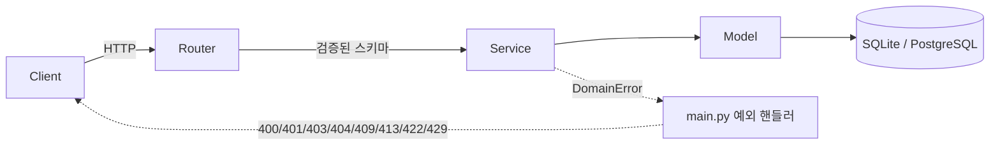
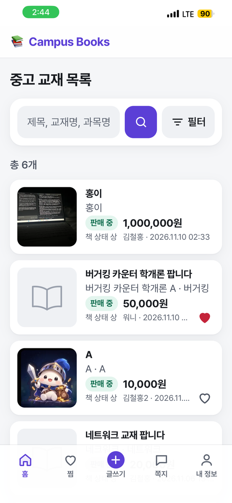
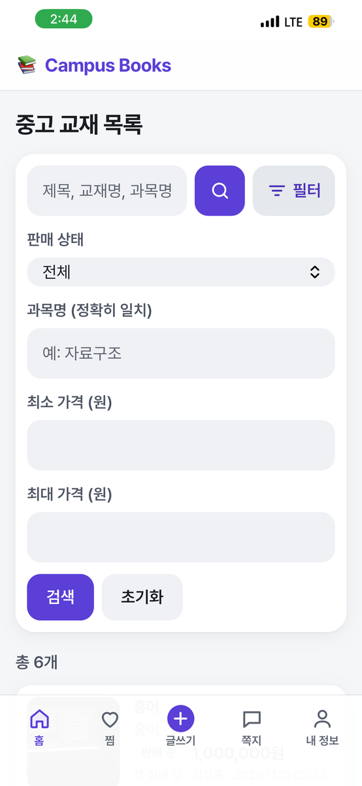
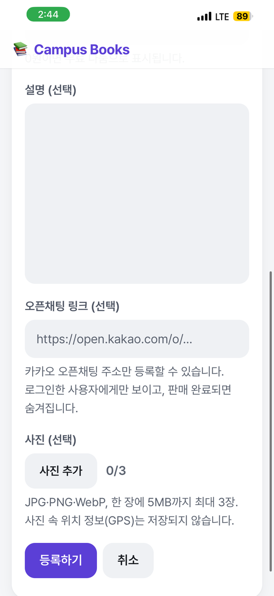
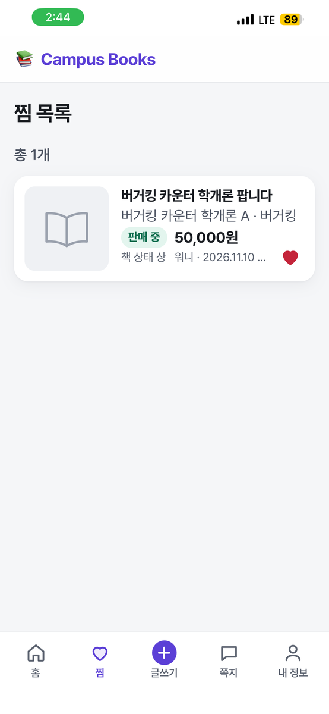
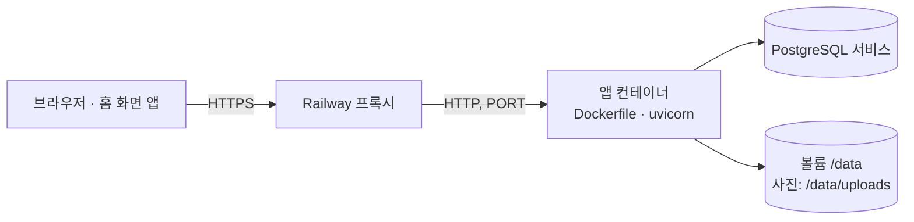
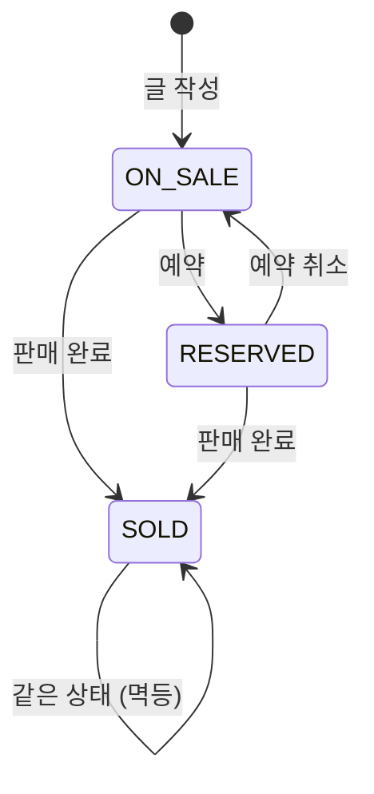

# Campus Books

같은 학교 학생끼리 전공 교재를 사고파는 **중고 교재 거래 게시판(API + 웹 화면)**입니다.

회원가입과 JWT 로그인, 비밀번호 변경·회원 탈퇴, 판매글 작성·조회·수정·삭제, 판매 상태 관리, 교재 검색·필터, 교재 사진, 찜하기, 찾는 교재 알림, 구매자와 판매자의 1:1 쪽지, 판매 완료 때 구매자 기록과 거래 후기·판매자 프로필, 신고·차단, 관리자 기능(신고 처리, 대시보드, 사용자·글·후기 관리, 정지·강제 탈퇴·재가입 차단, 관리 기록)을 제공합니다.
순수 HTML/CSS/JS로 만든 웹 화면 20개가 함께 들어 있어, 서버만 켜면 브라우저에서 바로 사용할 수 있습니다. 휴대폰 화면에 맞춘 모바일 레이아웃과, 홈 화면에 추가해 앱처럼 쓰는 PWA도 지원합니다.
포트폴리오 프로젝트로, 기능 수보다 **계층 분리, 입력 검증, 권한 처리, 테스트**를 꼼꼼하게 다루는 데 집중했습니다.

## 목차

1. [문제 정의](#문제-정의)
2. [주요 기능](#주요-기능)
3. [기술 스택](#기술-스택)
4. [프로젝트 구조](#프로젝트-구조)
5. [프론트엔드](#프론트엔드)
6. [데이터 모델](#데이터-모델)
7. [실행 방법](#실행-방법)
8. [배포 (Railway)](#배포-railway)
9. [API 목록](#api-목록)
10. [상태 전이 규칙](#상태-전이-규칙)
11. [설계 결정과 트레이드오프](#설계-결정과-트레이드오프)
12. [테스트](#테스트)
13. [향후 개선 계획](#향후-개선-계획)

---

## 문제 정의

### 제가 겪은 불편

수업을 듣다 보면 교재가 꼭 필요한 과목이 있습니다. 하지만 새 교재는 가격이 부담스러워 구매하기가 꺼려졌습니다.

그래서 중고 교재를 구해 보려고 했습니다.

- **선배에게 직접 문의**: 아는 선배가 많지 않아 구하기 어려웠습니다.
- **에브리타임 이용**: 중고 교재 거래가 중심인 서비스가 아니어서 원하는 교재를 찾기 어려웠습니다.

결국 비싼 새 교재를 샀고, 얼마 쓰지 못한 채 책장에 넣어 두게 되었습니다.
다시 팔고 싶어도 마땅한 거래 창구가 없어 판매 또한 쉽지 않았습니다.

즉 교재를 **구하는 입장과 파는 입장 모두**에서 불편을 겪었습니다.

### 기존 거래 방식의 문제

같은 수업을 다음 학기에 듣는 학생에게 넘기면 양쪽 모두 이득이지만, 이런 거래는 보통 단체 채팅방이나 커뮤니티 게시판에서 이루어집니다.
이런 곳에서는 다음과 같은 문제가 생기기 쉽습니다.

- **찾기 어렵다**: 글이 대화나 다른 게시글에 묻혀서 과목명이나 교재명으로 검색하기 어렵습니다.
- **상태를 알 수 없다**: 이미 팔렸거나 예약된 책인지 글만 보고는 알기 어렵습니다.
- **정보가 제각각이다**: 가격, 책 상태, 과목명 같은 정보가 글마다 다른 형식으로 적혀 있습니다.

### 목표

그래서 이 프로젝트는 다음을 목표로 합니다.

- 교재명, 과목명, 가격대, 판매 상태로 **검색과 필터**를 할 수 있게 한다.
- 판매 상태(판매 중 / 예약 중 / 판매 완료)를 **명확한 규칙**으로 관리한다.
- 판매글 정보를 **정해진 형식**(교재명, 과목명, 책 상태, 가격)으로 받는다.

## 주요 기능

| 기능 | 내용 |
|---|---|
| 회원 | 회원가입, 로그인(JWT 발급), 내 정보 조회, 닉네임 변경(30일에 1번, 변경 기록 테이블로 확인) |
| 비밀번호 변경 | 현재 비밀번호 확인(틀리면 400) 후 가입과 같은 규칙으로 변경. 변경 전에 발급된 토큰은 모든 기기에서 무효가 되고, 지금 기기에는 새 토큰을 바로 발급 |
| 본인 확인 질문·비밀번호 재설정 | 가입할 때 본인 확인 질문(준비된 9개 중 고르기 또는 직접 만들기)과 답을 정하고, 답은 정리한 뒤 bcrypt 해시만 저장. 비밀번호를 잊으면 이메일 → 질문 → 답 + 새 비밀번호로 재설정(이전 토큰은 모두 무효, 관리 기록과 다음 로그인 안내). 이메일당 24시간 5번 틀리면 잠금, IP당 1시간 30회. 관리자는 질문을 쓸 수 없고 서버 명령(`python -m app.cli reset-password`)으로 재설정 |
| 회원 탈퇴 | 비밀번호 재확인, 확인 창 두 번. 내 글·사진 파일·찜·차단은 삭제, 쪽지 대화방과 신고 기록은 남기고 상대 화면에는 "탈퇴한 사용자"로 표시. 관리자 계정은 탈퇴 불가(400) |
| 판매글 작성·조회 | 작성, 목록(최신순, 페이지네이션), 상세, 내 글 목록 |
| 판매글 관리 | 일부 필드 수정, 판매 상태 변경, 삭제 (모두 작성자만 가능) |
| 검색·필터 | 검색어(제목·교재명·과목명), 상태, 과목명, 가격대 |
| 교재 사진 | 글당 최대 3장(JPG·PNG·WebP·HEIC, 갤럭시 울트라 HDR·움직이는 사진(MPO) 포함, 장당 25MB). 화면이 휴대폰 원본을 먼저 절반씩 줄여 보내고 진행률을 보여줌. 서버가 WebP로 다시 인코딩해 위치 정보(GPS) 등 메타데이터를 지우고, 목록용 썸네일을 함께 만듭니다 |
| 연락 방법 | 판매글에 카카오 오픈채팅 링크(선택) 등록, 상세 화면에서 로그인한 사용자에게만 표시 |
| 찜하기 | 목록 카드·상세의 하트로 찜 추가·해제, 찜 목록(찜한 순서 최신순, 판매 완료 글은 배지와 함께 유지). 내 글은 찜 불가 |
| 찾는 교재 알림 | 키워드(교재명·과목명 부분 일치)와 최대 가격(선택)을 사용자당 10개까지 등록. 조건에 맞는 판매 중인 새 글(또는 수정으로 새로 맞게 된 글)이 올라오면 알림. 내 글·차단한 사용자의 글 제외, 같은 글은 한 번만. 헤더 종 아이콘의 안 읽은 수 배지와 알림 화면 |
| 1:1 쪽지 | 판매글 문의 시작, 쪽지함(최신 메시지순, 안 읽은 개수), 대화 화면(새 메시지 자동 확인, 이전 메시지 불러오기), 읽음 처리, 도배 방지. 사진 쪽지(메시지당 1장, 대화 참여자만 볼 수 있음, 10분 10장). 쪽지함 카드의 "⋯" 메뉴로 상대 신고·차단·대화방 나가기(내 목록에서만 숨김, 상대가 새 쪽지를 보내면 그 뒤 메시지만 다시 보임) |
| 거래 기록 | 판매 완료로 바꿀 때 이 글로 쪽지를 주고받은 사람 중 구매자를 고름(선택 안 함 가능). 후기가 달리기 전까지 구매자 변경·취소 가능. 글을 지워도 거래 기록은 남음 |
| 거래 후기 | 거래한 두 사람이 거래 후 14일 안에 서로 한 번씩 "좋아요/아쉬워요"와 짧은 글(선택, 200자). 쪽지 화면에서 작성. 쓴 뒤에는 수정·삭제 불가 |
| 판매자 프로필 | 로그인 없이 볼 수 있는 닉네임, 매너 점수(후기 3개 이상부터 좋아요 비율), 판매 중인 글, 받은 후기. 이메일 등 개인정보는 없음. 상세 화면의 판매자 이름에서 이동 |
| 차단 | 상세·대화 화면에서 사용자 차단. 서로 쪽지를 보낼 수 없고(양방향), 차단한 사용자의 글은 내 목록에서 숨김. 차단 목록 화면에서 해제. 상대에게는 알리지 않음 |
| 신고 | 글·사용자·거래 후기·쪽지 한 건 신고(사유 5가지, 기타는 설명 필수). 쪽지 신고는 신고 시점의 내용·사진을 사본으로 남기고 관리자는 그 메시지만 봄. 같은 대상 중복 신고 409, 1시간 5회 제한. 신고자는 상대에게 드러나지 않음 |
| 신고 처리 (관리자) | 관리자 전용 신고 관리 화면. 미처리 우선 목록, 기각·글 삭제·후기 숨김·기간 정지(1~365일) 처리와 처리 기록(누가·언제·어떤 조치·메모). 글 삭제·정지·후기 숨김은 사유 필수(기각만 선택). 같은 사용자의 미처리 신고 함께 처리. 관리자는 서버 CLI로만 지정 |
| 관리자 대시보드 | 가입자(정지 중·관리자·탈퇴 포함), 상태별 글 수, 오늘·최근 7일 가입자와 새 글(한국 시간 기준), 미처리 신고 수. 데이터 양과 상관없이 쿼리 3번 |
| 사용자 관리 (관리자) | 닉네임·이메일·`#번호` 검색, 정지 중·관리자·탈퇴 필터. 상세에서 이메일, 글·신고·후기 수, 정지 이력(최근 20건), 그 사용자의 글·신고·후기·기록으로 가는 링크. 이메일은 사용자 관리 화면에서만 보임 |
| 직접 정지·정지 해제 | 신고 없이 1~365일 정지(이미 더 길게 정지돼 있으면 줄이지 않음), 정지 바로 해제. 사유 필수, 관리자(자기 자신 포함)는 대상 불가 |
| 글 직접 삭제 | 관리자 글 목록(제목·교재명 검색, 상태·판매자 필터, 미처리 신고 수)에서 사유를 적고 삭제. 작성자 삭제와 같은 정리 규칙, 그 글의 미처리 신고는 같은 사유로 함께 처리 |
| 후기 숨김 해제 | 숨긴 후기 목록에서 사유를 적고 다시 보이게 함 (잘못 숨긴 경우) |
| 강제 탈퇴·재가입 차단 | 본인 탈퇴와 같은 규칙으로 계정 정리 + 같은 이메일 재가입 차단(선택, 기본 켬). 이메일 원문은 저장하지 않고 HMAC 해시만. 차단 목록(시각·사유만)과 이메일을 입력해 차단 풀기. 확인 창에 닉네임을 직접 입력해야 진행 |
| 관리 기록 | 관리자의 모든 쓰기 조치(신고 처리 포함)를 누가·언제·누구에게·무엇을·왜로 한 줄씩 기록. 조치와 같은 트랜잭션에 저장, 수정·삭제 API 없음. 조치·관리자·대상 사용자로 필터 |
| 이용 정지 | 정지된 사용자는 로그인 403("11월 16일 14:00까지 이용이 정지되었습니다."), 이미 받은 토큰으로도 쓰기 요청 403. 읽기·차단은 허용. 기간이 지나면 자동 해제 |
| 웹 화면 (20개) | 목록·검색, 상세(상태 변경·구매자 고르기·삭제·문의·찜·신고·차단), 작성·수정, 로그인, 회원가입(본인 확인 질문 고르기), 비밀번호 재설정(이메일 → 질문 → 답), 내 정보(내 글·찜 탭, 닉네임·비밀번호 변경, 본인 확인 질문 등록·변경, 회원 탈퇴), 찾는 교재 알림, 차단 목록, 쪽지함(신고·차단·나가기 메뉴), 대화(사진 쪽지, 메시지 신고, 거래 후기 작성), 프로필(매너 점수·후기 신고), 관리자 화면 8개(대시보드, 신고, 사용자 목록·상세, 글, 후기, 기록, 재가입 차단) |
| 모바일 화면 | 768px 미만에서 하단 탭 바(홈·글쓰기·쪽지·내 정보), 한 줄 검색 + 접는 필터, 가로형 카드, 상세 사진 좌우 넘기기와 하단 고정 연락 바, 대화 화면 키보드 대응. PC 화면은 그대로 |
| 홈 화면 앱 (PWA) | 홈 화면에 추가하면 주소창 없이 앱처럼 열림. 아이폰 Safari에는 "공유 → 홈 화면에 추가" 안내를 한 번 보여줌 |
| 빠른 화면 이동 | 서비스 워커가 화면 파일(HTML·CSS·JS·글꼴·아이콘·빈 화면 그림)을 미리 받아 두고 캐시에서 먼저 띄움. 버전은 서버가 파일 내용 해시로 자동으로 만듦. API·사진은 캐시하지 않음. 쪽지함·프로필은 필요한 API를 한꺼번에 요청. 로그인 상태에서 브라우저를 껐다 켠 재방문 기준 화면당 0.24~0.39초(전 0.77~1.42초, [설계 결정 22번](#22-화면-이동-속도-개선-측정으로-원인-찾기)) |
| 배포 | Railway에 배포됨. Dockerfile + Railway 설정 코드 `.railway/railway.ts`(헬스 체크·재시작·볼륨), PostgreSQL, 사진용 영구 볼륨. 운영 모드에서는 API 문서를 끄고 잘못된 설정이면 시작하지 않음 ([배포](#배포-railway)) |

## 기술 스택

| 분류 | 기술 | 선택 이유 |
|---|---|---|
| 언어 | Python 3.14.7 | 개발과 테스트에 사용한 버전 |
| 웹 프레임워크 | FastAPI | 타입 힌트 기반 입력 검증과 Swagger 문서 자동 생성 |
| ORM | SQLAlchemy 2.x | 타입이 지정된 `Mapped` 모델, SQLite와 PostgreSQL을 같은 코드로 지원 |
| 검증 | Pydantic v2 | 요청 형식 오류를 서비스 로직에 닿기 전에 422로 차단 |
| DB | SQLite (개발) / PostgreSQL (운영, Railway) | 개발 중에는 설치 없이 실행하고, 운영에서는 `DATABASE_URL`만 교체. 드라이버는 psycopg 3 |
| 이미지 | Pillow 12.3.0 | 실제 내용으로 형식 확인, 다시 인코딩(메타데이터 제거), 크기 조정 |
| 인증 | PyJWT, bcrypt | 서버에 세션을 저장하지 않는 토큰 인증, 솔트가 포함된 비밀번호 해시 |
| 프론트 | HTML/CSS/JS (ES 모듈, 빌드 도구 없음) | 별도 서버 없이 FastAPI가 정적 파일로 서빙하고, fetch로 API 호출 |
| 테스트 | pytest, httpx (TestClient), pytest-xdist | API를 실제 요청처럼 호출하는 통합 테스트, CPU 코어 수만큼 병렬 실행 |
| 배포 | Docker, Railway | 같은 이미지로 어디서나 실행, Git 연결만으로 빌드·배포와 관리형 PostgreSQL·볼륨 제공 |

글꼴: [Pretendard](https://github.com/orioncactus/pretendard) v1.3.9 (Regular·SemiBold·Bold), SIL Open Font License 1.1 ([`static/fonts/OFL-Pretendard.txt`](static/fonts/OFL-Pretendard.txt)). 공식 배포본의 서브셋 woff2를 수정 없이 `static/fonts/`에서 직접 제공합니다.

## 프로젝트 구조

```
campus-books/
├── app/
│   ├── main.py            # 앱 생성, 라우터 등록, 업무 예외 → HTTP 응답 변환
│   ├── cli.py             # 서버 관리 명령 (python -m app.cli make-admin 이메일)
│   ├── core/
│   │   ├── config.py      # .env 설정 (pydantic-settings)
│   │   ├── database.py    # 엔진, 세션, Base
│   │   ├── security.py    # 비밀번호 해시, JWT 발급·검증, 토큰의 비밀번호 지문
│   │   ├── deps.py        # 로그인 사용자 의존성 (CurrentUser, 정지 검사 ActiveUser, 관리자 AdminUser)
│   │   ├── exceptions.py  # 업무 예외 (DomainError 계층)
│   │   └── static_assets.py  # 정적 파일 제공: 내용 해시 버전과 미리 받을 목록을 sw.js에 넣기, Cache-Control
│   ├── models/            # SQLAlchemy 모델 (User, Post, PostImage, Wishlist, Conversation, Message, MessageImage, ConversationUserState, UserBlock, Report, MessageReportSnapshot,
│   │                      #   BookAlert, AlertNotification, Trade, Review, AdminAction, BannedEmail, NicknameChange, SecurityQuestion, PasswordResetNotice, PasswordResetAttempt)
│   ├── schemas/           # Pydantic 요청·응답 스키마
│   ├── routers/           # auth, users, posts, images, wishlist, conversations, blocks, reports, alerts, reviews, profiles,
│   │                      #   관리자: admin(대시보드·신고·기록), admin_users(사용자·정지·탈퇴·재가입 차단), admin_content(글·후기)
│   └── services/          # 업무 로직 (사진: image_service 검사·인코딩, image_storage 파일 쓰기·지우기,
│                          #   계정: account_service 닉네임·비밀번호 변경·탈퇴, security_question_service 본인 확인 질문,
│                          #   password_reset_service 비밀번호 재설정(질문·서버 명령),
│                          #   쪽지: conversation_service 대화방·메시지·나가기, message_image_service 사진 쪽지, 알림: alert_service 조건·매칭·알림,
│                          #   거래: trade_service 구매자 후보·기록, review_service 후기·매너 점수, profile_service 프로필,
│                          #   관리자: admin_service 신고 처리, admin_log_service 관리 기록, admin_dashboard_service 대시보드,
│                          #   admin_user_service 사용자·정지·강제 탈퇴, admin_content_service 글·후기, email_ban_service 재가입 차단)
├── static/                # 프론트엔드 (아래 "프론트엔드" 참고)
│   ├── index.html, post.html, post-form.html, login.html, signup.html, reset-password.html, me.html,
│   │   alerts.html, blocks.html, conversations.html, chat.html, user.html,
│   │   my-posts.html, wishlist.html (예전 주소: me.html의 탭으로 바로 이동),
│   │   admin-dashboard.html, admin.html, admin-users.html, admin-user.html, admin-posts.html,
│   │   admin-reviews.html, admin-log.html, admin-bans.html
│   ├── css/style.css
│   ├── img/               # book-placeholder.svg(사진 없는 글의 기본 그림), 앱 아이콘(icon-192·512, apple-touch-icon 180px),
│   │                      #   탭 아이콘 favicon.png(48px), 헤더 로고 logo.png(128px), 빈 화면 그림 empty-*.webp 5장(400×305),
│   │                      #   목록 배너 그림 hero.webp(480×360)
│   ├── manifest.json      # 홈 화면 앱 정보 (이름, standalone, 테마색, 아이콘 any·maskable)
│   ├── sw.js              # 서비스 워커 (화면 파일을 버전별로 미리 받고 캐시에서 먼저 제공. 버전·목록은 서버가 채움)
│   └── js/
│       ├── api.js         # fetch 래퍼, 에러를 {status, message, fieldErrors}로 통일
│       ├── token.js       # 토큰 보관(localStorage)만 담당
│       ├── auth.js        # 공통 헤더, 로그인 후 돌아갈 주소, 로그아웃
│       ├── ui.js          # 카드·페이지 버튼·날짜 형식·빈 화면(renderEmptyState) 등 공통 화면 부품
│       ├── wishlist-button.js  # 찜 하트 버튼 (목록·상세·찜 목록이 함께 씀)
│       ├── safety.js      # 신고 창·메뉴 창(<dialog>)과 차단·나가기 확인·안내 문구 (상세·쪽지함·대화·프로필이 함께 씀)
│       ├── photo-resize.js  # 올리기 전에 휴대폰 사진을 절반씩 줄이기 (글쓰기·대화가 함께 씀)
│       ├── security-question.js  # 본인 확인 질문 고르기(준비된 질문 목록·직접 만들기·답 안내) (회원가입·내 정보가 함께 씀)
│       ├── trade.js       # 구매자 고르기 창과 후기 작성 창(<dialog>), 평가 이름표 (상세·대화·프로필이 함께 씀)
│       ├── pwa.js         # 서비스 워커 등록, 아이폰 Safari 설치 안내 (모든 화면이 불러옴)
│       ├── signed-in.js   # 목록 화면 <head>에서 그리기 전에 실행: 토큰이 있으면 <html data-signed-in> (배너 모양 결정)
│       ├── admin-common.js  # 관리자 화면 공통: 권한 확인, 관리 메뉴, 사유 입력 폼·창(<dialog>), 사용자 링크
│       └── pages/         # 화면별 스크립트 (화면 1개 = 파일 1개)
├── tests/
├── tools/
│   ├── ui-check/          # 헤드리스 Chrome 화면 확인 스크립트 (run.sh, 화면별 *-check.mjs, 목록 화면 home-check.mjs, 서비스 워커 sw-check.mjs)
│   └── perf/              # 운영 사이트 화면 이동 속도 측정 (measure.mjs 측정, report.mjs 요청 목록, compare.mjs 전후 비교, README.md 결과)
├── uploads/               # 올린 사진 (서버가 만듦, .gitignore 대상, static/ 밖)
├── Dockerfile             # 배포 이미지 (python:3.14-slim, uvicorn)
├── .railway/railway.ts    # Railway 설정 코드 (빌드·헬스 체크·재시작·볼륨)
├── package.json           # railway.ts용 Railway SDK (개발 의존성만)
├── .dockerignore          # .env·DB·사진·테스트를 이미지에서 제외
├── .env.example
└── requirements.txt
```

### 계층 구조



- **Router**: 요청을 받아 서비스에 넘기고 응답 형식(`response_model`)만 정합니다.
- **Service**: 업무 규칙(권한, 상태 전이, 검색 조건)을 처리합니다. HTTP 상태 코드를 알지 못하고, 실패하면 `PostNotFoundError` 같은 업무 예외를 던집니다.
- **main.py**: 업무 예외를 HTTP 응답으로 바꾸는 일을 한 곳에서 맡습니다. 그래서 서비스 코드가 HTTP와 분리되고, 에러 응답 형식이 `{"detail": "..."}`로 통일됩니다.

| 예외 (기반 클래스) | HTTP 상태 |
|---|---|
| `BadRequestError` | 400 |
| `AuthenticationError` | 401 (`WWW-Authenticate: Bearer` 헤더 포함) |
| `ForbiddenError` | 403 |
| `NotFoundError` | 404 |
| `ConflictError` | 409 |
| `PayloadTooLargeError` | 413 (사진 25MB 초과) |
| `UnprocessableError` | 422 (지원하지 않는 사진 형식, 깨진 파일) |
| `TooManyRequestsError` | 429 (`Retry-After` 헤더 포함) |

## 프론트엔드

서버를 실행한 뒤 http://127.0.0.1:8000/ 에 접속하면 목록 화면(`/static/index.html`)으로 이동합니다. 별도 설치나 빌드는 필요 없습니다.

### 화면 구성

| 화면 | 주소 | 로그인 필요 | 주요 동작 |
|---|---|---|---|
| 목록 | `/static/index.html` | | 위쪽 배너(비로그인: 소개 문구·"교재 올리기"·그림, 로그인: 얇은 한 줄 띠), 한 줄 검색창 + "필터"를 누르면 상태·과목명·가격대 칸이 펼쳐짐(PC·모바일 같은 구조), 글이 없으면 "첫 교재 올리기", 페이지 이동, 카드마다 첫 사진 썸네일(없으면 기본 그림), 찜 하트(내 글 제외), 아이폰 Safari 설치 안내(처음 한 번) |
| 상세 | `/static/post.html?id={id}` | 연락·상태 변경·삭제·찜·신고·차단만 🔒 | 사진(작은 사진을 누르면 넘어감, 모바일은 손가락으로 넘기고 "2 / 3" 표시), 찜 하트(내 글 제외), 글 내용 확인, 판매자 닉네임을 누르면 프로필, 판매 완료로 바꿀 때 구매자 고르기 창(쪽지를 주고받은 사람 + "선택 안 함"), 판매 완료 글의 작성자에게 "구매자: ○○ · 변경"(후기가 있으면 변경 불가 안내), 쪽지 문의·오픈채팅 연락 버튼(로그인 시, 내 글·판매 완료 글 제외), 작성자에게만 상태 변경·수정·삭제 버튼 표시, 맨 아래 "이 글 신고"·"판매자 차단(해제)"(로그인 시, 내 글 제외) |
| 작성·수정 | `/static/post-form.html` | 🔒 | 판매글 작성, 기존 글 수정 (`?id=`가 있으면 수정), 사진 고르기·미리보기·빼기(최대 3장) |
| 로그인 | `/static/login.html` | | 로그인 후 원래 보던 화면으로 복귀, "비밀번호를 잊으셨나요?" 링크 |
| 회원가입 | `/static/signup.html` | | 필드별 오류 메시지 표시. "비밀번호를 잊었을 때" 칸에서 본인 확인 질문(준비된 9개 또는 직접 만들기)과 답을 정함. 답 칸에 "남이 쉽게 알 수 없는 답으로 정해 주세요" 안내, 직접 만든 질문에는 답이나 힌트를 넣지 말라는 안내. 가입하면 로그인 화면으로 |
| 비밀번호 재설정 | `/static/reset-password.html` | | 1단계 이메일 → 2단계 그 계정의 질문을 보여주고 답 + 새 비밀번호("이메일 바꾸기"로 1단계로). 가입하지 않은 이메일에도 질문이 나와 가입 여부를 알 수 없음. 성공하면 로그인 화면으로 |
| 내 정보 | `/static/me.html` | 🔒 | 프로필 카드(닉네임, 이메일, 가입일, 매너 점수, 공개 프로필 링크), "내 글"·"찜" 탭(`?tab=posts\|wishlist&page=`, 판매 완료 포함, 하트로 찜 해제), 찾는 교재 알림·차단 목록 링크, 계정 칸에서 펼쳐 쓰는 닉네임 변경(다음 변경 가능 날짜 안내)·비밀번호 변경·본인 확인 질문 등록·변경(비밀번호 확인, 질문이 없으면 등록 권유, 질문으로 재설정한 지 7일 안이면 바꿀 수 있는 날짜 안내, 관리자에게는 없음)·회원 탈퇴(관리자에게는 없음), 모바일은 관리 링크와 로그아웃 버튼. 예전 주소 `my-posts.html`·`wishlist.html`은 이 화면의 탭으로 바로 이동 |
| 찾는 교재 알림 | `/static/alerts.html` | 🔒 | 위: 찾는 교재 등록(키워드·최대 가격), 내 조건 목록("3/10"), 조건별 "지금 있는 글 검색"·삭제. 아래: 받은 알림 카드(키워드, 글 제목·교재명·현재 판매 상태·가격, 새 알림 강조), 페이지 이동. 목록을 그린 뒤 모두 읽음 처리 |
| 차단 목록 | `/static/blocks.html` | 🔒 | 내가 차단한 사용자(차단한 순서 최신순, 닉네임과 날짜만), 차단 해제, 페이지 이동 |
| 쪽지함 | `/static/conversations.html` | 🔒 | 내 대화방 목록(상대 닉네임, 글 제목 또는 "삭제된 글", 마지막 메시지(사진이면 "사진"), 안 읽은 개수), 카드 옆 "⋯" 메뉴(사용자 신고·차단·대화방 나가기, 탈퇴한 상대는 나가기만), 페이지 이동 |
| 대화 | `/static/chat.html?id={id}` | 🔒 | 메시지 보기·보내기, "사진" 버튼으로 사진 쪽지(브라우저에서 줄여 보내고 진행률 표시, 썸네일은 화면에 보일 때 받고 누르면 크게 보기), 상대 메시지마다 "⋯" → 이 메시지 신고, 5초마다 새 메시지 확인, 위로 스크롤하면 이전 메시지, 429 시 남은 시간 표시, 개인정보 주의 안내, 상대 신고·차단(해제), 차단 관계·이용 정지·상대 탈퇴면 입력창 잠금과 이유 안내(탈퇴한 상대는 "탈퇴한 사용자"로 표시하고 신고·차단 버튼 없음), 모바일은 키보드가 올라와도 입력창이 보이게 화면 높이를 맞춤, 거래가 기록된 대화면 위에 "후기 남기기"(마감 시각 표시)·작성 완료·기간 지남 안내와 상대 프로필 링크 |
| 프로필 | `/static/user.html?id={id}` | 후기 신고만 🔒 | 닉네임, 매너 점수(후기 3개 미만이면 개수만), 판매 중·예약 중인 글(목록과 같은 카드), 받은 후기(평가, 판매자/구매자로 받은 후기, 글, 작성자·교재명·날짜)와 "신고"(로그인 시, 내가 쓴 후기 제외), 글과 후기 각각 페이지 이동 |
| 관리: 대시보드 | `/static/admin-dashboard.html` | 🔒 관리자 | 헤더 "관리" 링크가 여는 첫 화면. 가입자·글·미처리 신고 숫자 카드, 숫자를 누르면 그 목록 화면으로 이동 |
| 관리: 신고 | `/static/admin.html` | 🔒 관리자 | 미처리·처리됨·전체 탭, 신고 카드(사유, 설명, 신고 시점 글 사본, 신고자 → 대상(사용자 상세 링크), 대상의 다른 미처리 신고 수), 후기 신고는 대상 후기(평가·글·교재명·받은 사람), 쪽지 신고는 신고 시점의 그 메시지(글·사진)만, 조치 선택(기각·글 삭제·후기 숨김·기간 정지 1/3/7/30일, 대상에 맞는 것만)과 사유(기각 외 필수), 확인 창 후 처리, 처리된 카드는 흐리게 + 처리 기록. 사용자 상세에서 오면 그 사용자가 신고당한 것만(`?reported_user_id=`) |
| 관리: 사용자 | `/static/admin-users.html` | 🔒 관리자 | 닉네임·이메일·번호 검색, 전체·정지 중·관리자·탈퇴 필터, 사용자 카드(이메일, 가입일, 정지 종료 시각, 글 수, 미처리 신고 수), 재가입 차단 화면 링크 |
| 관리: 사용자 상세 | `/static/admin-user.html?id={id}` | 🔒 관리자 | 계정 정보(이메일 포함, 탈퇴한 계정은 이메일 없음), 정지(일수 + 사유)·정지 해제·강제 탈퇴(닉네임 입력 + 재가입 차단 선택 + 확인 창), 글·신고·후기 수(누르면 해당 목록), 정지 이력과 이 사용자에 대한 기록 링크 |
| 관리: 글 | `/static/admin-posts.html` | 🔒 관리자 | 제목·교재명 검색, 상태 필터, 판매자 필터(사용자 상세에서 올 때), 미처리 신고 수 배지, 삭제(사유 창 → 확인 창) |
| 관리: 후기 | `/static/admin-reviews.html` | 🔒 관리자 | 숨긴 후기·전체 탭, 받은 사람·쓴 사람 필터, 숨김 해제(사유 입력) |
| 관리: 기록 | `/static/admin-log.html` | 🔒 관리자 | 관리 기록(조치, 관리자, 대상, 사유, 세부 내용) 최신순, 조치 종류·대상 사용자 필터 |
| 관리: 재가입 차단 | `/static/admin-bans.html` | 🔒 관리자 | 차단 목록(차단 번호·시각·사유만, 이메일은 해시라 보이지 않음), 이메일 + 사유를 입력해 차단 풀기. 관리 메뉴에는 없고 사용자 화면에서 이동 |

<!-- 스크린샷: 상세·내 글 화면은 docs/screenshots/ 에 이미지를 추가한 뒤 해당 줄의 주석을 푸세요 -->


<!--  -->


<!--  -->

### 목록 화면: 배너와 한 줄 검색

| 부분 | 비로그인 | 로그인 |
|---|---|---|
| 배너 | 소개 문구("같은 학교 학생끼리 전공 교재를 사고팔아요")·보조 문구·"교재 올리기" 버튼, 오른쪽에 그림 `hero.webp`(PC 240px, 모바일 104px) | 그림 없이 "안 쓰는 교재가 있나요?"와 "교재 올리기"만 있는 한 줄 띠(PC 64px, 모바일 52px) |
| 검색 | 검색창·검색 버튼·"필터" 버튼 한 줄. 판매 상태·과목명·가격은 필터를 눌렀을 때만 펼침 | 같음 |
| 글이 하나도 없을 때 | 그림·문구 아래 "첫 교재 올리기" (검색 결과가 없을 때는 버튼 없음) | 같음 |

- **배너 모양은 처음부터 정해집니다.** 목록 화면 `<head>`의 작은 일반 스크립트 `signed-in.js`가 화면을 그리기 전에 저장된 토큰이 있는지만 보고 `<html data-signed-in>`을 붙이고, CSS가 그에 맞는 모양(큰 배너/얇은 띠)을 그립니다. 로그인 확인 API를 기다리지 않으므로 그 사이에 목록이 밀리지 않습니다([설계 결정 27번](#27-로그인-여부에-따라-배너를-처음부터-다르게-그리기)).
- "교재 올리기"·"첫 교재 올리기"는 헤더의 "글쓰기"와 같은 글쓰기 화면으로 갑니다. 로그인하지 않았으면 글쓰기 화면이 로그인 화면으로 보내고, 로그인한 뒤 글쓰기로 돌아옵니다.
- 배너 그림은 실제 크기(`width`·`height`)를 넣어 자리를 먼저 잡고, 첫 화면에 보이므로 늦게 받지(`loading="lazy"`) 않습니다. WebP라 서비스 워커가 미리 받습니다.
- 한 줄 검색은 원래 모바일에만 있던 규칙을 공통 CSS로 옮겨 PC에도 씁니다. 접기·펼치기, 조건 수 표시, 오류가 나면 펼치기는 JS가 이미 폭과 상관없이 처리하고 있어 바꾸지 않았습니다. PC에서 펼친 칸은 4칸 한 줄입니다.
- 헤더 안은 JS가 그리므로, CSS가 헤더 줄의 최종 높이(PC 60px, 모바일 52px)를 미리 잡아 둡니다. 전에는 PC에서 높이 0으로 먼저 그려졌다가 헤더가 채워지며 아래 내용 전체가 60px 밀려 내려갔습니다(로그인 목록 CLS 0.023~0.047 → 0.001).

### 빈 화면 그림

목록이 비었을 때 안내 문구 위에 그림을 하나 둡니다. 화면마다 따로 그리지 않고 `ui.js`의 공통 함수 `renderEmptyState(요소, 문구, { image })`를 씁니다.

| 상황 | 화면 | 그림 |
|---|---|---|
| 등록된 글이 하나도 없음 | 목록, 내 글 | `empty-posts.webp` |
| 검색·필터 결과 없음 | 목록 | `empty-search.webp` |
| 찜한 글 없음 | 찜 목록 | `empty-wishlist.webp` |
| 주고받은 쪽지 없음 | 쪽지함 | `empty-messages.webp` |
| 받은 알림 없음 | 찾는 교재 알림 | `empty-alerts.webp` |

- 그림은 AI 이미지 생성 도구로 만든 뒤 배경을 지우고, 400×305 WebP(투명 배경, 장당 약 18~28KB)로 줄여 넣었습니다.
- 화면에서는 가로 200px로 가운데에 보여줍니다. ``에 실제 크기(`width`·`height`)를 넣어 그림을 받기 전에도 자리를 잡으므로, 그림이 뜰 때 아래 내용이 밀리지 않습니다.
- 그림은 꾸밈이라 `alt=""`와 `aria-hidden="true"`로 화면 낭독기에서 숨기고, 뜻은 문구로 전합니다. 문구 아래 버튼(교재 둘러보기, 첫 글 쓰기)도 가운데에 두고, 버튼이 여럿이면 나란히 놓되 좁은 화면에서는 줄바꿈합니다.
- 다른 공통 부품처럼 HTML 문자열(`innerHTML`)을 쓰지 않고 요소를 직접 만듭니다.

### 모바일 화면 (768px 미만)

휴대폰에서 쓰기 편하도록 768px 미만에서만 바뀌는 규칙을 `style.css`의 한 구역(`@media (max-width: 767.98px)`)에 모았습니다. 768px 이상(PC)은 그대로입니다.

| 항목 | 내용 |
|---|---|
| 하단 탭 바 | 로그인 메뉴 대신 화면 아래 고정 탭 바(홈·글쓰기·쪽지·내 정보 4칸). 찜은 내 정보의 탭으로 옮김. 쪽지 탭에 안 읽은 수 배지. "관리"·"로그아웃"은 내 정보 화면 안으로. 로그인·회원가입 링크는 헤더에 남김. 찾는 교재 알림 종은 탭을 늘리지 않고 헤더 오른쪽에 둠 |
| 탭 바가 없는 화면 | 상세·대화·글쓰기·로그인·회원가입 (`<body data-tab-bar="off">`). 화면 아래를 연락 바·입력창·긴 폼이 쓰기 때문 |
| 목록 검색 | 한 줄 검색창 + 검색·"필터" 버튼. 필터를 누르면 상태·과목명·가격 칸이 펼쳐짐. 걸려 있는 조건 수를 버튼에 표시("필터 2"), 접힌 칸에 오류가 나면 자동으로 펼침. 지금은 PC도 같은 구조([목록 화면](#목록-화면-배너와-한-줄-검색)) |
| 카드 | 사진(96px)을 왼쪽에 둔 가로형. 카드 높이 약 330px → 120~140px로 줄어 한 화면에 3~4장. 목록·찜 목록·내 글이 같은 카드 |
| 누르는 곳 | 버튼·링크·탭은 44px 이상 (문장 안의 링크는 예외) |
| 글자 | 본문 16px 이상. 상태 배지·날짜·글자 수·탭 이름만 12~14px |
| 입력칸 | 16px 이상. iOS Safari는 16px보다 작은 입력칸에 포커스하면 화면을 확대하기 때문 |
| iPhone 아래 막대 | `viewport-fit=cover` + `env(safe-area-inset-bottom)`만큼 탭 바·연락 바 아래를 띄움 |
| 상세: 사진 | 손가락으로 좌우로 넘기고(CSS `scroll-snap`), 사진 오른쪽 아래에 "2 / 3" 표시. 작은 사진 버튼도 남아 있어 누르면 그 사진으로 넘어가고, 넘긴 사진과 눌린 버튼(`aria-pressed`)이 항상 같음 |
| 상세: 하단 연락 바 | 찜 하트 · 가격 · "쪽지로 문의하기"를 화면 아래에 고정해, 긴 설명을 읽다가도 바로 문의. 비로그인은 "로그인하고 문의하기". 내 글·판매 완료 글·차단한 판매자의 글에는 없음. 오픈채팅 버튼은 375px 한 줄에 들어가지 않아 글 영역에 남김 |
| 대화: 키보드 | 키보드가 올라와도 입력창과 마지막 메시지가 보이게, 대화 화면 높이를 실제로 보이는 높이(`visualViewport.height`)에 맞춤. 안드로이드 Chrome용으로 `interactive-widget=resizes-content`도 둠. 입력 중에는 헤더·"← 쪽지함"·신고/차단 줄을 접고 개인정보 안내를 한 줄로 줄임. 보내기 버튼은 입력창 오른쪽 |
| 대화: 사진 | 입력줄이 "사진 · 입력칸 · 보내기" 한 줄. 썸네일은 받기 전에 200px 자리를 잡아 두어 스크롤이 크게 튀지 않음. 크게 보기 창의 닫기 버튼 44px |
| 대화: 보내기 | 보내기 버튼이 `pointerdown`·`mousedown` 기본 동작을 막아 포커스를 가져가지 않음. 눌러도 키보드가 내려갔다 올라오지 않음 |

아이폰 Safari에서 찍은 화면 (긴 변 1200px로 줄임):

| 목록 | 필터 펼침 | 글쓰기 | 찜 목록 |
|---|---|---|---|
|  |  |  |  |

- 모바일 기준 폭은 CSS와 JS(`ui.js`의 `MOBILE_QUERY`)에 같은 값으로 두고, 테스트로 같은지 확인합니다. 화면별 스크립트는 폭을 직접 적지 않고 `MOBILE_QUERY`만 씁니다.
- 연락 바의 하트와 문의 버튼은 새로 만들지 않고 글 영역에서 **옮겨 옵니다.** 같은 버튼이 두 벌이면 찜 상태·에러 문구를 두 곳에서 맞춰야 하기 때문입니다. 폭이 768px을 넘나들면(`matchMedia`) 원래 자리로 되돌립니다. 그래서 이 버튼을 찾는 코드는 위치 대신 id(`#inquiry-button`)로 찾습니다.
- 사진은 PC와 모바일이 같은 구조(사진을 가로로 이어 붙인 줄)이고, PC만 그 줄의 스크롤을 막아 작은 사진 버튼으로 넘깁니다. 대신 PC도 사진을 처음에 모두 받습니다.
- 헤드리스 Chrome으로 375·390·430px(아이폰 폭)에서 화면마다 가로 스크롤, 누르는 곳 크기, 글자·입력칸 크기를 검사하고, PC(1280px) 화면의 모든 요소 위치·크기가 바뀌지 않았는지 변경 전후를 비교했습니다.
- 상세·대화는 375px에서 터치 이벤트로 사진 넘기기·하트·문의·보내기를 확인했고, 키보드는 보이는 높이를 400px로 줄여 흉내 냈습니다. 실제 iOS·안드로이드 키보드 동작은 기기마다 다를 수 있습니다.

### 홈 화면 앱 (PWA)

홈 화면에 추가하면 주소창 없이 앱처럼 열립니다(`display: standalone`). 서비스 워커는 **https 주소나 `localhost`에서만** 동작하므로, 휴대폰으로 확인할 때는 https 주소로 접속해야 합니다.

| 기기 | 설치 방법 |
|---|---|
| 아이폰·아이패드 (Safari) | 아래쪽 공유 버튼 → "홈 화면에 추가". 목록 화면에 처음 한 번 이 안내가 뜨고, 닫으면 다시 뜨지 않음(localStorage에 기록). 이미 홈 화면 앱으로 열었으면 표시하지 않음 |
| 안드로이드 (Chrome) | 주소창 메뉴(⋮) → "앱 설치" 또는 "홈 화면에 추가" |
| PC (Chrome·Edge) | 주소창 오른쪽의 설치 아이콘 |

- **앱 정보**: `static/manifest.json` (이름 "Campus Books", 시작 주소 `/static/index.html`, 테마색은 포인트 보라 `#5b3fd6`).
- **앱 아이콘**: `icon-192.png`·`icon-512.png`는 보라 바탕이 정사각형을 꽉 채우고(투명 부분 없음), 책은 가운데 안전 영역(지름 80%의 원) 안에 있습니다. 그래서 안드로이드가 원·둥근 사각형으로 잘라도 책이 잘리지 않아 `maskable`로 쓸 수 있습니다. manifest에는 192·512 각각을 `"purpose": "any"`와 `"maskable"`로 **따로** 적었습니다. 한 항목에 `"any maskable"`을 함께 쓰면 자르지 않는 곳에서도 maskable용 여백이 그대로 보여 크롬이 권하지 않기 때문입니다.
- **탭 아이콘과 로고**: 브라우저 탭 아이콘은 `favicon.png`(48px, 둥근 네모), 헤더의 "Campus Books" 왼쪽 그림은 `logo.png`(128px 파일을 20px로 표시, 고해상도 화면에서도 선명). 로고는 링크 이름이 옆 글자라 `alt=""`로 둡니다. 아이콘의 보라는 포인트 색보다 조금 밝지만, 테마색(`theme_color`, `theme-color`)은 화면의 포인트 색과 맞추는 규칙이라 `#5b3fd6` 그대로입니다.
- **아이폰**: iOS는 manifest 아이콘 대신 `apple-touch-icon`(180px)과 `apple-mobile-web-app-*` meta 태그를 씁니다. 모든 HTML에 manifest와 함께 넣었습니다.
- 아이폰 설치 안내는 iOS Safari에서만 보여줍니다. 아이폰의 Chrome·Firefox 등은 메뉴가 달라 문구가 맞지 않기 때문입니다.

**서비스 워커** (`static/sw.js`, `app/core/static_assets.py`, 이유는 [설계 결정 17번](#17-pwa-캐시는-정적-파일만)·[22번](#22-화면-이동-속도-개선-측정으로-원인-찾기))

| 요청 | 처리 |
|---|---|
| `/static/`의 HTML·CSS·JS·`manifest.json`·글꼴·그림 | **캐시 먼저.** 캐시에 있으면 네트워크에 묻지 않고 바로 씀. 화면 주소의 `?id=` 같은 값은 빼고 경로로 저장 |
| API(`/posts`, `/conversations`, `/users`, `/admin` 등), 사진(`/images`) | **캐시하지 않음.** 서비스 워커가 건드리지 않고 브라우저가 그대로 요청 |
| GET이 아닌 요청, 다른 사이트, `sw.js` 자신 | 건드리지 않음 |

- **버전은 서버가 자동으로 만듭니다.** 서버가 시작할 때 `static/` 아래 모든 파일의 경로와 내용으로 SHA-256 해시(앞 16자리)를 만들어 `sw.js`의 `VERSION` 자리에 넣고, 미리 받을 파일 목록(화면이 쓰는 정적 파일 전체, 지금 67개)도 함께 채워 보냅니다. 목록에 넣는 확장자는 `.html`·`.css`·`.js`·`.json`·`.svg`·`.png`·`.webp`·`.woff2`이고, 빈 화면 그림을 넣으면서 `.webp`를 추가했습니다(그 전에는 빠져 있어 그림이 미리 받아지지 않았습니다). 파일이 하나라도 바뀌면 버전이 바뀌고, 바뀌지 않으면 다시 배포해도 같은 버전입니다(수정 시각은 쓰지 않음). 버전을 손으로 올릴 일이 없습니다.
- **버전 단위로 한꺼번에 갱신합니다.** 브라우저는 화면을 열 때마다 `sw.js`가 바뀌었는지 확인합니다. 버전이 바뀌었으면 새 서비스 워커가 뒤에서 목록의 파일을 모두 새 캐시(`campus-books-static-새버전`)에 받고, 다 받은 뒤에야 켜져 옛 캐시를 지웁니다. 하나라도 받지 못하면 설치를 취소하고 옛 버전을 그대로 쓰다가 다음 화면에서 다시 시도합니다. 파일마다 따로 갱신하지 않으므로 **새 HTML과 옛 JS가 섞이지 않습니다.** 설치할 때는 `cache: "no-cache"`로 서버에 확인하고 받아, 브라우저 HTTP 캐시의 옛 파일이 새 캐시에 들어가지 않게 합니다.
- **한계: 배포 직후 첫 화면은 옛 버전일 수 있습니다.** 새 버전을 알아챈 그 화면은 이미 옛 캐시로 떴고, 새 버전은 설치가 끝난 뒤 다음 화면부터 나옵니다. 그래서 배포 직후 잠깐은 옛 화면 코드가 새 API를 부르므로, API는 바로 앞 버전 화면과 호환되게 바꿔야 합니다(필드 삭제·이름 변경은 두 번에 나눠 배포).
- 헤드리스 확인(`tools/ui-check/sw-check.mjs`)으로 새 배포 뒤 재방문 두 번 안에 새 화면으로 바뀌는 것과, 로그아웃·계정 전환 뒤 이전 사용자의 화면 조각이 캐시에서 나오지 않는 것을 확인합니다.

**Cache-Control** (`/static/` 아래만, 서버가 붙임)

| 대상 | 값 | 이유 |
|---|---|---|
| HTML·CSS·JS·`manifest.json`·`sw.js` | `no-cache` | 파일 이름에 해시가 없어 내용이 바뀌어도 주소가 같습니다. 브라우저가 매번 서버에 바뀌었는지 묻게 하고(안 바뀌었으면 304라 가벼움), 속도는 서비스 워커 캐시가 맡습니다. 오래 캐시하면 새 HTML과 옛 JS가 섞일 수 있고, `sw.js`가 캐시되면 새 버전을 늦게 알아챕니다 |
| `/static/fonts/`, `/static/img/` | `public, max-age=604800` (1주일) | 거의 바뀌지 않고 크며(글꼴 3개 약 800KB), 옛 파일이 섞여도 화면이 깨지지 않습니다 |
| API, `/images` | 정적 파일 규칙을 붙이지 않음 | 바꾸지 않았습니다 |

전에는 정적 파일에 Cache-Control이 없어 브라우저가 "마지막 수정 후 경과 시간의 10%"만큼 임의로 캐시했습니다. 배포 직후에는 거의 캐시되지 않아, 화면을 옮길 때마다 HTML·JS를 서버에 다시 확인했습니다.

### 구조

- **화면마다 HTML 1개와 스크립트 1개**(`js/pages/*.js`)를 둡니다. 공통 부품은 `ui.js`, 공통 헤더와 로그인 처리는 `auth.js`에 모았습니다.
- **API 호출은 `api.js`로만** 합니다. 토큰을 헤더에 넣고, 서버 에러를 `ApiError`(`status`, `message`, `fieldErrors`)로 바꿔 화면마다 같은 방식으로 처리합니다. 401을 받으면 토큰을 지웁니다.
- **토큰 접근은 `token.js`로만** 합니다. 저장 위치를 바꿀 때 이 파일 하나만 고치면 됩니다.
- **검색 조건과 페이지 번호는 주소창에 저장**합니다(`?q=...&page=2`). 새로고침, 뒤로 가기, 링크 공유에도 같은 결과가 나옵니다.
- 로그인이 필요한 화면에 로그아웃 상태로 들어오면 로그인 화면으로 보내고, 로그인 후 원래 주소로 돌려보냅니다.
- **사진은 글을 저장한 뒤 한 장씩 따로 올립니다.** 글(JSON) 저장 → 뺀 사진 삭제 → 새 사진 업로드 순서입니다. 지우기를 먼저 해야 "3장 중 1장 바꾸기"가 3장 제한에 걸리지 않습니다. 사진 일부가 실패하면 글은 이미 저장된 상태이므로 화면을 수정 모드(`?id=`)로 바꾸고 "글은 저장됐지만 사진 1장을 처리하지 못했습니다: (서버 메시지)"를 보여줍니다. 다시 저장해도 글이 두 번 생기지 않습니다.
- 사진을 고르면 형식·크기·장수를 먼저 확인해 걸린 파일만 빼고 이유를 보여줍니다. 최종 검사는 서버가 합니다. 이 기준값이 서버와 같은지 테스트로 확인합니다.
- **찜 하트**는 로그인하지 않아도 보이고, 누르면 로그인 화면으로 갔다가 돌아옵니다. 내 글에는 없고, 판매 완료된 글에는 찜해 둔 경우에만(해제할 수 있게) 보입니다. 누르면 응답이 올 때까지 잠그고 성공한 뒤에 하트를 바꿉니다. 실패하면 화면 아래에 서버 메시지를 잠깐 띄웁니다.
- 찜 목록에서 하트를 눌러 해제해도 카드는 새로고침 전까지 그 자리에 남습니다. 실수로 눌렀을 때 다시 찜할 수 있고, 목록이 갑자기 밀리지 않습니다.
- **신고 창**은 브라우저 기본 `<dialog>`(`showModal`)로 띄웁니다. Esc로 닫히고 열린 동안 뒤 화면은 누를 수 없습니다. 사유를 고르지 않았거나 "기타"인데 설명이 없으면 보내기 전에 알려주고, 409(이미 신고)·429(횟수 제한)는 창을 닫지 않고 서버 메시지를 보여줍니다. 사유 목록과 설명 글자 수가 서버와 같은지 테스트로 확인합니다.
- **차단**은 브라우저 확인 창으로 무엇이 달라지는지(서로 쪽지 불가, 글 숨김, 차단 목록 위치)를 알려준 뒤 진행합니다. 완료 안내에는 "차단 목록은 내 글 화면에서 확인·해제할 수 있어요."와 내 글 화면 링크를 붙입니다. 차단 후에는 서버에서 글·대화방 정보를 다시 받아 문의 버튼·하트·입력창을 서버 상태에 맞춥니다.
- 대화 중에 상대가 나를 차단하면 다음 전송이 400으로 막히고, 화면은 대화방 정보를 다시 받아 입력창을 잠급니다. 이때 안내는 "이 사용자에게는 쪽지를 보낼 수 없습니다."로, 누가 차단했는지 말하지 않습니다.
- 로그인하면 헤더의 "쪽지" 옆에 안 읽은 쪽지 수가 보입니다. 헤더를 먼저 그리고 숫자는 따로 불러와, 숫자 요청이 늦어도 화면이 늦게 뜨지 않습니다.
- **본문에 필요한 API는 서로 기다리지 않고 한꺼번에 요청합니다.** 목록·상세는 원래 헤더(`/users/me`)와 본문을 함께 요청했고, 쪽지함과 프로필도 같게 맞췄습니다. 각각 왕복 한 번(약 0.2초)이 줄었습니다.
  - **쪽지함**: 헤더의 `/users/me`를 기다린 뒤 목록을 요청하던 것을 함께 요청합니다. 토큰이 만료됐으면 목록이 401을 받아 로그인 화면으로 보내고, 헤더 쪽에서 401을 먼저 알게 되어 토큰이 지워졌어도 로그인 화면으로 보냅니다.
  - **프로필**: `/users/{id}/profile`을 기다린 뒤 글·후기를 요청하던 것을 세 요청을 한꺼번에 보냅니다. 글·후기는 숨겨 둔 칸에 먼저 그려지고 프로필이 오면 함께 보입니다. 없거나 탈퇴한 사용자면 세 요청 모두 404이고 화면은 프로필의 오류만 보여줍니다.
- **찾는 교재 알림 종**은 헤더 메뉴(`nav`) 밖, 헤더 오른쪽에 둡니다. 모바일에서는 로그인 메뉴가 숨겨지고(하단 탭 바가 대신) 탭 바는 이미 5칸이라, PC와 모바일 모두에서 보이는 자리를 골랐습니다. 안 읽은 알림 수는 쪽지 배지와 같은 방식(99+, 화면 낭독기용 링크 이름)으로 따로 불러옵니다. 알림 화면은 목록을 그린 **뒤에** 모두 읽음 처리하므로, 이번에 처음 보는 알림은 강조된 채 남고 배지만 사라집니다.
- **비밀번호 변경**에 성공하면 응답으로 받은 새 토큰을 바로 저장합니다. 서버가 변경 전 토큰을 모두 무효로 만들기 때문에, 바꾸지 않으면 다음 요청에서 로그아웃됩니다. 현재 비밀번호가 틀리면(400) 공통 영역이 아니라 그 칸 아래에 메시지를 보여줍니다.
- **회원 탈퇴**는 되돌릴 수 없어 비밀번호를 받은 뒤 확인 창을 두 번 띄웁니다. 성공하면 토큰을 지우고 완료 안내 후 목록 화면으로 이동합니다(`location.replace`).
- **판매 완료**를 누르면 구매자 고르기 창이 먼저 뜹니다. 후보(이 글로 쪽지를 보낸 사람) 아래에 "선택 안 함"이 있고, 미리 골라 두지 않아 하나를 직접 골라야 상태가 바뀝니다. 창을 닫으면 아무것도 바뀌지 않습니다.
- **후기 작성 창**은 신고 창과 같은 `<dialog>`이고, 평가를 고르지 않으면 보내기 전에 알려주고 글자 수(200자)를 세어 보여줍니다. 후기는 고칠 수 없으므로 창에 "후기는 상대 프로필에 공개되고, 남긴 뒤에는 고치거나 지울 수 없어요."를 적어 둡니다.
- **관리자**에게만 헤더에 "관리" 링크가 보입니다. 헤더가 원래 부르는 `/users/me`의 `role`로 판단하므로 요청이 늘지 않습니다. 링크는 관리자 대시보드(`admin-dashboard.html`)로 가고, 관리자 화면 위의 관리 메뉴(대시보드·신고·사용자·글·후기·기록, 좁은 화면에서는 줄바꿈)로 옮겨 다닙니다. 관리자가 아닌 사람이 관리자 화면 주소로 들어오면 목록 화면으로 보냅니다(`location.replace`라 뒤로 가기로 돌아오지 않음). 이 확인과 메뉴는 `admin-common.js` 한 곳에 있습니다. 링크·화면을 숨기는 것은 편의일 뿐이고, 실제 권한 검사는 서버가 `/admin` API마다 합니다.
- **관리자 강제 조치**(정지·정지 해제·글 삭제·숨김 해제·강제 탈퇴·차단 해제)는 모두 사유를 입력해야 버튼이 동작하고, 보내기 전에 무엇이 바뀌는지 확인 창을 띄웁니다. 강제 탈퇴는 되돌릴 수 없어 대상 닉네임을 직접 입력해야 진행됩니다. 차단을 푼 뒤에는 입력한 이메일을 화면에서 지웁니다.
- **이용 정지 중**이면 모든 화면의 헤더 아래에 "○월 ○일 ○○:○○까지 이용이 정지된 상태입니다" 안내가 뜹니다. 쓰기 버튼을 눌러 403을 받고 나서야 알게 되지 않도록 하기 위해서입니다. 대화 화면은 입력창을 잠그고 같은 안내를 보여줍니다.

## 데이터 모델

```mermaid
erDiagram
    users ||--o{ posts : "판매"
    posts ||--o{ post_images : "사진 (최대 3장)"
    posts |o--o{ conversations : "문의 (글 삭제 시 NULL)"
    users ||--o{ conversations : "구매자 / 판매자"
    conversations ||--o{ messages : "포함"
    users ||--o{ messages : "보냄"
    users ||--o{ wishlists : "찜"
    posts ||--o{ wishlists : "찜됨 (글 삭제 시 함께 삭제)"
    users ||--o{ user_blocks : "차단함 (blocker)"
    users ||--o{ user_blocks : "차단당함 (blocked)"
    users |o--o{ reports : "신고함 (탈퇴 시 NULL)"
    users |o--o{ reports : "신고당함 (탈퇴 시 NULL)"
    users |o--o{ reports : "처리함 (관리자, 삭제 시 NULL)"
    users ||--o{ book_alerts : "찾는 교재 (최대 10개)"
    users ||--o{ alert_notifications : "받은 알림"
    posts ||--o{ alert_notifications : "알림 대상 (글 삭제 시 함께 삭제)"
    posts |o--o| trades : "거래 (글 삭제 시 NULL)"
    conversations ||--o| trades : "구매자와의 대화방"
    users ||--o{ trades : "판매자 / 구매자"
    trades ||--o{ reviews : "후기 (두 사람이 한 번씩)"
    users ||--o{ reviews : "씀 / 받음"
    users |o--o{ admin_actions : "조치함 (관리자, 삭제 시 NULL)"
    users |o--o{ admin_actions : "조치 대상"
    users |o--o{ banned_emails : "차단함 (관리자, 삭제 시 NULL)"
    users ||--o{ nickname_changes : "닉네임 변경 기록"
    users ||--o| security_questions : "본인 확인 질문 (답은 해시)"
    users ||--o{ password_reset_notices : "재설정 안내"
    conversations ||--o{ conversation_user_states : "사람별 나가기 상태"
    users ||--o{ conversation_user_states : "나간 사람"
    messages ||--o| message_images : "사진 (1장)"
    reports ||--o| message_report_snapshots : "쪽지 신고 사본"

    users {
        int id PK
        string email UK "최대 255자, 소문자로 저장"
        string password_hash "bcrypt"
        string nickname UK "2~30자"
        datetime created_at "DB 시간"
        string role "USER / ADMIN, 기본 USER, CLI로만 변경"
        datetime suspended_until "NULL 가능, 정지 종료 시각(UTC)"
    }

    book_alerts {
        int id PK
        int user_id FK "index"
        string keyword "2~100자, 교재명·과목명 부분 일치"
        int max_price "NULL이면 가격 무관, 이하(포함)"
        datetime created_at "DB 시간"
    }

    alert_notifications {
        int id PK
        int user_id FK "(user_id, post_id) unique, (user_id, created_at) index"
        int post_id FK "index"
        string keyword "알림을 만든 키워드 사본"
        datetime created_at "DB 시간"
        datetime read_at "NULL이면 안 읽음"
    }

    posts {
        int id PK
        int seller_id FK "index"
        string title "1~100자"
        string book_title "교재명, 1~200자"
        string course_name "과목명, 선택, 최대 100자"
        string condition "GOOD / FAIR / POOR"
        int price "0 ~ 10,000,000"
        text description "선택, 최대 2000자"
        string open_chat_url "선택, 최대 200자, https://open.kakao.com/ 로 시작"
        string status "ON_SALE / RESERVED / SOLD"
        datetime created_at "index, 최신순 정렬용"
        datetime updated_at "수정 시 자동 갱신"
    }

    post_images {
        int id PK
        int post_id FK "index, 글 삭제 시 함께 삭제"
        int slot "0~2, (post_id, slot) unique, 보여주는 순서"
        string filename "서버가 만든 이름 (32자리 16진수).webp"
        string thumb_filename "같은 이름_thumb.webp"
        datetime created_at "DB 시간, 업로드 횟수 제한에 사용"
    }

    conversations {
        int id PK
        int post_id FK "NULL 가능, (post_id, buyer_id) unique"
        int buyer_id FK "index"
        int seller_id FK "index, 글이 지워져도 권한 검사용"
        datetime created_at "DB 시간"
        datetime last_message_at "index, 최신 메시지순 정렬"
        int last_message_id "같은 초 정렬 보조, 마지막 메시지 조회"
    }

    wishlists {
        int user_id PK "FK, (user_id, post_id) 기본 키 = 같은 글은 한 번만"
        int post_id PK "FK, index (글 삭제 때 찾기)"
        datetime created_at "DB 시간, (user_id, created_at) index"
    }

    user_blocks {
        int blocker_id PK "FK, (blocker_id, blocked_id) 기본 키 = 한 번만"
        int blocked_id PK "FK, index (나를 차단했는지 찾기)"
        datetime created_at "DB 시간, CHECK blocker_id <> blocked_id"
    }

    reports {
        int id PK
        int reporter_id FK "NULL 가능, (reporter_id, created_at) index"
        string target_type "POST / USER / REVIEW"
        int target_id "글·사용자·후기 id, FK 없음, (reporter_id, target_type, target_id) unique"
        int reported_user_id FK "NULL 가능, index, 글 신고면 작성자, 후기 신고면 후기 작성자"
        string reason "SPAM / FRAUD / ABUSE / INAPPROPRIATE / OTHER"
        text description "선택(OTHER는 필수), 최대 500자"
        string post_title_snapshot "글 신고 시점의 제목 사본"
        text post_content_snapshot "글 신고 시점의 설명 사본"
        string status "PENDING / RESOLVED, (status, created_at) index"
        datetime created_at "DB 시간"
        string action "처리 후: DISMISS / DELETE_POST / HIDE_REVIEW / SUSPEND"
        text resolution_note "처리 사유, 최대 500자, DISMISS 외에는 필수"
        int resolved_by_id FK "처리한 관리자, 삭제 시 NULL"
        datetime resolved_at "DB 시간"
        int resolved_with_report_id "다른 신고와 함께 처리됐으면 그 신고 번호"
    }

    trades {
        int id PK
        int post_id FK "NULL 가능, unique (글당 거래 하나)"
        int conversation_id FK "unique, 구매자와의 대화방"
        int seller_id FK "index, CHECK seller_id <> buyer_id"
        int buyer_id FK "index"
        string book_title_snapshot "거래 시점 교재명 사본"
        datetime created_at "DB 시간, 후기 기간(14일)의 기준"
    }

    reviews {
        int id PK
        int trade_id FK "(trade_id, reviewer_id) unique"
        int reviewer_id FK "쓴 사람"
        int reviewee_id FK "받은 사람, (reviewee_id, created_at) index"
        string rating "GOOD / BAD"
        text content "선택, 최대 200자"
        datetime created_at "DB 시간"
        datetime hidden_at "NULL이면 보임, 관리자가 숨긴 시각"
    }

    messages {
        int id PK
        int conversation_id FK "(conversation_id, id) index"
        int sender_id FK "(sender_id, created_at) index, 도배 검사"
        text content "1~1000자"
        datetime created_at "DB 시간"
        datetime read_at "NULL이면 안 읽음"
    }

    admin_actions {
        int id PK
        int admin_id FK "조치한 관리자, 삭제 시 NULL"
        string action "DISMISS_REPORT / DELETE_POST / SUSPEND / UNSUSPEND / HIDE_REVIEW / UNHIDE_REVIEW / WITHDRAW_USER / UNBAN_EMAIL"
        string target_type "REPORT / POST / USER / REVIEW / EMAIL_BAN"
        int target_id "대상 행 번호, FK 없음 (지워지는 대상도 있음)"
        int target_user_id FK "관련 사용자, NULL 가능, (target_user_id, created_at) index"
        text reason "사유, 최대 500자, 신고 기각만 NULL 가능"
        json detail "조치별 추가 정보 (신고 번호, 정지 일수, 지운 글 제목 등). 이메일 없음"
        datetime created_at "DB 시간, index"
    }

    banned_emails {
        int id PK
        string email_hash UK "HMAC-SHA256 16진수 64자 (소문자로 바꾼 이메일). 원문 없음"
        text reason "차단 사유 (강제 탈퇴 사유)"
        int banned_by_id FK "차단한 관리자, 삭제 시 NULL"
        datetime created_at "DB 시간"
    }

    nickname_changes {
        int id PK
        int user_id FK "index"
        string old_nickname "바꾸기 전"
        string new_nickname "바꾼 뒤"
        datetime created_at "DB 시간, 30일 제한 기준"
    }

    security_questions {
        int id PK
        int user_id FK "UK, 사용자당 1개"
        string preset_key "준비된 질문 키 (직접 만들었으면 NULL)"
        string custom_text "직접 만든 질문 (준비된 질문이면 NULL)"
        string answer_hash "정리한 답의 SHA-256을 bcrypt로. 원문 없음"
        datetime created_at
        datetime updated_at
    }

    password_reset_notices {
        int id PK
        int user_id FK
        string method "QUESTION / SERVER"
        datetime reset_at "질문 변경 7일 제한 기준"
        datetime seen_at "확인한 시각 (NULL이면 다음 로그인 때 안내)"
    }

    password_reset_attempts {
        int id PK
        string email_hash "HMAC (질문 받기는 빈 값)"
        string ip "요청한 IP"
        bool success
        datetime created_at "24시간 잠금·1시간 IP 제한 기준, 이틀 지나면 지움"
    }

    conversation_user_states {
        int id PK
        int conversation_id FK "(conversation_id, user_id) unique"
        int user_id FK "index"
        int cleared_through_message_id "이 번호 이하 메시지는 이 사람에게 숨김 (0이면 없음)"
        bool left "나간 상태 (새 메시지가 오면 다시 보임)"
        datetime updated_at
    }

    message_images {
        int id PK
        int message_id FK "UK, 메시지당 1장"
        string filename "UPLOAD_DIR/messages/ 안의 서버가 만든 이름"
        string thumb_filename
        datetime created_at "index, 10분 10장 제한 기준"
    }

    message_report_snapshots {
        int id PK
        int report_id FK "UK"
        int message_id "FK 없음"
        int conversation_id
        text content "신고 시점의 내용"
        datetime sent_at "보낸 시각"
        string image_filename "사진 쪽지면 파일 이름, 아니면 NULL"
    }
```



- `condition`과 `status`는 DB 고유 ENUM 대신 **문자열 컬럼 + 값 검사**로 저장합니다. SQLite와 PostgreSQL에서 똑같이 동작하게 하기 위해서입니다.
- 사진 파일은 DB가 아니라 `UPLOAD_DIR/posts/`에 두고, DB에는 서버가 만든 파일 이름만 저장합니다. 사용자가 올린 원래 파일 이름은 저장하지 않습니다.
- 글당 3장 제한은 서비스 검사와 함께 `(post_id, slot)` unique + `slot` 0~2 CHECK 제약으로 DB에서도 막습니다. 동시에 올려도 3장을 넘지 않습니다.
- 신고의 `target_id`에는 FK를 걸지 않았습니다. 글이 삭제되면 행이 지워지지만 신고 기록은 남아야 하기 때문입니다. 대신 신고 시점의 글 제목·설명을 사본으로 저장합니다([설계 결정 14번](#14-신고차단-저장만-하는-신고-상대에게-알리지-않는-차단)).
- `created_at`과 `updated_at`은 앱 서버 시간이 아니라 DB 시간을 씁니다. `updated_at`은 값이 실제로 바뀐 경우에만 갱신됩니다.
- 회원 탈퇴는 `users` 행을 지우지 않고 이메일·닉네임·비밀번호를 지운 "탈퇴 표시" 행으로 남깁니다. `password_hash`가 `!withdrawn`이면 탈퇴한 계정입니다([설계 결정 19번](#19-회원-탈퇴-사용자-행은-지우지-않고-익명화)).
- 거래(`trades`)와 후기(`reviews`)는 **새 테이블만으로** 만들어 기존 테이블을 바꾸지 않았습니다. 구매자 없이 판매 완료한 글에는 거래 행이 없습니다. 글이 지워지면 거래의 `post_id`만 비우고 교재명 사본으로 후기를 계속 보여줍니다([설계 결정 21번](#21-거래-후기-새-테이블만으로-설계-수정삭제-없는-후기)).
- 알림의 `(user_id, post_id)` unique 제약으로, 조건이 여러 개 맞거나 글 수정으로 다시 매칭해도 한 사람에게 같은 글 알림은 하나만 생깁니다.
- 관리 기록(`admin_actions`)과 재가입 차단(`banned_emails`)도 **새 테이블만으로** 만들었습니다. 정지 이력은 `users`에 컬럼을 더하지 않고 관리 기록의 `SUSPEND`·`UNSUSPEND` 줄로 봅니다([설계 결정 23번](#23-관리-기록-조치와-같은-트랜잭션에-새-테이블로)).
- 내 정보·본인 확인 질문·나가기·쪽지 신고·사진 쪽지(`nickname_changes`, `security_questions`, `password_reset_notices`, `password_reset_attempts`, `conversation_user_states`, `message_report_snapshots`, `message_images`)도 모두 **새 테이블만으로** 만들었습니다. `create_all`이 서버 시작 때 새 테이블을 만들므로 운영 DB에 따로 실행할 명령이 없습니다. 새 값(`ReportTargetType.MESSAGE`, `AdminActionType.RESET_PASSWORD_BY_QUESTION`·`RESET_PASSWORD_BY_SERVER`)도 CHECK 제약 없는 문자열 컬럼이라 `ALTER`가 필요 없고, 테스트로 확인합니다.
- `recovery_codes`는 예전 복구 코드 기능의 테이블로, 본인 확인 질문으로 바꾼 뒤 **쓰지 않는 테이블**입니다. 운영 DB에 남겨 두었고 코드에서는 읽거나 쓰지 않습니다(새로 만든 DB에는 생기지 않음).
- 쪽지 사진은 `UPLOAD_DIR/messages/`에 둡니다. 판매글 사진의 공개 주소(`/images/{filename}`)는 `posts/` 폴더만 찾으므로, 쪽지 사진 이름을 알아도 열 수 없습니다.
- `banned_emails`에는 이메일 원문이 없습니다. 같은 키로 만든 해시끼리만 비교할 수 있어, 목록만 봐서는 어떤 이메일인지 알 수 없습니다([설계 결정 25번](#25-재가입-차단-이메일-원문-대신-hmac-해시)).

## 실행 방법

### 1. 설치

```bash
git clone https://github.com/kim123-dev/campus-books.git
cd campus-books

python -m venv venv
# Windows
venv\Scripts\activate
# macOS / Linux
source venv/bin/activate

pip install -r requirements.txt
```

### 2. 환경 변수 설정

`.env.example`을 복사해 `.env`를 만듭니다. `.env`는 `.gitignore`에 포함되어 있어 커밋되지 않습니다.

```bash
cp .env.example .env
```

`SECRET_KEY`는 반드시 바꿔야 합니다. HS256 서명에는 **32바이트 이상**의 키를 권장합니다.

```bash
python -c "import secrets; print(secrets.token_urlsafe(32))"
```

| 변수 | 기본값 | 설명 |
|---|---|---|
| `ENVIRONMENT` | `development` | `production`이면 API 문서를 끄고 운영 설정을 검사합니다([배포](#배포-railway)) |
| `DATABASE_URL` | `sqlite:///./dev.db` | 운영에서는 PostgreSQL 주소(`postgresql://…`, 드라이버는 자동으로 psycopg로 바뀜) |
| `SECRET_KEY` | (없음, 필수) | JWT 서명 키. 기본값이 없어서, 설정하지 않으면 서버가 시작되지 않습니다 |
| `EMAIL_HASH_KEY` | (비어 있음) | 재가입 차단 이메일의 HMAC 키. 개발에서는 비워 두면 `SECRET_KEY`에서 만든 값을 씁니다. 운영에서는 필수(32자 이상, `SECRET_KEY`와 다른 값). **한 번 정하면 바꾸지 마세요**(기존 차단이 맞지 않게 됨, [설계 결정 25번](#25-재가입-차단-이메일-원문-대신-hmac-해시)) |
| `ACCESS_TOKEN_EXPIRE_MINUTES` | `60` | 액세스 토큰 유효 시간(분) |
| `UPLOAD_DIR` | `./uploads` | 사진 저장 폴더. 사진은 그 아래 `posts/`에 저장됩니다. `static/` 밖에 두어야 합니다 |
| `BCRYPT_ROUNDS` | `12` | 비밀번호 해시 작업 비용(4~31). 운영에서는 기본값을 그대로 쓰세요. 테스트에서만 4로 낮춥니다 |

### 3. 서버 실행

```bash
uvicorn app.main:app --reload
```

- 서버가 시작될 때 테이블이 없으면 자동으로 만듭니다(`create_all`). 이미 있는 테이블에 컬럼을 추가하지는 않습니다(아래 참고).
  - 쪽지 기능의 `conversations`, `messages`, 사진의 `post_images`, 찜의 `wishlists`, 차단의 `user_blocks`, 신고의 `reports`, 찾는 교재 알림의 `book_alerts`, `alert_notifications`, 거래의 `trades`, `reviews`, 관리 기록의 `admin_actions`, 재가입 차단의 `banned_emails`는 새 테이블이라 기존 `dev.db`에서도 서버를 켜면 자동으로 생깁니다. 별도 작업이 필요 없습니다.
  - 사진 폴더(`uploads/posts/`)는 첫 업로드 때 자동으로 만들어집니다.
- 웹 화면: http://127.0.0.1:8000/
- API 문서: http://127.0.0.1:8000/docs (개발 모드에서만. 운영 모드에서는 꺼집니다)
- `/docs` 오른쪽 위의 **Authorize** 버튼에 가입한 이메일(username 칸)과 비밀번호를 넣으면, 로그인이 필요한 API를 바로 호출할 수 있습니다.

### 4. 기존 `dev.db` 업데이트 (오픈채팅 링크 추가 전에 만든 DB)

`create_all`은 없는 테이블만 만들고, 이미 있는 `posts` 테이블에 새 컬럼을 추가하지 않습니다.
그래서 `open_chat_url` 컬럼이 생기기 전에 만든 `dev.db`를 그대로 쓰면 글 조회가 `no such column` 오류(500)로 실패합니다.
아래처럼 한 번만 백업하고 컬럼을 추가하면 기존 데이터를 유지한 채 사용할 수 있습니다. 비워도 되는 컬럼이라 기존 글은 링크 없이(`NULL`) 남습니다.

```bash
# 1. 백업 (*.bak은 .gitignore에 포함되어 커밋되지 않습니다)
cp dev.db dev.db.bak

# 2. 컬럼 추가 (sqlite3 명령이 없으면 아래 python 한 줄을 사용)
sqlite3 dev.db "ALTER TABLE posts ADD COLUMN open_chat_url VARCHAR(200);"
python -c "import sqlite3; c = sqlite3.connect('dev.db'); c.execute('ALTER TABLE posts ADD COLUMN open_chat_url VARCHAR(200)'); c.commit()"
```

- 이미 컬럼이 있으면 `duplicate column name` 오류가 나며 아무것도 바뀌지 않습니다.
- 데이터가 필요 없다면 `dev.db`를 지우고 서버를 다시 켜도 됩니다. 테이블이 새 구조로 만들어집니다.
- 이런 수동 작업을 없애려면 마이그레이션 도구(Alembic)가 필요합니다([향후 개선 계획 2번](#향후-개선-계획)).

### 5. 기존 `dev.db` 업데이트 (관리자·신고 처리 추가 전에 만든 DB)

관리자 기능은 이미 있는 `users`, `reports` 테이블에 컬럼을 추가합니다. 4번과 같은 이유로, 그 전에 만든 `dev.db`는 아래처럼 한 번 백업하고 컬럼을 추가해야 합니다. 이 작업 없이 서버를 켜면 로그인·신고 등이 `no such column` 오류(500)로 실패하고, 관리자 지정 CLI는 "DB를 읽지 못했습니다"라고 안내합니다.

```bash
# 1. 백업
cp dev.db dev.db.before-admin.bak

# 2. 컬럼·인덱스 추가 (python으로 한 번에)
python - <<'EOF'
import sqlite3
con = sqlite3.connect("dev.db")
with con:
    for sql in [
        "ALTER TABLE users ADD COLUMN role VARCHAR(20) NOT NULL DEFAULT 'USER'",
        "ALTER TABLE users ADD COLUMN suspended_until DATETIME",
        "ALTER TABLE reports ADD COLUMN action VARCHAR(20)",
        "ALTER TABLE reports ADD COLUMN resolution_note TEXT",
        "ALTER TABLE reports ADD COLUMN resolved_by_id INTEGER REFERENCES users (id) ON DELETE SET NULL",
        "ALTER TABLE reports ADD COLUMN resolved_at DATETIME",
        "ALTER TABLE reports ADD COLUMN resolved_with_report_id INTEGER",
        "CREATE INDEX ix_reports_status_created ON reports (status, created_at)",
    ]:
        con.execute(sql)
EOF
```

- 기존 사용자는 모두 일반 사용자(`USER`), 정지 없음(`NULL`)으로 남고, 기존 신고는 모두 미처리(`PENDING`)로 보입니다.
- 컬럼을 **코드보다 먼저** 추가해도 괜찮습니다. 예전 코드는 모르는 컬럼을 무시하므로, `--reload`로 서버를 켜 둔 채 작업해도 오류가 나지 않습니다.
- Windows PowerShell처럼 `<<'EOF'`를 쓸 수 없으면, 위 목록을 `.py` 파일로 저장해 `python 파일이름.py`로 실행하세요.

### 6. 관리자 지정

관리자는 가입 화면이나 API로 만들 수 없습니다. 먼저 일반 회원으로 가입한 뒤, **서버에서** 다음 명령을 실행합니다.

```bash
python -m app.cli make-admin admin@campus.ac.kr
```

- `.env`의 `DATABASE_URL`이 가리키는 DB를 바꿉니다. 서버를 끄지 않아도 되고, 다시 로그인하지 않아도 바로 적용됩니다(권한을 토큰이 아니라 요청마다 DB에서 읽기 때문).
- 가입하지 않은 이메일이면 종료 코드 1과 함께 "가입한 사용자가 없습니다"를 출력합니다. 이미 관리자면 아무것도 바꾸지 않습니다.
- 관리자 해제 명령은 아직 없습니다([향후 개선 계획](#향후-개선-계획)).
- 배포한 서버에서 지정하는 방법은 [배포 후 관리자 지정](#배포-후-관리자-지정)을 보세요.

**비밀번호 재설정 (관리자 비밀번호 분실 등)**: 관리자는 본인 확인 질문을 쓸 수 없으므로, 비밀번호를 잊으면 서버에서 재설정합니다.

```bash
python -m app.cli reset-password admin@campus.ac.kr
```

- 헷갈리는 글자(0·O·1·l·I)를 뺀 16자 새 비밀번호를 만들어 **화면에 한 번만** 보여줍니다. 로그·파일·관리 기록 어디에도 비밀번호를 남기지 않으니, 본인에게 안전하게 전달하고 로그인한 뒤 바로 바꾸게 합니다.
- 이 계정의 기존 로그인은 모두 끊기고(토큰의 비밀번호 지문), 관리 기록에 `RESET_PASSWORD_BY_SERVER`로 남으며, 다음 로그인 때 "비밀번호가 재설정됐어요" 안내가 나옵니다.
- 배포한 서버에서는 [배포 후 관리자 지정](#배포-후-관리자-지정)의 방법 1(`railway ssh`)처럼 실행합니다. 방법 2(내 컴퓨터에서 운영 DB 주소로)도 되지만 출력에 비밀번호가 나오므로 화면 공유·녹화 중에는 실행하지 않습니다.

## 배포 (Railway)

> 배포 주소: **https://campus-books.up.railway.app**

[Railway](https://railway.com)에 GitHub 저장소를 연결해 배포하도록 구성했습니다. 앱 서비스 하나, PostgreSQL 서비스 하나, 사진용 볼륨 하나로 이루어집니다.



### 구성 파일

| 파일 | 내용 |
|---|---|
| `Dockerfile` | `python:3.14-slim`(개발과 같은 버전). 의존성을 먼저 설치해 코드만 바뀐 배포는 캐시로 빨리 빌드. `app/`, `static/`만 복사. `uvicorn`을 `exec`로 실행해 재배포 종료 신호를 바로 받음. 포트는 Railway가 넣는 `PORT`를 씀 |
| `.railway/railway.ts` | Railway 설정을 코드로 관리(IaC). Dockerfile로 빌드, 헬스 체크 `GET /health`(100초), 실패 시 재시작(최대 10번), 볼륨 `campus-books-volume`을 `/data`에 연결. 환경 변수는 관리하지 않음(`unmanaged`) |
| `.dockerignore` | `.env`, `*.db`, `*.bak`, `uploads/`, `tests/`, `docs/`, `.git/` 등을 이미지에서 제외. 비밀값·로컬 DB·사용자 사진이 이미지에 섞이지 않게 함 |

- 프록시(HTTPS 종료) 뒤에서 동작하므로 `--proxy-headers --forwarded-allow-ips='*'`로 `X-Forwarded-*` 헤더를 믿게 했습니다. 그래야 리다이렉트 주소가 `https://`로 만들어집니다.
- 컨테이너는 root로 실행합니다. Railway 볼륨이 root 소유로 붙어서, 다른 사용자로 바꾸면 사진을 저장하지 못하기 때문입니다.

### Railway 설정 코드 (`railway.ts`)

예전에는 `railway.json`(Config as Code)을 썼지만, 이 방식은 2026-12-01부터 읽히지 않아 `.railway/railway.ts`로 옮겼습니다. Railway는 배포할 때 `.railway/`를 읽지 않으므로, 바꾼 내용은 CLI로 직접 반영해야 합니다.

```bash
npm install                 # railway.ts가 쓰는 Railway SDK 설치
railway config plan         # 바뀔 내용 미리보기 (destructive 0건인지 확인)
railway config apply        # 실제 반영
```

- **Windows(Git Bash)에서 plan이 "CLI 5.42.1 이상 필요"로 실패할 때:** SDK가 `$_` 경로로 CLI 버전을 다시 확인하는데, `railway` 셸 래퍼를 거치면 이 경로가 실행할 수 없는 값이 됩니다. exe를 직접 실행하고 그 경로를 넘깁니다.
  ```bash
  R="$(npm root -g)/@railway/cli/bin/railway.exe"; _="$(cygpath -w "$R")" "$R" config plan
  ```
- **대시보드 Builder를 직접 `Dockerfile`로 맞춘 이유:** railway.json의 값은 그 배포에만 쓰이고 서비스 설정에는 저장되지 않아, 대시보드에는 기본값 Railpack이 남아 있었습니다. apply는 IaC 쪽 값만 바꾸므로, railway.json을 지우기 전에 대시보드에서 Builder를 Dockerfile로 맞추고 첫 배포가 Dockerfile로 빌드되는지 확인했습니다.
- **plan에 재시작 정책 변경이 계속 남는 이유:** `ON_FAILURE`/최대 10번은 Railway 기본값이라 IaC 쪽에서는 빈 값(null)으로 읽힙니다. 그래서 apply 뒤에도 plan이 `null → ON_FAILURE`, `null → 10`을 보여 줍니다. 실제 서비스와 배포에는 이미 적용돼 있어 무시해도 됩니다. 이 두 줄 외의 변경이 나오면 확인합니다.
- **볼륨은 region(`sfo`)과 크기(500MB)까지 적어 둡니다.** 빼면 plan이 볼륨 연결을 떼거나 값을 지우려 합니다(destructive).

### 배포 순서

1. Railway에서 새 프로젝트를 만들고 GitHub 저장소를 연결합니다. 서비스 Settings의 Builder를 `Dockerfile`로 둡니다. 빌드·헬스 체크·재시작 설정은 `railway config apply`로 반영합니다([Railway 설정 코드](#railway-설정-코드-railwayts)).
2. 같은 프로젝트에 **PostgreSQL** 서비스를 추가합니다.
3. 앱 서비스에 **볼륨**을 추가하고 마운트 경로를 `/data`로 둡니다. 사진은 그 아래 `/data/uploads/posts/`에 저장됩니다. 컨테이너 디스크는 재배포 때 초기화되므로 볼륨이 없으면 사진이 사라집니다.
4. 앱 서비스의 **Variables**에 아래 환경 변수를 넣습니다.
5. **Networking**에서 도메인을 만들면 https 주소가 생깁니다. 서비스 워커(PWA)는 https에서만 동작하므로 이 주소로 접속합니다.
6. 첫 배포가 뜨면 테이블은 `create_all`이 자동으로 만듭니다. 가입한 뒤 [관리자를 지정](#배포-후-관리자-지정)합니다.

| 변수 | 값 | 설명 |
|---|---|---|
| `ENVIRONMENT` | `production` | 운영 모드 (아래 표) |
| `DATABASE_URL` | `${{Postgres.DATABASE_URL}}` | PostgreSQL 서비스의 주소를 참조. `postgres://`·`postgresql://`는 `postgresql+psycopg://`로 자동 변환 |
| `SECRET_KEY` | 32자 이상 임의 값 | `python -c "import secrets; print(secrets.token_urlsafe(32))"`로 만듭니다. 코드·저장소에는 두지 않습니다 |
| `EMAIL_HASH_KEY` | 32자 이상 임의 값 (`SECRET_KEY`와 다르게) | 재가입 차단 이메일의 HMAC 키. `SECRET_KEY`와 같은 방법으로 따로 만듭니다. **한 번 넣은 뒤에는 바꾸지 않습니다.** 바꾸면 이미 차단한 이메일의 해시가 맞지 않아 차단이 풀린 것과 같아지고, 원문이 없어 다시 계산할 수도 없습니다 |
| `UPLOAD_DIR` | `/data/uploads` | 볼륨 안의 사진 폴더 |
| `ACCESS_TOKEN_EXPIRE_MINUTES` | (선택) `60` | 토큰 유효 시간(분) |

`PORT`는 Railway가 넣어 주므로 따로 설정하지 않습니다.

### 운영 모드 (`ENVIRONMENT=production`)

| 항목 | 동작 |
|---|---|
| API 문서 | `/docs`, `/redoc`, `/openapi.json`을 끕니다(404). 누구나 전체 API 구조를 훑어보지 못하게 하기 위해서입니다. 개발 모드에서는 그대로 켜져 있습니다 |
| DB 확인 | `DATABASE_URL`이 SQLite면 **서버가 시작되지 않습니다.** 배포 서버의 디스크는 재배포 때 초기화되어 SQLite 파일이 통째로 사라지기 때문입니다 |
| 키 확인 | `SECRET_KEY`가 32자보다 짧으면 **서버가 시작되지 않습니다.** 짧은 키는 JWT 위조를 막기 어렵습니다. `EMAIL_HASH_KEY`가 없거나 32자보다 짧거나 `SECRET_KEY`와 같아도 시작하지 않습니다 |

설정을 빠뜨린 채 떠서 데이터가 사라지거나 토큰이 위조되는 것보다, 시작 단계에서 멈추는 쪽이 안전하다고 보았습니다. 이 검사는 `test_production_settings.py`가 확인합니다.

### 배포 후 관리자 지정

관리자는 웹으로 만들 수 없고 서버 CLI로만 지정합니다([설계 결정 15번](#15-관리자-cli로만-지정-라우터-단위-권한-검사-정지는-요청마다-확인)). 먼저 배포된 사이트에서 일반 회원으로 가입한 뒤, 다음 중 한 가지로 실행합니다.

```bash
# 방법 1: Railway CLI로 실행 중인 앱 컨테이너에 접속해 실행 (컨테이너의 DATABASE_URL을 그대로 씀)
railway ssh
python -m app.cli make-admin admin@campus.ac.kr

# 방법 2: 내 컴퓨터에서 운영 DB를 가리켜 실행
# PostgreSQL 서비스 Variables의 외부 접속 주소(DATABASE_PUBLIC_URL)를 씁니다.
DATABASE_URL="postgresql://…(외부 접속 주소)" python -m app.cli make-admin admin@campus.ac.kr
```

- 다시 로그인하지 않아도 바로 적용됩니다(권한을 토큰이 아니라 요청마다 DB에서 읽기 때문).
- 방법 2는 운영 DB 주소가 내 컴퓨터의 셸 기록에 남을 수 있으므로, 실행 뒤 기록을 지우거나 방법 1을 권장합니다.

### 운영에서 주의할 점

- **스키마 변경**: `create_all`은 새 테이블만 만들고 기존 테이블의 컬럼은 바꾸지 않습니다. 새 테이블만 추가한 기능(쪽지, 찜, 차단, 신고, 찾는 교재 알림, 거래 기록·후기, 관리 기록, 재가입 차단)은 그대로 배포하면 되지만, 기존 테이블에 컬럼을 추가하면 PostgreSQL에도 `ALTER TABLE`을 직접 실행해야 합니다. Alembic 도입이 다음 과제입니다([향후 개선 계획 2번](#향후-개선-계획)).
- **인스턴스 수**: 볼륨은 서비스 하나에만 붙으므로 앱은 한 대로 운영합니다. 도배·신고·업로드 횟수 제한은 DB 기준이라 여러 대로 늘려도 동작하지만, 사진 저장은 오브젝트 스토리지로 옮긴 뒤에 늘릴 수 있습니다.
- **백업**: PostgreSQL과 볼륨(사진)은 따로 백업해야 합니다.

## API 목록

총 68개입니다(관리자 API 16개 포함). 🔒 표시는 `Authorization: Bearer <토큰>` 헤더가 필요한 API이고, 🔒✋는 이용 정지 중이면 403인 쓰기 API, 🔒👑는 관리자 전용 API입니다.

| 메서드 | 경로 | 인증 | 설명 | 성공 | 주요 실패 |
|---|---|---|---|---|---|
| GET | `/health` | | 서버 상태 확인 | 200 | |
| POST | `/auth/signup` | | 회원가입 (`email`, `password`, `nickname`, `security_question`: `{question_key 또는 custom_question, answer}`) | 201 | 400 재가입이 차단된 이메일, 409 이메일·닉네임 중복, 422 (질문 없음·답 2~20자 아님·답이 질문에 들어 있음 등) |
| POST | `/auth/login` | | 로그인 (form: `username`=이메일, `password`) | 200 | 401, 403 이용 정지, 422 |
| POST | `/auth/password-reset/question` | | 재설정 1단계: 이메일의 본인 확인 질문 (`{"email"}`). 쓸 수 없는 계정·없는 이메일에도 이메일마다 같은 그럴듯한 질문 | 200 | 422, 429 IP 1시간 30회 |
| POST | `/auth/password-reset` | | 재설정 2단계 (`email`, `answer`, `new_password`). 이전 토큰은 모두 무효 | 204 | 400 이메일 또는 답 불일치, 422, 429 이메일 24시간 5번 틀림·IP 1시간 30회 |
| GET | `/users/me` | 🔒 | 내 정보 조회 (`role`, `suspended_until`, `nickname_changeable_at`, `security_question`, `security_question_changeable_at`, `password_reset_notice`는 이 응답에만. 답은 어디에도 없음) | 200 | 401 |
| PATCH | `/users/me` | 🔒✋ | 닉네임 변경 (`{"nickname": …}`, 30일에 1번) | 200 | 400 같은 닉네임·30일 안 됨, 401, 409 중복, 422 |
| PUT | `/users/me/security-question` | 🔒 | 본인 확인 질문 등록·변경 (`{"password", "security_question"}`) | 200 | 400 관리자·비밀번호 불일치·질문으로 재설정한 지 7일 안 됨, 401, 422 |
| POST | `/users/me/password-reset-notice/dismiss` | 🔒 | "비밀번호가 재설정됐어요" 안내 확인 | 204 | 401 |
| GET | `/users/me/posts` | 🔒 | 내 판매글 목록 (모든 상태, 최신순) | 200 | 401, 422 |
| GET | `/users/me/wishlist` | 🔒 | 내 찜 목록 (찜한 순서 최신순, 판매 완료 포함) | 200 | 401, 422 |
| PUT | `/users/me/password` | 🔒 | 비밀번호 변경 (새 액세스 토큰 발급, 이전 토큰은 모두 무효) | 200 | 400 현재 비밀번호 불일치, 401, 422 |
| POST | `/users/me/withdraw` | 🔒 | 회원 탈퇴 (본문 `{"password": …}`) | 204 | 400 비밀번호 불일치·관리자, 401, 422 |
| GET | `/users/me/alerts` | 🔒 | 내 찾는 교재 조건 목록 (`max_count` 포함) | 200 | 401 |
| POST | `/users/me/alerts` | 🔒✋ | 찾는 교재 등록 | 201 | 400 개수 초과, 401, 409 같은 키워드, 422 |
| DELETE | `/users/me/alerts/{alert_id}` | 🔒 | 찾는 교재 삭제 (받은 알림은 남음) | 204 | 401, 404 없거나 남의 조건 |
| GET | `/users/me/blocks` | 🔒 | 내가 차단한 사용자 목록 (차단한 순서 최신순) | 200 | 401, 422 |
| POST | `/users/{user_id}/block` | 🔒 | 차단 (이미 차단했으면 그대로) | 201 / 200 | 400 자기 자신, 401, 404 |
| DELETE | `/users/{user_id}/block` | 🔒 | 차단 해제 (차단하지 않은 사용자여도 성공) | 204 | 401, 404 |
| POST | `/users/{user_id}/reports` | 🔒✋ | 사용자 신고 | 201 | 400 자기 자신, 401, 404, 409 중복, 422, 429 |
| GET | `/users/{user_id}/profile` | | 프로필 (닉네임, 매너 점수) | 200 | 404 없거나 탈퇴 |
| GET | `/users/{user_id}/posts` | 선택 | 프로필의 판매 중·예약 중인 글 (최신순, `is_wishlisted`는 로그인 시에만) | 200 | 404, 422 |
| GET | `/users/{user_id}/reviews` | 선택 | 받은 거래 후기 (최신순, 숨긴 후기 제외, `is_mine`은 로그인 시에만) | 200 | 404, 422 |
| POST | `/posts` | 🔒✋ | 판매글 작성 (상태는 항상 `ON_SALE`로 시작) | 201 | 401, 422 |
| GET | `/posts` | 선택 | 판매글 목록 (검색·필터, 최신순, `is_wishlisted`는 로그인 시에만, 로그인 시 내가 차단한 사용자의 글 제외) | 200 | 422 |
| GET | `/posts/{post_id}` | 선택 | 판매글 상세 (`open_chat_url`·`is_wishlisted`·`is_seller_blocked`는 로그인 시에만) | 200 | 404 |
| PATCH | `/posts/{post_id}` | 🔒✋ | 판매글 수정 (보낸 필드만) | 200 | 400 판매 완료, 401, 403, 404, 422 |
| PATCH | `/posts/{post_id}/status` | 🔒✋ | 판매 상태 변경 (판매 완료 때 `buyer_id` 선택) | 200 | 400 전이 불가·SOLD가 아닌데 구매자·후보 아님, 401, 403, 404, 409 이미 판매 완료, 422 |
| GET | `/posts/{post_id}/buyer` | 🔒 | 지금 구매자, 고를 수 있는 후보, 바꿀 수 있는지 (작성자만) | 200 | 401, 403, 404 |
| PUT | `/posts/{post_id}/buyer` | 🔒✋ | 구매자 변경 (`{"buyer_id": null}`이면 선택 안 함으로) | 200 | 400 판매 완료 아님·후보 아님, 401, 403, 404, 409 구매자 없이 완료·후기 있음, 422 |
| DELETE | `/posts/{post_id}` | 🔒✋ | 판매글 삭제 (쪽지 대화방은 남음, 사진은 파일까지 삭제) | 204 | 401, 403, 404 |
| POST | `/posts/{post_id}/images` | 🔒✋ | 사진 1장 올리기 (multipart, 필드 이름 `file`) | 201 | 400 판매 완료·이미 3장, 401, 403, 404, 413 25MB 초과, 422 형식·해상도·손상, 429 |
| DELETE | `/posts/{post_id}/images/{image_id}` | 🔒✋ | 사진 삭제 (파일도 삭제) | 204 | 400 판매 완료, 401, 403, 404 |
| GET | `/images/{filename}` | | 사진 파일 (`image/webp`) | 200 | 404 |
| POST | `/posts/{post_id}/wishlist` | 🔒✋ | 찜하기 (이미 찜했으면 그대로) | 201 / 200 | 400 본인 글·판매 완료 글에 새 찜, 401, 404 |
| DELETE | `/posts/{post_id}/wishlist` | 🔒✋ | 찜 해제 (찜하지 않은 글이어도 성공) | 204 | 401, 404 |
| POST | `/posts/{post_id}/reports` | 🔒✋ | 글 신고 | 201 | 400 본인 글, 401, 404, 409 중복, 422, 429 |
| POST | `/posts/{post_id}/conversations` | 🔒✋ | 문의 시작 (이미 있으면 기존 대화방) | 201 / 200 | 400 본인 글·판매 완료·차단 관계(새 방만), 401, 404 |
| GET | `/conversations` | 🔒 | 내 대화방 목록 (최신 메시지순) | 200 | 401, 422 |
| GET | `/conversations/unread-count` | 🔒 | 안 읽은 쪽지 수 (헤더 배지용) | 200 | 401 |
| GET | `/conversations/{conversation_id}` | 🔒 | 대화방 정보 (`can_send`·`blocked_by_me`, 거래가 기록됐으면 후기 상태 `trade` 포함) | 200 | 401, 403, 404 |
| GET | `/conversations/{conversation_id}/messages` | 🔒 | 메시지 목록 (조회 시 상대 메시지 읽음 처리) | 200 | 401, 403, 404, 422 |
| POST | `/conversations/{conversation_id}/messages` | 🔒✋ | 메시지 전송 | 201 | 400 차단 관계·탈퇴한 상대, 401, 403, 404, 422, 429 도배 |
| POST | `/conversations/{conversation_id}/images` | 🔒✋ | 사진 쪽지 (multipart `file`, 함께 보낼 글 `content` 선택) | 201 | 400 차단 관계·탈퇴한 상대, 401, 403, 404, 413, 422, 429 도배·사진 10분 10장 |
| POST | `/conversations/{conversation_id}/leave` | 🔒 | 대화방 나가기 (내 목록에서만 숨김) | 204 | 401, 403, 404 |
| GET | `/messages/{message_id}/image` | 🔒 | 쪽지 사진 (`size=full\|thumb`, `Cache-Control: private, no-store`) | 200 | 401, 403 참여자 아님, 404 없음·나가며 숨긴 메시지·사진 없음 |
| POST | `/messages/{message_id}/reports` | 🔒✋ | 쪽지 한 건 신고 (상대가 보낸 메시지만) | 201 | 400 내 메시지, 401, 403 참여자 아님, 404 없음·나가며 숨긴 메시지, 409 중복, 422, 429 |
| POST | `/trades/{trade_id}/reviews` | 🔒✋ | 거래 후기 작성 | 201 | 400 기간 지남, 401, 403 당사자 아님, 404 거래 없음·상대 탈퇴, 409 이미 작성, 422 |
| POST | `/reviews/{review_id}/reports` | 🔒✋ | 거래 후기 신고 | 201 | 400 내가 쓴 후기, 401, 404 없거나 숨김, 409 중복, 422, 429 |
| GET | `/notifications` | 🔒 | 찾는 교재 알림 목록 (최신순, 페이지네이션, 차단한 판매자 글 제외) | 200 | 401, 422 |
| GET | `/notifications/unread-count` | 🔒 | 안 읽은 알림 수 (헤더 종 배지용) | 200 | 401 |
| POST | `/notifications/read-all` | 🔒 | 알림 모두 읽음 | 204 | 401 |
| GET | `/admin/dashboard` | 🔒👑 | 대시보드 (가입자·글·오늘/7일 가입·새 글·미처리 신고 수) | 200 | 401, 403 |
| GET | `/admin/reports` | 🔒👑 | 신고 목록 (미처리 먼저, 최신순, `status`·`reported_user_id` 필터, 페이지네이션) | 200 | 401, 403, 422 |
| GET | `/admin/reports/{report_id}/image` | 🔒👑 | 쪽지 신고 사본에 남은 사진 | 200 | 401, 403, 404 쪽지 신고 아님·사진 없음 |
| POST | `/admin/reports/{report_id}/resolve` | 🔒👑 | 신고 처리 (기각·글 삭제·후기 숨김·기간 정지, 기각 외에는 사유 필수) | 200 | 400 조치 규칙 위반, 401, 403, 404, 409 이미 처리, 422 |
| GET | `/admin/actions` | 🔒👑 | 관리 기록 (최신순, `action`·`admin_id`·`target_user_id` 필터) | 200 | 401, 403, 422 |
| GET | `/admin/users` | 🔒👑 | 사용자 목록·검색 (가입 최신순, `q`·`status` 필터, **이메일 포함**) | 200 | 401, 403, 422 |
| GET | `/admin/users/{user_id}` | 🔒👑 | 사용자 상세 (이메일, 활동 수, 정지 이력) | 200 | 401, 403, 404 |
| POST | `/admin/users/{user_id}/suspend` | 🔒👑 | 직접 정지 (`days` 1~365, `reason`) | 200 | 400 관리자, 401, 403, 404, 409 탈퇴한 계정, 422 |
| POST | `/admin/users/{user_id}/unsuspend` | 🔒👑 | 정지 해제 (`reason`) | 200 | 401, 403, 404, 409 탈퇴·정지 중 아님, 422 |
| POST | `/admin/users/{user_id}/withdraw` | 🔒👑 | 강제 탈퇴 (`reason`, `ban_email` 기본 `true`) | 200 | 400 관리자, 401, 403, 404, 409 이미 탈퇴, 422 |
| GET | `/admin/email-bans` | 🔒👑 | 재가입 차단 목록 (번호·시각·사유만) | 200 | 401, 403, 422 |
| POST | `/admin/email-bans/unban` | 🔒👑 | 재가입 차단 해제 (`email`, `reason`) | 204 | 401, 403, 404 차단 목록에 없음, 422 |
| GET | `/admin/posts` | 🔒👑 | 글 목록·검색 (최신순, `q`·`status`·`seller_id` 필터, 미처리 신고 수) | 200 | 401, 403, 422 |
| POST | `/admin/posts/{post_id}/delete` | 🔒👑 | 글 직접 삭제 (`reason`, 그 글의 미처리 신고 함께 처리) | 200 | 401, 403, 404, 422 |
| GET | `/admin/reviews` | 🔒👑 | 후기 목록 (숨긴 후기 포함, `hidden`·`reviewee_id`·`reviewer_id` 필터) | 200 | 401, 403, 422 |
| POST | `/admin/reviews/{review_id}/unhide` | 🔒👑 | 후기 숨김 해제 (`reason`) | 204 | 401, 403, 404, 409 숨긴 후기 아님, 422 |

🔒✋ API는 이용 정지 중이면 위 실패 코드보다 먼저 **403** "○월 ○일 ○○:○○까지 이용이 정지되었습니다."를 돌려줍니다([이용 정지](#이용-정지)).

### 목록 쿼리 파라미터 (`GET /posts`)

| 파라미터 | 형식 | 설명 |
|---|---|---|
| `q` | 문자열, 최대 100자 | 제목·교재명·과목명 중 하나라도 **부분 일치**. 대소문자 무시. `%`, `_`, `\`는 일반 글자로 처리 |
| `status` | `ON_SALE` / `RESERVED` / `SOLD` | 판매 상태. 보내지 않으면 전체 |
| `course_name` | 문자열, 최대 100자 | 과목명 **정확히 일치**. 앞뒤 공백 제거, 대소문자 무시 |
| `min_price` | 0 ~ 10,000,000 | 최소 가격 (포함) |
| `max_price` | 0 ~ 10,000,000 | 최대 가격 (포함). `min_price`보다 작으면 422 |
| `page` | 1 이상, 기본 1 | 페이지 번호 |
| `size` | 1 ~ 100, 기본 20 | 페이지당 글 수 |

- 여러 조건을 보내면 모두 AND로 묶입니다. `q`나 `course_name`에 빈 값을 보내면 조건이 없는 것으로 봅니다.
- `/users/me/posts`는 `page`, `size`만 지원합니다.

예시 요청:

```
GET /posts?q=자료구조&status=ON_SALE&min_price=10000&max_price=20000&page=1&size=10
```

응답 형식 (`total`은 조건에 맞는 전체 글 수):

```json
{
  "items": [
    {
      "id": 1,
      "title": "자료구조 교재 팝니다",
      "book_title": "C언어로 쉽게 풀어쓴 자료구조",
      "course_name": "자료구조",
      "condition": "GOOD",
      "price": 15000,
      "description": "필기 거의 없어요.",
      "status": "ON_SALE",
      "seller": { "id": 3, "nickname": "책벌레" },
      "thumbnail_url": null,
      "is_wishlisted": false,
      "created_at": "2026-11-06T10:00:00",
      "updated_at": "2026-11-06T10:00:00"
    }
  ],
  "total": 1,
  "page": 1,
  "size": 10
}
```

판매자 정보는 `id`와 `nickname`만 보여주고, 이메일은 노출하지 않습니다.

### 오픈채팅 링크 (`open_chat_url`)

작성(`POST /posts`)과 수정(`PATCH /posts/{post_id}`)에서 선택으로 보낼 수 있습니다.

| 규칙 | 내용 |
|---|---|
| 허용 형식 | `https://open.kakao.com/`으로 시작하고, 뒤에 영문·숫자와 `. _ ~ - / ? = & %`만 있는 주소 |
| 거절 (422) | `javascript:`, `data:`, `http://`, 다른 도메인(`open.kakao.com.evil.com` 포함), 따옴표·꺾쇠·공백·역슬래시가 섞인 주소, 201자 이상 |
| 빈 값 | `""`, 공백만, `null`은 "링크 없음"으로 저장. 수정에서 보내면 링크가 지워집니다 |
| 응답 범위 | 상세·작성·수정·상태 변경 응답에만 포함. 목록과 내 글 목록 응답에는 없습니다 |
| 공개 범위 | `GET /posts/{post_id}`는 로그인 없이도 볼 수 있지만, 토큰이 없거나 잘못·만료되었으면 `open_chat_url`을 `null`로 응답합니다 (401이 아님) |

### 사진

| 규칙 | 내용 |
|---|---|
| 형식 | JPG(갤럭시 울트라 HDR·움직이는 사진처럼 여러 장이 든 MPO는 첫 장), PNG, WebP, HEIC(아이폰 기본 형식, `pillow-heif`). 확장자나 `Content-Type`이 아니라 **파일 내용**을 Pillow로 열어 판단합니다. `.jpg`로 이름만 바꾼 텍스트, 앞부분만 JPEG처럼 꾸민 파일, 중간에 잘린 사진은 422. PNG를 `.jpg`라는 이름으로 올리면 내용이 PNG이므로 받습니다 |
| 크기 | 장당 25MB. `Content-Length`가 크면 본문을 받기 전에 413, 헤더가 없어도 서비스가 읽으면서 25MB를 넘는 순간 멈추고 413. 화면이 보통 2000~3999px JPEG로 줄여 보내므로, 이 한도는 브라우저가 열지 못해 원본 그대로 보내는 사진(예: 안드로이드 Chrome의 HEIC)을 위한 것입니다 |
| 해상도 | JPEG는 2억 화소, 그 밖 형식은 5천만 화소 초과면 422. JPEG는 처음부터 1/2·1/4·1/8 크기로 풀 수 있어(draft) 큰 사진도 메모리를 적게 씁니다. 작은 파일이 풀면 거대한 이미지가 되어 메모리를 다 쓰는 공격(decompression bomb)을 막습니다 |
| 동시 처리 | 5천만 화소 PNG·HEIC 한 장을 푸는 데 약 430MB를 쓰므로(배포 메모리 1GB) 서버 전체에서 한 번에 1장만 풀고, 나머지 요청은 순서를 기다립니다 |
| 브라우저에서 줄이기 | 고른 사진을 **정확히 절반씩** 줄여(긴 변 2000~3999px JPEG) 보냅니다. 임의 크기로 줄이면 책 글씨에 물결무늬가 생겨, 마지막 1600px 축소는 서버(Lanczos)가 합니다. 원본을 보낼 때와 화질이 같습니다(PSNR 39.0 vs 39.1dB). 진행률은 XHR로 "사진 저장 중 1/3 · 64%"처럼 보여줍니다 |
| 장수 | 글당 3장. 4번째는 400. 지운 칸은 다음 업로드가 다시 씁니다 |
| 저장 | WebP로 다시 인코딩. 상세용(긴 변 1600px)과 썸네일(긴 변 400px) 2개 파일. 휴대폰 사진의 회전 정보는 픽셀에 반영한 뒤 메타데이터를 지웁니다. 투명 PNG는 투명도를 유지합니다 |
| 업로드 횟수 | 한 사용자가 10분에 20장까지. 넘으면 429 (`Retry-After: 600`). 기준은 `image_service.IMAGE_UPLOAD_RATE_LIMIT` 하나로 바꿉니다 |
| 판매 완료 | 판매 완료된 글은 내용처럼 사진도 추가·삭제할 수 없습니다(400) |
| 삭제 | 사진 삭제·글 삭제 모두 DB를 먼저 커밋하고 파일을 지웁니다. 파일 삭제가 실패해도 요청은 성공하고 로그만 남깁니다 |

응답에서 사진은 다음과 같이 보입니다.

- 상세(`GET /posts/{id}`): `"images": [{"id": 3, "url": "/images/3f9c…e1.webp", "thumbnail_url": "/images/3f9c…e1_thumb.webp"}]` (보여주는 순서대로)
- 목록·내 글 목록: 글마다 첫 사진의 `"thumbnail_url"` 하나 (사진이 없으면 `null`). 목록에는 사진 목록 전체를 싣지 않습니다.

판정 순서: 401 → 404 글 없음 → 403 작성자 아님 → 400 판매 완료 → 400 이미 3장 → 429 횟수 제한 → 413 크기 → 422 형식. 디코딩처럼 무거운 일은 싼 검사를 모두 통과한 뒤에 합니다. 거절한 이유(형식·해상도·용량·손상)는 배포 로그에 사용자 번호와 함께 남깁니다(사진 내용은 남기지 않음).

### 1:1 쪽지

구매자가 판매글에서 문의를 시작하면 대화방이 생기고, 그 방의 구매자와 판매자만 조회·전송할 수 있습니다.

| 규칙 | 내용 |
|---|---|
| 대화방 수 | 같은 글·같은 구매자의 대화방은 하나. 다시 요청하면 기존 방을 200으로 돌려줍니다 (DB unique 제약 + 동시 요청 시 기존 방 반환) |
| 문의 불가 | 본인 글(400), 판매 완료된 글에 **새** 문의(400). 판매 완료 전에 만든 방은 계속 쓸 수 있고, 예약 중인 글은 문의할 수 있습니다 |
| 권한 | 방이 없으면 404, 구매자·판매자가 아니면 403. 글이 삭제되어도 그대로 적용됩니다 |
| 메시지 내용 | 앞뒤 공백을 지운 뒤 1~1000자. 공백만 있으면 422. 문장 사이 줄바꿈은 유지 |
| 읽음 처리 | 메시지 목록을 조회하면, 그 방에서 상대가 보낸 안 읽은 메시지 **전체**의 `read_at`을 채웁니다 |
| 도배 방지 | 같은 사용자가 최근 **10초 안에 5개**를 보냈으면 429 (`Retry-After: 10`). 대화방과 상관없이 셉니다 |
| 개인정보 | 상대 정보는 `id`와 `nickname`만. 이메일은 어떤 응답에도 없습니다 |
| 사진 쪽지 | `POST /conversations/{id}/images` (multipart `file`, 글 `content` 선택). 메시지당 1장, 판매글 사진과 같은 검사·재인코딩. 글 쪽지와 같은 검사(차단·탈퇴·정지·10초 5건)에 **10분 10장** 제한이 더해집니다(`message_image_service.MESSAGE_IMAGE_RATE_LIMIT`). 사진만 보내면 `content`는 `""`, 메시지·목록 미리보기에 `has_image: true` |
| 사진 보기 | 공개 주소가 없습니다. `GET /messages/{id}/image?size=thumb\|full`로 **대화 참여자만** 받고(제3자·관리자도 403), 나가며 숨긴 메시지는 404. `Cache-Control: private, no-store`라 브라우저·중간 서버에 남지 않습니다. 화면은 토큰을 붙여 fetch로 받아 `blob:` 주소로 보여주고, 그림을 다 그리면 주소를 바로 해제합니다. 차단·정지 중이어도, 상대가 탈퇴해도 지난 사진은 볼 수 있습니다 |
| 나가기 | `POST /conversations/{id}/leave` (204). 메시지는 지우지 않고 "이 번호까지는 나에게 숨김"만 기록합니다. 내 목록·안 읽은 수에서 빠지고 상대 화면은 그대로입니다. 상대가 새 쪽지를 보내거나 내가 같은 글에 다시 문의하면 방이 다시 보이지만, 나가기 전 메시지는 계속 숨깁니다. 정지 중에도 나갈 수 있습니다 |
| 상대 탈퇴 | 대화방과 메시지는 남습니다. 상대는 `nickname: "탈퇴한 사용자"`, `withdrawn: true`로 보이고, `can_send`가 `false`, 전송은 400 "탈퇴한 사용자에게는 쪽지를 보낼 수 없습니다." |

대화방 응답 (목록 항목과 대화방 정보가 같은 형식, `post`는 글이 삭제되면 `null`):

```json
{
  "id": 7,
  "post": { "id": 1, "title": "자료구조 교재 팝니다", "status": "ON_SALE" },
  "partner": { "id": 3, "nickname": "책벌레", "withdrawn": false },
  "my_role": "BUYER",
  "last_message": { "content": "네, 아직 있어요", "is_mine": false, "created_at": "2026-11-09T10:05:00", "has_image": false },
  "unread_count": 1,
  "created_at": "2026-11-09T10:00:00",
  "last_message_at": "2026-11-09T10:05:00"
}
```

메시지 목록은 페이지 번호 대신 **메시지 id 커서**를 씁니다. 응답은 `{"items": [...], "has_more": true}`이고, `items`는 오래된 것부터 정렬됩니다.

| 파라미터 | 설명 |
|---|---|
| (없음) | 최근 `limit`개 |
| `before_id` | 이 id보다 오래된 메시지 `limit`개 (위로 스크롤해 이전 대화 보기) |
| `after_id` | 이 id보다 새 메시지 `limit`개 (새 메시지 확인) |
| `limit` | 1 ~ 100, 기본 50 |

`before_id`와 `after_id`를 함께 보내면 422입니다.

### 찜

| 규칙 | 내용 |
|---|---|
| 중복 | 같은 글은 한 번만. 다시 찜하면 200으로 그대로 성공합니다 (DB 기본 키 + 동시 요청 시 기존 찜으로 처리) |
| 해제 | 찜하지 않은 글을 해제해도 204. 같은 요청을 여러 번 보내도 결과가 같습니다 |
| 찜 불가 | 본인 글(400), 판매 완료된 글에 **새** 찜(400). 찜해 둔 뒤 판매 완료되면 목록에 남고 해제할 수 있습니다. 예약 중인 글은 찜할 수 있습니다 |
| 찜 여부 | 목록·상세 응답의 `is_wishlisted`. 로그인했으면 `true`/`false`, 로그인하지 않았거나 토큰이 잘못되었으면 `null`. 내 글 목록에서는 `null` |
| 찜 목록 순서 | 찜한 시각 최신순. 같은 초에 찜한 글은 글 번호가 큰 글이 먼저 |
| 글 삭제 | 글을 지우면 그 글의 찜도 모두 지워집니다 |
| 개인정보 | 찜 개수나 누가 찜했는지는 어떤 응답에도 없습니다 |

판정 순서: 401 → 422 → 404 글 없음 → 400 내 글 → (이미 찜했으면 200) → 400 판매 완료 글에 새 찜.

### 찾는 교재 알림

등록 요청: `{"keyword": "자료구조", "max_price": 15000}` (`max_price`는 선택)

| 규칙 | 내용 |
|---|---|
| 키워드 | 앞뒤 공백을 지운 뒤 2~100자. 1글자는 너무 많은 글에 걸려 422 |
| 최대 가격 | 선택, 0~10,000,000 정수(strict). 없으면 가격과 상관없이 알림 |
| 개수 | 사용자당 10개. 11번째는 400 "찾는 교재는 최대 10개까지 등록할 수 있습니다." |
| 중복 | 같은 사람이 대소문자만 다른 같은 키워드를 등록하면 409. 다른 사람끼리는 같은 키워드 가능 |
| 매칭 | 키워드가 글의 **교재명이나 과목명**에 들어 있으면(부분 일치, 대소문자 무시, `%`·`_`는 글자 그대로) 맞음. **글 제목은 보지 않음**. 가격은 `max_price` 이하(포함) |
| 알림 대상 | **판매 중(`ON_SALE`)인 글만**. 내 글과 내가 차단한 사용자의 글은 제외 |
| 알림 시점 | 새 글 작성 때, 그리고 수정으로 교재명·과목명·가격이 바뀌었을 때(새로 맞게 된 사람만). 제목·설명만 바꾼 수정은 다시 매칭하지 않음. 예약 중인 글은 수정으로 조건에 맞아도 알림 없음 |
| 중복 알림 | 한 사람에게 같은 글 알림은 하나(조건 여러 개가 맞으면 먼저 등록한 조건의 키워드로) |
| 이전 글 | 조건을 등록하기 전에 올라온 글은 알림 대상이 아닙니다. 화면의 "지금 있는 글 검색"이 같은 조건의 목록 검색(`?q=…&max_price=…`)을 엽니다 |
| 읽음 | `POST /notifications/read-all`로 모두 읽음. 화면은 목록을 그린 뒤 부릅니다 |
| 차단 | 알림을 받은 뒤 판매자를 차단하면 그 알림은 목록과 안 읽은 수에서 빠집니다 |
| 정리 | 글이 삭제되면 그 글의 알림도 삭제. 조건을 지워도 받은 알림은 남음(키워드 사본). 탈퇴하면 조건과 알림 모두 삭제 |

알림 응답 항목:

```json
{
  "id": 4,
  "keyword": "자료구조",
  "post": { "id": 12, "title": "자료구조 교재 팝니다", "book_title": "C언어로 쉽게 풀어쓴 자료구조",
            "course_name": "자료구조", "price": 15000, "status": "ON_SALE", "thumbnail_url": null },
  "created_at": "2026-11-10T20:43:00",
  "read_at": null
}
```

`post.status`는 알림 당시가 아니라 **지금** 상태입니다(알림 뒤 예약·판매 완료될 수 있음).

### 차단

| 규칙 | 내용 |
|---|---|
| 쪽지 | 둘 중 한 명이라도 상대를 차단했으면 **새 문의 시작과 메시지 전송이 400**입니다(양방향). 이미 있는 대화방은 문의 시작 요청에 그대로 돌려주고, 지난 메시지도 계속 볼 수 있습니다 |
| 안내 문구 | 내가 차단한 경우 "차단한 사용자에게는 쪽지를 보낼 수 없습니다. 차단을 해제하면 다시 보낼 수 있어요.", 상대가 나를 차단한 경우 "이 사용자에게는 쪽지를 보낼 수 없습니다." (누가 차단했는지 말하지 않음) |
| 목록 | 로그인한 사용자의 `GET /posts`에서 **내가 차단한** 사용자의 글만 빠집니다(한쪽 방향). 나를 차단한 사람의 글은 그대로 보입니다. 같은 쿼리 안의 하위 쿼리로 걸러 쿼리 수가 늘지 않습니다 |
| 상세 | 차단한 사용자의 글도 주소로 열 수 있고, `is_seller_blocked: true`로 알려줍니다. 화면은 문의 버튼·하트 대신 "차단 해제"를 보여줍니다 |
| 대화방 정보 | `GET /conversations/{id}`와 문의 시작 응답에 `can_send`(둘 다 차단하지 않았을 때만 `true`)와 `blocked_by_me`가 있습니다. 대화방 목록에는 넣지 않았습니다 |
| 찜 | 차단과 상관없이 그대로 둡니다. 찜 목록에서도 빠지지 않습니다 |
| 중복·해제 | 다시 차단하면 200으로 그대로 성공, 차단하지 않은 사용자를 해제해도 204 |
| 개인정보 | 차단 목록에는 상대의 `id`·`nickname`과 차단 시각만 있습니다. 누가 나를 차단했는지는 어떤 응답에도 없습니다 |

판정 순서: 401 → 404 사용자 없음 → 400 자기 자신.

### 거래 기록과 후기

**구매자 기록** (`PATCH /posts/{id}/status`에 `{"status": "SOLD", "buyer_id": 7}`, `PUT /posts/{id}/buyer`)

| 규칙 | 내용 |
|---|---|
| 후보 | 이 글의 대화방 상대 중 **쪽지를 한 번 이상 보낸** 사람(최근 대화순). 탈퇴했거나 판매자와 차단 관계(어느 쪽이든)면 빠집니다. 정지된 사용자는 후보에 남습니다(거래 사실은 정지와 무관) |
| 선택 안 함 | `buyer_id`를 빼면 지금처럼 상태만 바뀌고 거래 기록이 생기지 않습니다(오프라인 거래 등) |
| 같은 요청 다시 | 이미 판매 완료된 글에 같은 구매자로 다시 보내면 200(멱등), 다른 구매자면 409 "이미 판매 완료된 글입니다. 구매자를 바꾸려면 구매자 변경을 이용해 주세요." |
| 구매자 변경 | 다른 후보로 바꾸거나 `null`로 기록을 지울 수 있습니다. **후기가 하나라도 있으면 409**, 구매자 없이 완료한 글에 나중에 구매자를 붙이는 것도 409입니다. 바꿔도 거래 시각은 그대로라 후기 기간이 늘지 않습니다 |
| 글 삭제 | 거래의 글 연결만 끊고 거래·후기·교재명 사본은 남습니다 |

판정 순서(상태 변경): 401 → 403 이용 정지 → 422 → 404 → 403 작성자 아님 → 400 SOLD가 아닌데 구매자 → 409 이미 판매 완료 → 400 전이 불가 → 400 후보 아님.
판정 순서(구매자 변경): 401 → 403 이용 정지 → 422 → 404 → 403 작성자 아님 → 400 판매 완료 아님 → 409 구매자 없이 완료 → 409 후기 있음 → 400 후보 아님.

**후기 작성** (`POST /trades/{trade_id}/reviews`): `{"rating": "GOOD", "content": "약속 시간을 잘 지켜요"}`

| 규칙 | 내용 |
|---|---|
| 평가 | `GOOD`(좋아요) / `BAD`(아쉬워요). 글은 선택, 앞뒤 공백을 지운 뒤 최대 200자 |
| 누가 | 거래한 판매자와 구매자만, 거래마다 한 번씩. 두 번째는 409 (DB unique 제약으로 동시 요청도 막음) |
| 기간 | 거래가 기록된 때부터 **14일**. 지나면 400 "후기는 거래 후 14일 안에만 남길 수 있습니다." |
| 차단 | 차단 관계여도 쓸 수 있습니다([설계 결정 21번](#21-거래-후기-새-테이블만으로-설계-수정삭제-없는-후기)) |
| 상대 탈퇴 | 404 "탈퇴한 사용자에게는 후기를 남길 수 없습니다." 이미 받은 후기는 남고 작성자는 "탈퇴한 사용자"로 보입니다 |
| 수정·삭제 | API가 없습니다. 문제가 있는 후기는 신고 → 관리자 숨김으로만 내립니다 |
| 쪽지 화면 | `GET /conversations/{id}`의 `trade`: `{"trade_id", "written", "can_write", "deadline"}`. 거래가 기록되지 않은 대화방은 `null` |

판정 순서: 401 → 403 이용 정지 → 422 → 404 거래 없음 → 403 당사자 아님 → 404 상대 탈퇴 → 400 기간 지남 → 409 이미 작성.

**프로필** (`GET /users/{id}/profile`, `/posts`, `/reviews`)

| 규칙 | 내용 |
|---|---|
| 공개 범위 | 로그인 없이 볼 수 있습니다. `id`·`nickname`·매너 점수만 있고 이메일·권한·정지 여부는 없습니다. 없거나 탈퇴한 사용자는 404 |
| 매너 점수 | `{"good", "bad", "total", "good_ratio"}`. **후기가 3개 미만이면 `good_ratio`는 `null`**입니다. 쿼리 한 번(`GROUP BY rating`)으로 셉니다 |
| 글 | 판매 중·예약 중인 글만(지금 살 수 있는 글). 판매 완료 글은 빠집니다 |
| 후기 | 판매자로 받은 후기와 구매자로 받은 후기를 함께(`reviewee_role`로 구분), 최신순. 숨긴 후기는 목록과 매너 점수에서 모두 빠집니다. 작성자 닉네임과 거래를 JOIN으로 함께 읽어 후기 수만큼 쿼리가 늘지 않습니다 |

### 신고

| 규칙 | 내용 |
|---|---|
| 요청 | `{"reason": "FRAUD", "description": "선입금을 요구해요"}`. 사유는 `SPAM`(광고·도배), `FRAUD`(사기 의심), `ABUSE`(욕설·괴롭힘), `INAPPROPRIATE`(부적절한 글·물품), `OTHER`(기타) |
| 설명 | 선택, 앞뒤 공백을 지운 뒤 최대 500자. `OTHER`는 설명이 없으면 422 "기타 사유는 설명을 입력해 주세요." |
| 응답 | 201 `{"id": 1, "created_at": "..."}`. 처리 결과나 대상 정보는 돌려주지 않습니다 |
| 대상 | 글(`POST /posts/{id}/reports`), 사용자(`POST /users/{id}/reports`), 거래 후기(`POST /reviews/{id}/reports`), 쪽지 한 건(`POST /messages/{id}/reports`). 후기 신고의 피신고자는 후기 작성자입니다(탈퇴했으면 비움). 받은 사람이든 제3자든 로그인한 사람은 신고할 수 있습니다 |
| 쪽지 신고 | 대화 참여자만(403), 상대가 보낸 메시지만(내 메시지 400), 나가며 숨긴 메시지는 404. 신고 시점의 내용·보낸 시각·사진 파일 이름을 `message_report_snapshots`에 남기고, 관리자는 **그 메시지만** 봅니다(대화의 다른 메시지는 볼 수 없음). 처리는 기각·기간 정지만(글 삭제 400) |
| 중복 | 같은 사람이 같은 대상(글·사용자·후기)을 두 번 신고하면 409 "이미 신고한 대상입니다." (DB unique 제약). 글 신고와 그 글 작성자 신고는 다른 대상입니다 |
| 횟수 제한 | 한 사람이 **1시간에 5건**(글·사용자·후기 신고 합산)을 넘으면 429 (`Retry-After: 3600`). 중복 신고는 횟수 제한보다 먼저 409로 알려줍니다 |
| 신고 불가 | 본인 글(400), 자기 자신(400), 내가 쓴 후기(400 "내가 쓴 후기는 신고할 수 없습니다."), 숨긴 후기(404) |
| 저장 | 접수된 신고는 `PENDING`이고, 관리자가 처리하면 `RESOLVED`가 됩니다([관리자 신고 처리](#관리자-신고-처리)). 글 신고는 신고 시점의 제목·설명 사본을 남겨, 글이 삭제되어도 관리자가 내용을 확인할 수 있습니다 |
| 비공개 | 신고당한 사람의 어떤 응답에도 신고 여부나 신고자가 드러나지 않습니다(신고 전후 응답이 같은지 테스트로 확인) |

판정 순서: 401 → 403 이용 정지 → 422 → 404 대상 없음 → 400 본인 글·자기 자신·내가 쓴 후기 → 409 중복 → 429 횟수 제한.

### 관리자 신고 처리

`/admin`으로 시작하는 API는 모두 관리자만 쓸 수 있습니다. 로그인하지 않았으면 401, 일반 사용자면 403 "관리자만 사용할 수 있습니다."입니다. 이 검사는 신고를 찾기 전에 하므로, 일반 사용자가 신고 번호로 신고가 있는지 알아낼 수 없습니다.

**목록** (`GET /admin/reports?status=PENDING&page=1&size=20`)

| 항목 | 내용 |
|---|---|
| 정렬 | 미처리 먼저, 그 안에서 최신순 |
| `status` | `PENDING`(미처리) / `RESOLVED`(처리됨) / 생략하면 전체 |
| 항목마다 | 사유, 설명, 글 사본, `post_exists`(글이 아직 있는지), 후기 신고면 `review`(평가·글·교재명·받은 사람·숨김 여부), 신고자·피신고자 닉네임, 피신고자의 정지 종료 시각, 처리 기록(`resolution`), `other_pending_count`(같은 피신고자의 다른 미처리 신고 수) |
| 개인정보 | 사용자는 `id`·`nickname`만. 이메일은 없습니다 |
| 쿼리 수 | 신고 수와 상관없이 4번(개수, 목록·사용자 JOIN, 남은 글, 피신고자별 미처리 수), 후기 신고가 있으면 후기 조회 1번 추가. 관리자 확인 쿼리 제외 |

**처리** (`POST /admin/reports/{id}/resolve`)

```json
{"action": "SUSPEND", "suspend_days": 7, "note": "선입금 요구 반복", "include_same_user": true}
```

| 조치 | 효과 |
|---|---|
| `DISMISS` (기각) | 조치 없이 처리 완료로 기록 |
| `DELETE_POST` (글 삭제) | 글 신고에만. 작성자 삭제와 같은 규칙으로 지움(찜 삭제, 사진 파일 삭제, 대화방은 남김). 신고의 글 사본은 그대로 남음. **같은 글의 다른 미처리 신고도 자동으로 함께 처리** |
| `HIDE_REVIEW` (후기 숨김) | 후기 신고에만. 후기의 `hidden_at`을 채워 프로필 목록과 매너 점수에서 뺍니다(행은 남음). **같은 후기의 다른 미처리 신고도 자동으로 함께 처리** |
| `SUSPEND` (기간 정지) | `suspend_days` 1~365일 필수. 이미 더 늦게 끝나는 정지가 있으면 그 시각을 유지(정지 기간이 줄지 않음). 관리자는 정지할 수 없음 |

| 규칙 | 내용 |
|---|---|
| 함께 처리 | `include_same_user: true`면 같은 피신고자의 미처리 신고를 모두 같은 조치로 기록하고, 각 기록에 `resolved_with_report_id`를 남깁니다. `DISMISS`·`SUSPEND`에서만 쓸 수 있고 `DELETE_POST`·`HIDE_REVIEW`와 함께 보내면 422입니다 |
| 처리 기록 | `action`, `resolution_note`(공백만이면 없음), `resolved_by_id`, `resolved_at`(DB 시간)을 같은 신고 행에 저장 |
| 중복 처리 | 이미 처리된 신고는 409 "이미 처리된 신고입니다." 두 관리자가 동시에 처리해도 `UPDATE … WHERE status='PENDING'`으로 한쪽만 성공합니다 |
| 응답 | `{"action": "SUSPEND", "resolved_ids": [3, 5, 8], "suspended_until": "..."}`. 첫 번호가 요청한 신고, 나머지는 함께 처리된 신고 |
| 400 | 사용자·후기 신고에 글 삭제, 글·사용자 신고에 후기 숨김("후기 숨김은 후기 신고에만 쓸 수 있습니다."), 이미 삭제된 글, 관리자 정지, 피신고자 없음(탈퇴) |
| 사유 | `DELETE_POST`·`SUSPEND`·`HIDE_REVIEW`는 `note`가 필수입니다. 비었거나 공백만이면 422 "글 삭제·정지·후기 숨김은 처리 사유를 입력해 주세요." 기각(`DISMISS`)만 비워 둘 수 있습니다 |
| 관리 기록 | 처리 한 번에 관리 기록 한 줄(`DISMISS_REPORT`·`DELETE_POST`·`SUSPEND`·`HIDE_REVIEW`)을 같은 트랜잭션에 남기고, 함께 처리한 신고 번호를 `detail`에 적습니다 |

판정 순서: 401 → 403 관리자 아님 → 422 → 404 신고 없음 → 409 이미 처리 → 400 조치 규칙 위반.

### 관리자 사용자·글·후기 관리

아래 API도 모두 `/admin` 아래에 있어 같은 관리자 검사를 받습니다. **강제 조치는 모두 `reason`(1~500자, 앞뒤 공백 제거) 필수**이고, 성공하면 관리 기록 한 줄을 남깁니다. 요청 본문의 모르는 필드는 422입니다.

**대시보드** (`GET /admin/dashboard`)

| 항목 | 내용 |
|---|---|
| `users` | `total`(탈퇴하지 않은 가입자, 관리자 포함), `suspended`(지금 정지 중), `admins`, `withdrawn` |
| `posts` | `total`, `on_sale`, `reserved`, `sold` |
| `signups`, `new_posts` | `today`(한국 시간 오늘 자정부터), `last_7_days`(오늘을 포함한 7일) |
| `pending_reports` | 미처리 신고 수 |
| 쿼리 수 | 데이터 양과 상관없이 3번(사용자, 글, 신고를 조건부 `COUNT`로 한 번씩) |

**사용자** (`GET /admin/users`, `GET /admin/users/{id}`)

| 규칙 | 내용 |
|---|---|
| 검색 `q` | 닉네임·이메일 부분 일치(대소문자 무시, `%`·`_`는 글자 그대로), 또는 `#12`·`12` 같은 사용자 번호 |
| `status` | `SUSPENDED`(정지 중) / `ADMIN` / `WITHDRAWN`(탈퇴). 생략하면 **탈퇴하지 않은** 전체 |
| 항목 | 번호, 이메일, 닉네임, 권한, 가입 시각, 정지 종료 시각, 탈퇴 여부, 글 수, 미처리 신고 수. 쿼리는 사용자 수와 상관없이 2번 |
| 상세 | 위 항목 + 활동 수(글, 받은 신고·미처리, 받은 후기·숨긴 것, 쓴 후기) + 정지 이력(관리 기록의 `SUSPEND`·`UNSUSPEND`, 최근 20건). 탈퇴한 계정도 번호로 볼 수 있지만 이메일은 `null`, 닉네임은 "탈퇴한 사용자" |
| 이메일 노출 범위 | 응답에 이메일이 있는 API는 `/users/me`, 가입 응답, 이 두 관리자 API뿐입니다. `test_email_exposure.py`가 OpenAPI 문서의 모든 응답 형식을 훑어 확인합니다 |

**정지·정지 해제** (`POST /admin/users/{id}/suspend`, `/unsuspend`)

| 규칙 | 내용 |
|---|---|
| 요청 | 정지 `{"days": 7, "reason": "…"}`(1~365일), 해제 `{"reason": "…"}` |
| 정지 기간 | 신고 처리의 정지와 같은 규칙. 이미 더 늦게 끝나는 정지가 있으면 그 시각을 유지합니다. 응답 `{"suspended_until": …}` |
| 해제 | `suspended_until`을 비웁니다. 정지 중이 아니면 409 "정지 중인 사용자가 아닙니다." |
| 대상 불가 | 관리자(자기 자신 포함) 400 "관리자는 정지할 수 없습니다.", 탈퇴한 계정 409 "이미 탈퇴한 사용자입니다." |
| 기록 | `SUSPEND`(일수·종료 시각·이전 종료 시각), `UNSUSPEND`(이전 종료 시각) |

판정 순서: 401 → 403 관리자 아님 → 422 → 404 → 409 탈퇴·정지 중 아님 → 400 관리자.

**글 직접 삭제** (`GET /admin/posts`, `POST /admin/posts/{id}/delete`)

| 규칙 | 내용 |
|---|---|
| 목록 | `q`(제목·교재명), `status`, `seller_id` 필터, 최신순, 글마다 `pending_report_count`(이 글의 미처리 신고 수) |
| 삭제 | 신고 없이 사유만으로 지웁니다. 작성자 삭제와 같은 규칙(사진 파일·찜·알림 삭제, 대화방은 남김) |
| 함께 처리 | 이 글에 대한 미처리 글 신고를 같은 사유로 `DELETE_POST` 처리하고, 응답 `{"resolved_report_ids": [3, 5]}`로 알려줍니다 |
| 기록 | `DELETE_POST`, 대상 사용자는 작성자. 글은 지워지므로 제목·교재명 사본과 함께 처리한 신고 번호를 `detail`에 남깁니다 |
| 이미 지워진 글 | 404 (두 관리자가 동시에 지워도 한쪽만 성공) |

**후기 숨김 해제** (`GET /admin/reviews`, `POST /admin/reviews/{id}/unhide`)

| 규칙 | 내용 |
|---|---|
| 목록 | 숨긴 후기도 포함. `hidden`(true/false), `reviewee_id`(받은 사람), `reviewer_id`(쓴 사람) 필터, 최신순 |
| 해제 | `hidden_at`을 비워 프로필과 매너 점수에 다시 넣습니다. 숨긴 후기가 아니면 409 "숨긴 후기가 아닙니다." 숨기기는 신고 처리(`HIDE_REVIEW`)로만 합니다 |
| 기록 | `UNHIDE_REVIEW`, 대상 사용자는 후기 작성자, `detail`에 교재명·숨겼던 시각 |

**강제 탈퇴와 재가입 차단** (`POST /admin/users/{id}/withdraw`)

```json
{"reason": "선입금 사기 반복", "ban_email": true}
```

| 규칙 | 내용 |
|---|---|
| 정리 | 본인 탈퇴와 같은 코드(`account_service.erase_account`)로 지웁니다. 글·사진 파일·찜·차단·찾는 교재 삭제, 대화방·신고 기록은 남김, 토큰 즉시 무효([설계 결정 19번](#19-회원-탈퇴-사용자-행은-지우지-않고-익명화)) |
| 재가입 차단 | `ban_email`(기본 `true`)이면 소문자로 바꾼 이메일의 HMAC-SHA256 해시를 `banned_emails`에 저장합니다. 이후 그 이메일(대소문자 무관)로 가입하면 400 "이 이메일로는 가입할 수 없습니다." 차단 사유는 알려주지 않습니다 |
| 응답 | `{"email_banned": true, "deleted_posts": 2}` |
| 기록 | `WITHDRAW_USER`, `detail`은 `email_banned`·`deleted_posts`뿐. **닉네임·이메일은 기록에도 남기지 않습니다**(탈퇴로 지운 개인정보가 기록에 다시 남지 않게) |
| 대상 불가 | 관리자(자기 자신 포함) 400 "관리자는 강제 탈퇴할 수 없습니다.", 이미 탈퇴 409 |
| 가입 판정 순서 | 이메일·닉네임 중복 409가 차단 400보다 먼저입니다 |

판정 순서: 401 → 403 관리자 아님 → 422 → 404 → 409 이미 탈퇴 → 400 관리자.

**재가입 차단 목록·해제** (`GET /admin/email-bans`, `POST /admin/email-bans/unban`)

| 규칙 | 내용 |
|---|---|
| 목록 | 차단 번호·시각·사유만. 해시도 내려주지 않습니다 |
| 해제 | `{"email": "…", "reason": "…"}`. 관리자가 입력한 이메일을 같은 방법으로 해시해 찾아 지웁니다. 없으면 404 "재가입 차단 목록에 없는 이메일입니다." 성공하면 204 |
| 기록 | `UNBAN_EMAIL`, 대상은 차단 행 번호, `detail`에는 차단했던 시각만(이메일 없음) |

**관리 기록** (`GET /admin/actions?action=SUSPEND&target_user_id=3`)

| 항목 | 내용 |
|---|---|
| 필터 | `action`(조치 종류), `admin_id`(관리자), `target_user_id`(대상 사용자) |
| 항목 | 조치, 관리자, 대상 종류·번호, 대상 사용자(탈퇴했으면 번호와 "탈퇴한 사용자"), 사유, `detail`, 시각 |
| 쿼리 수 | 기록 수와 상관없이 2번(개수, 목록·관리자·대상 사용자 JOIN) |
| 변경 | 기록을 고치거나 지우는 API는 없습니다 |

### 비밀번호 변경·회원 탈퇴

**비밀번호 변경** (`PUT /users/me/password`): `{"current_password": "…", "new_password": "…"}`

| 규칙 | 내용 |
|---|---|
| 현재 비밀번호 | 틀리면 400 "현재 비밀번호가 올바르지 않습니다." 로그인한 상태의 본인 확인 실패라 401(로그인 풀림)이 아니라 400입니다 |
| 새 비밀번호 | 가입과 같은 규칙(8~64자, 72바이트 이하). 같은 검증 코드를 함께 씁니다 |
| 토큰 | 응답으로 새 `access_token`을 줍니다. **변경 전에 발급된 토큰은 모든 기기에서 401**이 됩니다([설계 결정 18번](#18-토큰의-비밀번호-지문-비밀번호를-바꾸면-이전-토큰은-모두-무효)) |
| 정지 중 | 정지 중에도 바꿀 수 있습니다. 유출이 의심되면 바로 바꿔야 하기 때문입니다 |

**회원 탈퇴** (`POST /users/me/withdraw`): `{"password": "…"}`

| 규칙 | 내용 |
|---|---|
| 확인 | 토큰만 훔친 사람이 계정을 지우지 못하게 비밀번호를 다시 받습니다. 틀리면 400 |
| 관리자 | 400 "관리자 계정은 탈퇴할 수 없습니다." 관리자가 모두 탈퇴하면 신고를 처리할 사람이 없어집니다 |
| 결과 | 204. 이후 같은 이메일로 로그인하면 401, 이전 토큰도 401. 같은 이메일·닉네임으로 다시 가입할 수 있습니다 |
| 지우는 것·남기는 것 | [설계 결정 19번](#19-회원-탈퇴-사용자-행은-지우지-않고-익명화)의 표 참고 |
| 탈퇴한 사용자 | 다른 사람 화면에는 "탈퇴한 사용자". 차단·신고 대상으로 찾으면 404 |

판정 순서: 401 → 422 → 400 관리자 → 400 비밀번호 불일치. POST로 둔 이유는 본문이 있는 DELETE를 지원하지 않는 프록시·클라이언트가 있기 때문입니다.

### 닉네임 변경·본인 확인 질문

**닉네임 변경** (`PATCH /users/me`): `{"nickname": "…"}`

| 규칙 | 내용 |
|---|---|
| 형식 | 앞뒤 공백을 지운 뒤 2~30자(가입과 같은 규칙). 탈퇴 표시에 쓰는 `withdrawn-`으로 시작하면 422 |
| 주기 | 마지막 변경 후 **30일**이 지나야 다시 바꿀 수 있습니다. 400 메시지에 다음 변경 가능 날짜(한국 시간)를 넣고, `/users/me`의 `nickname_changeable_at`으로 화면이 미리 안내합니다 |
| 판정 순서 | 401 → 403 이용 정지 → 422 → 409 다른 사람이 쓰는 닉네임 → 400 지금과 같은 닉네임 → 400 30일 안 됨 |
| 기록 | `nickname_changes`에 바꾸기 전·후를 남깁니다. 탈퇴하면 함께 지웁니다 |

**본인 확인 질문과 비밀번호 재설정** ([설계 결정 30번](#30-비밀번호-찾기-복구-코드에서-본인-확인-질문으로))

| 규칙 | 내용 |
|---|---|
| 질문 | 준비된 9개(어릴 때 자주 가던 가게, 처음 산 책·음반, 초등학교 친구 별명, 첫 아르바이트, 아끼던 장난감 이름, 동아리, 첫 상장, 가족이 자주 가던 식당, 처음 혼자 여행한 곳의 숙소)에서 고르거나 직접 만듭니다(5~60자). 답이 몇 개 안 되는 질문(색·혈액형), 공개된 정보(출신 학교), SNS에 자주 나오는 것(반려동물 이름)은 넣지 않았습니다 |
| 답 | NFKC로 모양을 맞추고, 소문자로 바꾸고, **모든 공백을 지운 뒤** 2~20자. 질문 안에 그대로 들어 있는 답은 거절합니다. 정리한 답의 SHA-256을 bcrypt로 해시해 저장합니다(한글 20자도 bcrypt 72바이트 제한에 걸리지 않게) |
| 재설정 | 1단계 `POST /auth/password-reset/question` `{"email"}` → 질문, 2단계 `POST /auth/password-reset` `{"email", "answer", "new_password"}` → 204. 비밀번호 지문 때문에 이전 토큰은 모두 401이 됩니다 |
| 가입 여부 숨기기 | 없는 이메일, 질문이 없는 계정, 탈퇴한 계정, 관리자 계정에도 1단계는 이메일마다 늘 같은 "그럴듯한 질문"(이메일의 HMAC으로 준비된 질문 중 하나)을 줍니다. 2단계 실패는 이유와 상관없이 같은 400 "이메일 또는 답이 맞지 않습니다."이고, 질문이 없어도 bcrypt 비교를 한 번 합니다 |
| 잠금 | 이메일당 **24시간에 5번 틀리면** 마지막으로 틀린 때부터 24시간 잠급니다(맞는 답도 429와 `Retry-After`). 잠긴 동안의 시도는 세지 않고, 성공하면 그 전 실패는 더 세지 않습니다. IP당 질문 받기 + 재설정 합쳐 **1시간 30회**. 이메일은 HMAC 해시로만 기록하고 이틀 지난 기록은 지웁니다. 422(형식 오류)는 세지 않습니다 |
| 질문 변경 | 내 정보에서 `PUT /users/me/security-question` `{"password", "security_question"}`. 질문으로 비밀번호가 재설정된 뒤 **7일 동안은 바꿀 수 없습니다**(남이 답을 맞혀 재설정했더라도 질문까지 바꾸지 못해, 주인이 같은 답으로 되찾을 수 있게). 판정 순서: 401 → 422 → 400 관리자 → 400 비밀번호 불일치 → 400 7일 안 됨 |
| 기록·안내 | 재설정할 때마다 관리 기록에 `RESET_PASSWORD_BY_QUESTION`(관리자 칸은 비어 있고 화면에는 "본인(질문 확인)")을 남기고, 다음 로그인 때 모든 화면 위에 "비밀번호가 재설정됐어요" 안내를 한 번 보여줍니다(`확인`을 누르면 `POST /users/me/password-reset-notice/dismiss`) |
| 관리자 | 질문을 쓸 수 없습니다(등록 400, 재설정은 같은 400). 비밀번호를 잊으면 서버 명령 `python -m app.cli reset-password 이메일`([관리자 지정](#6-관리자-지정) 참고) |
| 정지·탈퇴 | 정지된 계정도 재설정·질문 변경을 할 수 있습니다(정지는 그대로). 탈퇴하면 질문과 안내를 함께 지웁니다 |
| 기존 가입자 | 질문이 없는 계정은 `/users/me`의 `security_question`이 `null`이고, 내 정보가 등록을 권합니다. 예전 복구 코드로는 더 이상 재설정할 수 없습니다 |

### 이용 정지

| 규칙 | 내용 |
|---|---|
| 로그인 | 비밀번호가 **맞은 뒤에만** 정지 여부를 검사해 403. 비밀번호가 틀리면 평소와 같은 401이라, 비밀번호를 모르는 사람은 정지 사실을 알 수 없습니다 |
| 쓰기 (403) | 글 작성·수정·상태 변경·삭제, 사진 올리기·삭제, 찜·찜 해제, 문의 시작, 메시지·사진 쪽지 전송, 글·사용자·후기·쪽지 신고, 닉네임 변경, 찾는 교재 등록, 구매자 변경, 후기 작성. **정지 전에 받은 토큰도** 요청마다 DB의 정지 상태를 확인해 막습니다 |
| 허용 | 모든 조회(목록, 상세, 내 글, 찜 목록, 쪽지함, 지난 대화, 찾는 교재·알림, 프로필, `/users/me`)와 차단·차단 해제, 찾는 교재 삭제·알림 읽음, 대화방 나가기, 비밀번호 변경·재설정, 본인 확인 질문 등록·변경, 회원 탈퇴. 정지된 사람도 상황을 파악하고, 원치 않는 연락은 막고, 계정을 지킬 수 있어야 하기 때문입니다 |
| 메시지 | 한국 시간으로 "11월 16일 14:00까지 이용이 정지되었습니다." 해가 다르면 연도도 붙입니다 |
| 자동 해제 | 별도 작업 없이 요청마다 `suspended_until > 지금`을 비교합니다. 종료 시각이 지나면 다음 요청부터 바로 쓸 수 있고, `/users/me`의 `suspended_until`은 `null`이 됩니다 |
| 정지된 사람의 글 | 목록에 그대로 보입니다(숨김은 향후 개선 계획) |

### 에러 응답

모든 에러는 `{"detail": ...}` 형식입니다. 422는 FastAPI 기본 형식(필드별 오류 목록)을 따릅니다.

수정·삭제 API는 다음 순서로 판정하므로, 여러 문제가 겹치면 앞의 에러가 반환됩니다.

```
401 로그인 안 됨 → 403 이용 정지 → 422 요청 형식 오류 → 404 글 없음 → 403 작성자 아님 → 400 상태 규칙 위반
```

쪽지 API도 같은 순서입니다: 401 → 403 이용 정지(전송만) → 422 → 404 대화방 없음 → 403 참여자 아님 → 400 차단 관계 → 429 도배.

이용 정지를 형식 검사(422)보다 먼저 알려주는 이유는, 형식을 고쳐 다시 보내도 어차피 막히기 때문입니다.

## 상태 전이 규칙



| 현재 \ 변경 | ON_SALE | RESERVED | SOLD |
|---|---|---|---|
| **ON_SALE** | 200 (변화 없음) | 200 | 200 |
| **RESERVED** | 200 | 200 (변화 없음) | 200 |
| **SOLD** | **400** | **400** | 200 (변화 없음) |

- **같은 상태로의 변경은 멱등**입니다. 네트워크 오류로 같은 요청을 다시 보내도 에러가 나지 않고, 값이 바뀌지 않으므로 `updated_at`도 그대로입니다.
- **SOLD는 마지막 상태**입니다. 다른 상태로 되돌릴 수 없습니다.
- 상태는 상태 변경 API로만 바꿀 수 있습니다. 작성·수정 요청에 `status`를 넣으면 422입니다.
- SOLD 글은 **내용 수정도 불가(400)**하지만 **삭제는 가능**합니다.
- 규칙은 `app/services/post_service.py`의 `ALLOWED_TRANSITIONS` 표 한 곳에서 관리합니다.
- 상세 화면의 상태 변경 버튼은 `static/js/pages/post.js`에 있는 같은 이름의 표로 정하고, 두 표가 같은지 테스트로 확인합니다([설계 결정 6번](#6-프론트서버-상태-규칙표-일치-테스트)).

## 설계 결정과 트레이드오프

### 1. 계정 존재 여부 노출

| | 내용 |
|---|---|
| **결정** | 로그인 실패는 이메일이 없는 경우와 비밀번호가 틀린 경우 모두 `"이메일 또는 비밀번호가 올바르지 않습니다."`(401)로 응답합니다. 회원가입에서 이메일이 중복되면 `"이미 사용 중인 이메일입니다."`(409)로 응답합니다. |
| **이유** | 로그인 API로 가입된 이메일을 하나씩 확인해 보는 공격을 막습니다. 반면 회원가입에서는 사용자가 왜 가입이 안 되는지 알아야 다음 행동(로그인, 다른 이메일 사용)을 할 수 있습니다. |
| **트레이드오프** | 회원가입 API를 통해서는 특정 이메일의 가입 여부를 알아낼 수 있습니다. 사용성을 위해 이 위험을 감수했고, 요청 횟수 제한과 이메일 인증 방식 가입으로 보완할 계획입니다([향후 개선 계획](#향후-개선-계획)). |

같은 관점에서, 남의 글을 수정·삭제하려 하면 404가 아니라 **403**을 반환합니다. 판매글은 누구나 조회할 수 있는 공개 데이터라서 글이 있다는 사실을 숨길 이유가 없고, 403이 원인을 더 정확하게 알려주기 때문입니다.

### 2. Hard delete

| | 내용 |
|---|---|
| **결정** | 글을 삭제하면 DB 행을 실제로 지우고 204를 반환합니다. 삭제한 글은 다시 조회하면 404입니다. |
| **이유** | 모든 조회 쿼리에 "삭제되지 않은 글" 조건을 붙일 필요가 없어 코드가 단순합니다. 사용자가 지운 내용이 서버에 남지 않습니다. |
| **트레이드오프** | 거래 이력과 분쟁·신고 대응 자료가 사라지고, 실수로 지운 글을 되살릴 수 없습니다. 거래 후기나 신고 기능이 생기면 soft delete를 다시 검토합니다. |

### 3. SOLD 글 수정 불가

| | 내용 |
|---|---|
| **결정** | 판매 완료된 글에 `PATCH /posts/{id}`를 보내면 `"판매 완료된 글은 수정할 수 없습니다."`(400)를 반환합니다. 빈 본문 `{}`도 400입니다. 삭제는 허용합니다. |
| **이유** | 거래가 끝난 뒤 가격이나 책 상태를 바꾸면 거래 당시의 정보와 달라져 분쟁의 원인이 될 수 있습니다. 빈 본문도 막은 것은 "SOLD 글에는 수정 API를 쓸 수 없다"는 규칙을 예외 없이 단순하게 유지하기 위해서입니다. |
| **트레이드오프** | 판매 후 오타 같은 사소한 실수도 고칠 수 없습니다. 판매자가 글을 정리하고 싶을 때를 위해 삭제는 허용했습니다. |

### 4. 토큰을 localStorage에 저장

| | 내용 |
|---|---|
| **결정** | 로그인 토큰을 브라우저의 localStorage에 저장하고, 요청할 때 `Authorization: Bearer` 헤더로 보냅니다. |
| **이유** | 새 탭을 열거나 새로고침해도 로그인이 유지됩니다. 쿠키를 쓰지 않으므로 CSRF 대책이 따로 필요 없고, 서버의 Bearer 인증을 그대로 쓸 수 있습니다. |
| **트레이드오프** | XSS 취약점이 생기면 악성 스크립트가 토큰을 읽어 갈 수 있습니다. 그래서 XSS가 생길 여지 자체를 줄였습니다. 화면에 값을 넣을 때는 항상 `textContent`와 `createElement`만 쓰고, `static/js`의 모든 파일에 `innerHTML`, `outerHTML`, `insertAdjacentHTML`이 없는지 테스트로 검사합니다. 근본적인 해결책은 HttpOnly 쿠키입니다([향후 개선 계획](#향후-개선-계획)). |

### 5. 로그아웃은 토큰 삭제만

| | 내용 |
|---|---|
| **결정** | 로그아웃하면 브라우저에 저장된 토큰만 지웁니다. 서버에는 로그아웃 API가 없습니다. |
| **이유** | JWT는 서버가 로그인 상태를 저장하지 않는 방식이라, 토큰을 지우면 그 브라우저에서는 더 이상 인증 요청을 보낼 수 없습니다. |
| **한계** | 서버가 이미 발급한 토큰을 무효화할 수 없습니다. 토큰이 유출되면 로그아웃한 뒤에도 만료 시간(기본 60분)까지는 그 토큰으로 요청할 수 있습니다. 유출이 의심되어 **비밀번호를 바꾸는 경우에는** 토큰의 비밀번호 지문으로 이전 토큰을 모두 끊습니다([설계 결정 18번](#18-토큰의-비밀번호-지문-비밀번호를-바꾸면-이전-토큰은-모두-무효)). 일반 로그아웃은 리프레시 토큰과 짧은 액세스 토큰 만료로 보완할 계획입니다. |

### 6. 프론트·서버 상태 규칙표 일치 테스트

| | 내용 |
|---|---|
| **결정** | 상세 화면은 상태 변경 버튼을 고르기 위해 전이표(`ALLOWED_TRANSITIONS`)를 따로 갖고 있습니다. 테스트가 `post.js`에서 이 표를 읽어 서버의 표와 같은지 비교합니다. |
| **이유** | 서버 규칙만 바뀌고 프론트를 놓치면, 누르면 400이 나는 버튼이 보이거나 필요한 버튼이 사라집니다. 두 표가 어긋나면 테스트가 바로 실패하므로 배포 전에 알 수 있습니다. |
| **트레이드오프** | JS 파일을 정규식으로 읽으므로 상수의 이름이나 모양이 바뀌면 테스트가 실패합니다. 비교 없이 조용히 통과하지 않도록 의도한 동작입니다. 서버가 표를 API로 내려주는 방식도 있지만, 화면마다 요청이 하나 늘어납니다. |

### 7. 오픈채팅 링크는 로그인한 사용자에게만

| | |
|---|---|
| **결정** | 상세 API는 로그인 없이 볼 수 있게 두되, 토큰이 없거나 잘못·만료된 요청이면 `open_chat_url`만 `null`로 비워 응답합니다. 화면은 "로그인하면 연락 방법을 볼 수 있어요"와 로그인 링크(돌아올 주소 포함)를 보여줍니다. |
| **이유** | 링크를 아무나 볼 수 있으면 크롤러가 모아 스팸을 보낼 수 있습니다. 화면에서만 숨기면 API로 바로 보이므로 서버가 응답에서 뺍니다. 오래된 토큰 때문에 글 자체를 못 보는 일이 없도록 401 대신 링크만 비웁니다. |
| **트레이드오프** | 같은 주소인데 로그인 여부에 따라 응답이 달라서, 응답을 캐시할 때 주의해야 합니다. 또 지금은 아무 이메일로나 가입할 수 있어 "로그인한 사용자"가 곧 "같은 학교 학생"은 아닙니다([향후 개선 계획 1번](#향후-개선-계획)). |

링크 형식은 서버가 1차로 검사하고(422), 화면도 `https://open.kakao.com/`으로 시작할 때만 링크를 만들어 `javascript:` 같은 주소가 `href`에 들어가지 않게 한 번 더 막습니다. 링크는 `target="_blank"`와 `rel="noopener noreferrer"`로 열어, 열린 페이지가 원래 탭을 조작하지 못하게 합니다.

### 8. 쪽지: 글이 삭제되어도 대화방은 남긴다

| | |
|---|---|
| **결정** | 글을 삭제하면 대화방의 `post_id`만 `NULL`로 바꾸고 대화방과 메시지는 남깁니다. 목록에서는 `post: null`로 보입니다. 대화방에 `seller_id`를 따로 저장해, 글이 없어도 권한 검사가 됩니다. |
| **이유** | 함께 지우면 구매자가 예고 없이 대화를 잃고, 판매자가 글을 지워 대화 기록을 없앨 수 있습니다. 거래 분쟁 때 기록이 필요합니다. |
| **트레이드오프** | FK에 `ondelete="SET NULL"`을 두었지만 SQLite는 FK를 검사하지 않아서, 글 삭제 서비스에서 직접 `NULL`로 바꿉니다. 글 제목은 남지 않으므로, 삭제된 글의 대화방은 상대 닉네임으로만 구분됩니다. |

### 9. 쪽지: 커서 페이지네이션, 조회 시 읽음 처리, DB 기준 도배 방지

| | |
|---|---|
| **커서** | 쪽지는 새 메시지가 계속 추가되므로, 페이지 번호 방식이면 페이지 경계가 밀려 중복·누락이 생깁니다. 메시지 id를 기준으로 이전(`before_id`)이나 이후(`after_id`)를 가져옵니다. |
| **읽음 처리** | 메시지 목록 GET이 읽음 처리까지 합니다. GET에 부수 효과가 생기는 대신, 화면이 별도 요청 없이 "열면 읽음"을 구현할 수 있습니다. 응답 페이지 밖의 안 읽은 메시지도 함께 읽음 처리해 규칙을 단순하게 했습니다. |
| **도배 방지** | 최근 10초 동안 보낸 메시지 수를 DB에서 셉니다. 새 라이브러리가 필요 없고, 서버를 재시작하거나 여러 대로 늘려도 같은 기준으로 동작합니다. 앱 서버 시간 대신 DB 시간을 기준으로 비교합니다. 기준은 `conversation_service.MESSAGE_RATE_LIMIT` 하나로 바꿀 수 있습니다. 메시지마다 쿼리가 한 번 늘어나며, 트래픽이 커지면 Redis 같은 저장소로 옮기는 것을 검토합니다. |
| **목록 정렬** | 대화방에 `last_message_at`과 `last_message_id`를 따로 저장해, 하위 쿼리 없이 인덱스로 최신 메시지순 정렬을 합니다. SQLite는 시간을 초 단위로 저장하므로 같은 초의 메시지는 `last_message_id`로 순서를 정합니다. 목록 요청 하나에 쿼리는 방 수와 상관없이 5번입니다(로그인 사용자, 개수, 방·글·상대 JOIN, 마지막 메시지, 안 읽은 개수). |

### 10. 쪽지 화면: 폴링으로 새 메시지 확인

| | |
|---|---|
| **결정** | 대화 화면은 5초마다 `after_id`로 새 메시지를 확인합니다. `setInterval` 대신 응답이 온 뒤 다음 요청을 예약해 요청이 겹치지 않게 하고, 탭이 숨겨지면 멈췄다가 다시 보이면 바로 확인합니다. 연결이 불안정하면 15초 간격으로 늦춥니다. |
| **이유** | 지금 구조(동기 FastAPI + SQLite)에 서버 변경 없이 붙일 수 있고, 테스트하기 쉽습니다. 메시지는 id로 모아 두어 전송 응답과 폴링이 같은 메시지를 줘도 한 번만 그립니다. |
| **트레이드오프** | 새 메시지가 최대 5초 늦게 보이고, 대화 화면을 연 사람마다 5초에 요청 1번이 생깁니다. 사용자가 늘면 WebSocket으로 바꿀 계획입니다([향후 개선 계획](#향후-개선-계획)). |

그 밖의 화면 처리:
- 맨 아래를 보고 있을 때만 새 메시지를 따라 내려가고, 위쪽 이전 대화를 읽는 중이면 위치를 두고 "새 메시지 ↓" 버튼을 띄웁니다.
- 이전 메시지를 위에 붙인 뒤 늘어난 높이만큼 스크롤을 보정해, 보던 위치가 튀지 않게 합니다.
- Enter는 보내기, Shift+Enter는 줄바꿈입니다. 한글 조합 중인 Enter(`isComposing`)는 무시해 마지막 글자가 두 번 가지 않게 하고, 터치 화면에서는 Enter를 줄바꿈으로 둡니다.
- 429를 받으면 서버 메시지와 `Retry-After` 초를 보여주고, 그동안 보내기 버튼을 잠그며 입력한 내용은 남겨 둡니다.
- 내가 보낸 메시지의 "읽음" 표시는 넣지 않았습니다. `after_id` 폴링은 새 메시지만 받아 예전 메시지의 `read_at` 변화를 알 수 없어서, 화면을 연 시점 값만 보여주면 틀린 "안 읽음"이 남기 때문입니다.

### 11. 사진: 다시 인코딩으로 메타데이터(GPS) 제거

| | |
|---|---|
| **결정** | 올라온 파일을 그대로 저장하지 않고, Pillow로 픽셀을 읽어 **WebP로 새로 인코딩**합니다. 인코딩 전에 EXIF·XMP·ICC 같은 부가 정보(`info`)를 비워, 새 파일에는 픽셀만 남습니다. |
| **이유** | 휴대폰 사진의 EXIF에는 **찍은 위치(GPS 위도·경도)**, 시각, 기기 정보가 들어 있습니다. 기숙사나 자취방에서 교재를 찍어 올리면 사는 곳이 그대로 공개됩니다. 사용자가 이를 알고 지우기를 기대할 수 없으므로 서버가 지웁니다. 또 원본 바이트를 그대로 저장하면 이미지 뒤에 덧붙인 스크립트나 다른 파일(폴리글랏 파일)도 함께 저장·배포되는데, 새로 인코딩하면 실제 픽셀 말고는 아무것도 따라가지 않습니다. 형식이 하나(WebP)로 통일되고 크기도 줄어 목록 화면이 가벼워집니다. |
| **트레이드오프** | 업로드마다 디코딩·인코딩에 CPU를 씁니다. 그래서 크기·해상도 제한과 업로드 횟수 제한(10분 20장)을 두었습니다. 다시 압축하므로 원본보다 화질이 조금 떨어지고(품질 85), 색 프로필(ICC)을 버려 일부 사진의 색감이 약간 달라질 수 있습니다. 회전 정보도 메타데이터라서, 지우기 전에 픽셀을 실제로 돌려 둡니다. 테스트가 GPS를 넣은 JPEG을 올린 뒤 저장된 파일에 EXIF가 없는지 확인합니다. |

### 12. 사진: 전용 경로로 이미지 제공

| | |
|---|---|
| **결정** | 사진은 `static/` 밖의 `UPLOAD_DIR`에 저장하고, `GET /images/{filename}` 한 경로로만 내려줍니다. 파일 이름은 서버가 만든 `32자리 16진수(_thumb).webp` 형식만 받고, 그 밖의 이름은 디스크를 찾아보지도 않고 404입니다. 응답은 항상 `Content-Type: image/webp`와 `X-Content-Type-Options: nosniff`를 붙입니다. |
| **이유** | 업로드 폴더를 `StaticFiles`로 열면 확장자에 따라 형식이 정해지고, 폴더에 무엇이 들어가든 그대로 배포됩니다. 전용 경로는 ① 정해진 이름 형식만 열어 `../.env` 같은 **경로 조작이 원천적으로 통하지 않고**, ② 브라우저가 내용을 HTML·스크립트로 짐작해 실행하지 않도록(`nosniff`) **형식을 고정**하며, ③ 사용자가 올린 파일과 앱의 화면 파일(`static/`)이 섞이지 않게 합니다. 이름은 추측할 수 없는 임의 값이라, 남의 사진 주소를 번호로 훑어볼 수도 없습니다. 같은 이름에 다른 내용이 들어가는 일이 없으므로 1년 캐시(`immutable`)를 걸었습니다. |
| **트레이드오프** | 파일 전송을 앱 서버(파이썬)가 맡으므로 nginx나 CDN이 바로 주는 것보다 느립니다. 사용자가 늘면 같은 규칙(이름 형식, 헤더)을 유지한 채 오브젝트 스토리지 + CDN으로 옮길 계획입니다. 사진 자체는 로그인 없이 볼 수 있습니다(판매글처럼 공개 정보로 봄). |

### 13. 찜: 토글 대신 POST·DELETE, 찜 여부는 목록 응답에

| | |
|---|---|
| **결정** | 찜 추가는 `POST`(이미 있으면 200), 해제는 `DELETE`(없어도 204)로 나눴습니다. 하트 상태는 목록·상세 응답의 `is_wishlisted`로 내려주고, 로그인한 사용자의 목록 요청에서만 "이 페이지 글 중 내가 찜한 글"을 쿼리 한 번으로 찾습니다. |
| **이유** | 토글 API는 더블클릭이나 네트워크 재시도 때 상태가 거꾸로 뒤집힙니다. POST·DELETE는 같은 요청을 몇 번 보내도 결과가 같아, 화면이 서버 상태를 믿고 하트를 그릴 수 있습니다. 찜 여부를 응답에 넣으면 화면마다 "내 찜 id 전체"를 따로 받아오는 요청이 필요 없고, 찜이 많아져도 응답 크기가 그대로입니다. |
| **트레이드오프** | 로그인한 목록 요청은 쿼리가 1번 늘어 3번(개수 + 목록 + 찜 여부, 로그인 사용자 확인 제외)입니다. 비로그인 목록은 2번 그대로입니다. 같은 주소인데 로그인 여부에 따라 응답이 달라 캐시할 때 주의해야 합니다(오픈채팅 링크와 같은 사정). |

카드는 전체가 링크(`<a>`)라 그 안에 버튼을 넣으면 HTML 규칙에 어긋나고 화면 낭독기·키보드 동작이 꼬입니다. 그래서 하트 버튼은 링크 옆(같은 `<li>` 안)에 두고 CSS로 사진 오른쪽 위에 겹쳤습니다. 버튼 이름에 글 제목을 넣어("자료구조 교재 팝니다 찜하기") 여러 카드 중 어떤 글의 버튼인지 알 수 있게 했습니다.

### 14. 신고·차단: 저장만 하는 신고, 상대에게 알리지 않는 차단

| | |
|---|---|
| **결정** | 차단은 쪽지를 **양방향**으로 막고, 목록에서는 **내가 차단한** 사람의 글만 숨깁니다. 상대가 나를 차단한 경우 안내 문구에 "차단"이라는 말을 쓰지 않습니다. 신고는 DB에 저장만 하고, 같은 대상 중복을 409로 막고 1시간 5건으로 제한합니다. 글 신고는 제목·설명 사본을 함께 저장합니다. |
| **이유** | 쪽지를 한쪽만 막으면 차단당한 사람이 계속 메시지를 보낼 수 있어 차단의 의미가 없습니다. 반대로 "상대가 나를 차단했다"를 알려주면 보복이나 다른 계정으로 접근하는 계기가 되므로 알리지 않습니다. 신고 사본은 신고당한 사람이 글을 지워 증거를 없애는 것을 막습니다. 중복 방지와 횟수 제한은 신고를 괴롭힘 수단으로 쓰거나 관리자 확인 목록을 도배하는 것을 줄입니다. |
| **트레이드오프** | 상대가 나를 차단해도 그 사람의 글은 내 목록에 보이고 상세도 열 수 있습니다. 문의를 누르면 400 안내가 나와, 눈치 빠른 사용자는 차단을 짐작할 수 있습니다. 완전히 숨기려면 상대 글까지 감춰야 해서 오히려 차단 사실이 더 드러나므로 이 정도로 두었습니다. 신고 사본은 개인정보가 담긴 글이 지워진 뒤에도 남으므로, 관리자 화면을 만들 때 보관 기간을 정해야 합니다. |

외래 키 규칙: 차단(`user_blocks`)은 사용자가 탈퇴하면 함께 지워지도록 `CASCADE`, 신고(`reports`)는 기록을 남기도록 `SET NULL`로 정했습니다. 다만 SQLite는 기본 설정에서 외래 키 동작을 실행하지 않고, 탈퇴는 사용자 행을 지우지 않으므로([설계 결정 19번](#19-회원-탈퇴-사용자-행은-지우지-않고-익명화)) 차단 행 삭제와 신고의 사용자 id 비우기는 `account_service.withdraw`가 직접 합니다.

### 15. 관리자: CLI로만 지정, 라우터 단위 권한 검사, 정지는 요청마다 확인

| | |
|---|---|
| **결정** | 관리자는 `users.role` 컬럼 하나로 구분하고, 서버의 CLI(`python -m app.cli make-admin`)로만 지정합니다. 가입 요청에 `role` 같은 모르는 필드를 넣으면 422입니다. 관리자 검사는 `/admin` 라우터 전체에 의존성으로 걸고, 테스트가 앱에서 `/admin`으로 시작하는 **모든 경로를 자동으로 찾아** 401·403을 확인합니다. 정지는 토큰에 넣지 않고 쓰기 요청마다 DB의 `suspended_until`을 확인합니다. |
| **이유** | 관리자를 만드는 API가 있으면 그 API 자체가 공격 대상이 됩니다. 서버에 접속할 수 있는 사람만 지정하게 하면 웹으로는 관리자가 될 길이 없습니다. 가입에서 모르는 필드를 조용히 무시하면 `role`이 통했는지 알 수 없으므로 거절해 분명히 합니다. 권한 검사를 API마다 적으면 새 API에서 빠뜨리기 쉬워 라우터 단위로 걸었고, 빠뜨려도 테스트가 실패합니다. 정지를 토큰에 넣으면 이미 발급된 토큰이 만료될 때까지 정지가 적용되지 않습니다. |
| **트레이드오프** | 관리자 지정·해제에 서버 접속이 필요합니다(해제 명령은 아직 없음). 가입의 `extra="forbid"`로 예전에는 무시되던 모든 추가 필드가 422가 됩니다(가입 화면은 정해진 3개 필드만 보냄). 쓰기 요청은 이미 로그인 사용자를 DB에서 읽고 있어 정지 확인에 쿼리가 늘지 않습니다. `users`에는 마지막 종료 시각만 있고, 정지·해제 이력은 관리 기록(`admin_actions`)에서 봅니다([23번](#23-관리-기록-조치와-같은-트랜잭션에-새-테이블로)). |

관리 화면은 처리 전에 무엇이 바뀌는지(지울 글 제목, 정지 일수, 함께 처리할 건수)를 확인 창으로 보여주고, 처리 뒤에는 함께 처리된 카드도 바뀌므로 목록을 서버에서 다시 받아 그립니다. 다른 관리자가 먼저 처리했으면(409) 카드 안에 서버 메시지를 보여줍니다.

### 16. 토큰이 탭끼리 공유되어 생기는 문제와 대응

| | |
|---|---|
| **문제** | 토큰은 localStorage에 있어 같은 브라우저의 모든 탭이 같은 값을 봅니다. A 계정으로 대화 화면을 열어 둔 채 다른 탭에서 B 계정으로 로그인하면, 열려 있던 대화 화면이 모르는 사이에 B의 토큰으로 폴링·전송합니다. 서버는 B 기준으로 `is_mine`을 계산하므로 **상대 메시지가 내 말풍선으로 그려지고**, 그 화면에서 보낸 메시지는 **B 이름으로 전송**됩니다. |
| **대응** | 대화 화면은 열 때의 토큰을 기억하고(`sessionToken`), 요청 전후마다 지금 토큰과 비교합니다. 다른 탭의 변경은 `storage` 이벤트(`token.js`의 `onTokenChangedInOtherTab`)로 바로 알아챕니다. 다르면 폴링과 전송을 멈추고 "다른 탭에서 로그인 상태가 바뀌어 이 대화를 멈췄습니다. 새로고침하면 지금 로그인한 계정으로 다시 열립니다."를 보여줍니다. 요청 중에 바뀌었으면 받은 응답도 그리지 않습니다. |
| **트레이드오프** | 계속 요청을 보내는 대화 화면만 막았습니다. 다른 화면은 한 번 그린 뒤 버튼을 누를 때만 요청하므로, 다른 탭에서 계정을 바꾸면 그 화면의 다음 동작(찜, 글 수정 등)은 바뀐 계정으로 처리됩니다. 권한 검사는 서버가 하므로 남의 글을 고칠 수는 없지만, 헤더의 닉네임은 새로고침 전까지 예전 계정으로 보일 수 있습니다. 탭마다 다른 계정을 쓰려면 sessionStorage를 써야 하는데, 그러면 새 탭마다 다시 로그인해야 해서 고르지 않았습니다. |

### 17. PWA 캐시는 정적 파일만

| | |
|---|---|
| **결정** | 서비스 워커는 `/static/` 아래 정적 파일만 캐시하고, API 응답과 사진(`/images`)은 캐시하지 않습니다. `/static/` 밖의 요청은 아예 가로채지 않습니다. 정적 파일은 버전별로 모두 미리 받아 캐시에서 먼저 쓰고, 버전이 바뀌면 새 캐시를 다 받은 뒤 옛 캐시를 지웁니다([프론트엔드](#홈-화면-앱-pwa), [설계 결정 22번](#22-화면-이동-속도-개선-측정으로-원인-찾기)). |
| **이유** | 글 상태·쪽지·찜은 늘 최신이어야 하는데, API를 캐시하면 팔린 글이 판매 중으로 보이거나 새 쪽지가 안 보일 수 있습니다. 또 API 응답에는 로그인한 사용자의 쪽지 같은 개인 데이터가 있어, 기기 캐시에 남으면 로그아웃한 뒤나 같은 기기를 쓰는 다른 사람에게 보일 수 있습니다. 정적 파일은 누가 보든 같은 내용이라(사용자 정보는 화면이 API로 받아 그림) 계정을 바꿔도 남의 화면이 나오지 않습니다. 사진은 글이 삭제되면 서버에서도 지우므로 캐시에 남기지 않습니다. |
| **트레이드오프** | 오프라인에서는 화면의 틀만 열리고 글·쪽지는 보이지 않습니다(목록이 "서버에 연결할 수 없습니다"를 보여줌). 화면 코드를 캐시에서 먼저 쓰므로 배포 직후 첫 화면은 옛 버전이고, 그동안 API는 바로 앞 버전 화면과 호환되어야 합니다. |

### 18. 토큰의 비밀번호 지문: 비밀번호를 바꾸면 이전 토큰은 모두 무효

| | |
|---|---|
| **결정** | 액세스 토큰에 `pwd` 클레임으로 **비밀번호 지문**(현재 `password_hash`의 SHA-256 앞 16자)을 넣습니다. 요청마다 로그인 사용자를 DB에서 읽을 때 지금 해시로 지문을 다시 계산해, 토큰의 값과 다르면 401입니다. 비밀번호를 바꾸면 해시가 바뀌므로 **그 전에 발급된 토큰은 모든 기기에서 즉시 무효**가 되고, 변경 응답으로 받은 새 토큰만 쓸 수 있습니다. 지문이 없는 토큰(이 기능 전에 발급)도 거절합니다. |
| **이유** | 비밀번호를 바꾸는 흔한 이유는 유출 의심입니다. 이미 빼앗긴 토큰이 만료(60분)까지 살아 있으면 비밀번호를 바꾼 의미가 줄어듭니다. 그래서 [설계 결정 5번](#5-로그아웃은-토큰-삭제만)의 한계("서버가 발급한 토큰을 무효화할 수 없음")를 **비밀번호 변경 상황에서는** 해결했습니다. 토큰 차단 목록 테이블이나 `users`의 `token_version` 컬럼 없이 되는 가장 단순한 방법입니다. 마이그레이션 도구가 없어 기존 테이블에 컬럼을 더하면 수동 `ALTER`가 필요한데, 이 방법은 스키마를 바꾸지 않습니다. 사용자 행은 원래 요청마다 읽으므로 쿼리도 늘지 않습니다. bcrypt는 매번 새 솔트를 쓰므로 같은 비밀번호로 "바꿔도" 지문이 바뀌고, 탈퇴도 해시를 바꾸므로 탈퇴한 계정의 토큰이 함께 무효가 됩니다. |
| **트레이드오프** | 다른 기기는 모두 로그아웃되며 "이 기기만 끊기" 같은 선택은 없습니다. 일반 로그아웃은 여전히 토큰을 끊지 못합니다. 지문은 해시의 해시 일부라 토큰을 열어 봐도 비밀번호를 알 수 없지만, 토큰이 조금 길어집니다. 이 기능을 배포하면 이미 로그인해 있던 사용자는 한 번 다시 로그인해야 합니다. 요청마다 SHA-256을 한 번 계산합니다(bcrypt가 아니라 비용은 작음). |

### 19. 회원 탈퇴: 사용자 행은 지우지 않고 익명화

| | |
|---|---|
| **결정** | 탈퇴하면 `users` 행을 지우지 않고 개인정보를 지운 "탈퇴 표시"로 바꿉니다. 이메일은 `withdrawn-(임의 값)@withdrawn.invalid`, 닉네임은 `withdrawn-(임의 값)`, `password_hash`는 bcrypt 형식이 아닌 `!withdrawn`(어떤 비밀번호와도 일치하지 않음), 정지 시각은 비웁니다. 다른 사람에게는 닉네임 대신 "탈퇴한 사용자"로 보여주고, 사용자 조회(`get_user_by_id`)는 탈퇴한 계정을 없는 사람으로 돌려줘 인증은 401, 차단·신고 대상은 404가 됩니다. |
| **이유** | 대화방의 `buyer_id`·`seller_id`와 메시지의 `sender_id`가 `users`를 **NOT NULL 외래 키**로 가리킵니다. 행을 지우면 외래 키를 실제로 검사하는 **PostgreSQL(운영)에서 삭제가 실패**합니다. SQLite(개발·테스트)는 기본 설정에서 외래 키를 검사하지 않아 이 문제를 놓치기 쉽습니다. 컬럼을 NULL 허용 + `SET NULL`로 바꾸려면 기존 테이블 구조를 바꿔야 하는데 `create_all`은 반영하지 않습니다. 익명화는 스키마를 바꾸지 않고 개발과 운영에서 똑같이 동작합니다. 대화 기록은 남은 사람의 거래 분쟁 대비 기록이라 지우지 않습니다. |
| **트레이드오프** | 탈퇴한 사용자 행이 계속 쌓입니다(개인정보는 없음). 탈퇴 여부를 특별한 해시 값으로 판단해 `deleted_at` 같은 컬럼보다 덜 명시적입니다. Alembic을 도입하면 컬럼으로 옮길 후보입니다. 내가 보낸 쪽지 내용은 상대 화면에 남습니다(탈퇴 화면 안내 문구에 적어 둠). |

| 데이터 | 탈퇴 후 |
|---|---|
| 사용자 행 | **남음** (이메일·닉네임·비밀번호를 지운 탈퇴 표시. 같은 이메일·닉네임으로 다시 가입 가능) |
| 내 판매글 | **삭제** (글 삭제와 같은 규칙: 다른 사람의 찜과 찾는 교재 알림도 삭제, 대화방의 글 연결은 끊음) |
| 사진 파일 | **삭제** (DB 커밋 뒤에 디스크에서 지움) |
| 내 찜 | **삭제** |
| 차단 (내가 한 것, 나를 한 것) | **삭제** |
| 찾는 교재 조건과 받은 알림 | **삭제** |
| 쪽지 대화방·메시지 | **남음** (상대 화면에 "탈퇴한 사용자", 새 메시지 전송 불가) |
| 신고 기록 | **남음** (내가 한 신고·나를 대상으로 한 신고 모두. 신고자·피신고자 id만 비우고, 관리 화면에는 "(탈퇴한 사용자)") |
| 발급된 토큰 | **무효** (비밀번호 해시가 바뀌어 지문이 달라짐, [18번](#18-토큰의-비밀번호-지문-비밀번호를-바꾸면-이전-토큰은-모두-무효)) |

SQLite는 외래 키 동작(`CASCADE`, `SET NULL`)을 실행하지 않으므로 위 정리는 모두 `account_service.withdraw`가 한 트랜잭션 안에서 직접 합니다. 관리자는 탈퇴할 수 없습니다(신고를 처리할 사람이 사라지지 않게).

### 20. 찾는 교재 알림: 검색 SQL을 재사용하지 않는 역방향 매칭

| | |
|---|---|
| **결정** | 새 글이 저장될 때(또는 수정으로 교재명·과목명·가격이 바뀔 때) 가격·본인 글·차단·이미 받은 알림 조건은 **SQL로 먼저 좁히고**, 남은 조건의 키워드만 파이썬에서 `keyword.lower() in 교재명·과목명.lower()`로 확인합니다. 글을 `flush`해 번호를 받은 뒤 **같은 트랜잭션에서** 알림 행을 만들고 한 번에 커밋합니다. 알림은 **판매 중(`ON_SALE`)인 글에만** 만듭니다. |
| **이유** | 검색은 "키워드 하나 → 그 키워드를 포함한 글들"이라 글 컬럼에 `LIKE '%키워드%'`를 겁니다. 알림은 방향이 반대인 "글 하나 → 이 글에 들어 있는 키워드들"입니다. SQL로 하려면 저장된 키워드 컬럼을 패턴으로 써야 하고(`:교재명 LIKE '%' || keyword || '%'`), 키워드 안의 `%`·`_`·`\`를 SQL 안에서 이스케이프해야 해 DB마다 문법이 갈리고 읽기 어렵습니다. 파이썬 문자열 비교에는 와일드카드가 없어 이스케이프가 필요 없습니다. 후보는 SQL에서 이미 줄였고 사용자당 10개라 비교할 수가 적습니다. 한 트랜잭션이라 글만 저장되고 알림이 빠지거나 그 반대가 생기지 않고, 백그라운드 작업이 없어 테스트가 단순합니다. 예약 중·판매 완료 글은 지금 살 수 없어 알림이 헛걸음이 되므로 판매 중인 글만 알립니다. |
| **같은 결과 보장** | 매칭 의미가 검색(SQL)과 알림(파이썬) 두 곳에 있으므로, 검색 테스트와 같은 성질(부분 일치, 영어 대소문자 무시, `%`·`_`가 와일드카드로 동작하지 않음, 가격 경계 포함)을 알림 테스트에서도 같은 입력으로 확인합니다(`test_alert_notifications.py`). 한쪽 규칙만 바뀌면 테스트가 실패합니다. |
| **트레이드오프** | 글 작성 요청 시간에 매칭이 들어갑니다. 조건이 아주 많아지면 작업 큐로 옮겨야 합니다. 조건을 등록하기 전에 올라온 글은 알리지 않습니다("지금 있는 글 검색" 링크로 보완). 예약 중에서 판매 중으로 돌아온 글은 다시 알리지 않습니다. SQLite의 `lower()`는 ASCII만 바꾸고 파이썬은 유니코드 전체를 바꿔, 일부 라틴 문자(É 등)에서 결과가 다를 수 있습니다(한글은 대소문자가 없어 영향 없음). 같은 글을 동시에 두 번 수정하면 unique 제약으로 한 요청이 실패할 수 있어 다시 시도해야 합니다. |

중복 알림은 `(user_id, post_id)` unique 제약과 "이미 이 글로 알림을 받은 사람 제외" 조건으로 막습니다. 그래서 글을 수정할 때 다시 매칭해도 **새로 조건에 맞게 된 사람만** 알림을 받습니다. 글 제목은 매칭하지 않습니다. "운영체제 말고 자료구조 팝니다" 같은 제목 때문에 엉뚱한 알림이 가지 않게 하기 위해서입니다.

### 21. 거래 후기: 새 테이블만으로 설계, 수정·삭제 없는 후기

| | |
|---|---|
| **결정** | 구매자는 `posts`에 컬럼을 더하지 않고 새 `trades` 테이블에, 후기는 새 `reviews` 테이블에 둡니다. 신고 대상 `REVIEW`와 조치 `HIDE_REVIEW`도 `reports`의 기존 문자열 컬럼(값 검사 없음)에 값만 늘렸습니다. 관리자 숨김용 `hidden_at`은 숨김 기능보다 먼저 배포될 것을 생각해 후기 테이블을 만들 때부터 넣었습니다. |
| **이유** | 운영 DB는 Alembic 없이 `create_all`만 씁니다. 새 테이블은 배포 뒤 시작할 때 자동으로 생기지만, 기존 테이블의 새 컬럼은 PostgreSQL에 `ALTER TABLE`을 직접 실행해야 합니다([운영에서 주의할 점](#운영에서-주의할-점)). 새 테이블로만 만들면 개발 `dev.db`와 운영 DB 모두 수동 작업 없이 배포됩니다. 거래를 따로 두면 "구매자 없이 판매 완료"(오프라인 거래, 기능 전에 판매 완료된 글)를 행이 없는 것으로 자연스럽게 나타낼 수 있습니다. |
| **트레이드오프** | 글 하나의 구매자를 보려면 `trades`를 한 번 더 읽어야 합니다. `reports.action`에 DB 값 검사가 없어 잘못된 값은 Pydantic 스키마가 막습니다. Alembic을 도입하면 `posts.buyer_id`처럼 더 단순한 구조로 바꿀지 다시 볼 수 있습니다. |

**구매자 변경 규칙과 경합 방지**

| 규칙 | 이유 |
|---|---|
| 후보는 이 글로 **쪽지를 한 번 이상 보낸** 사람만 | 아무나 구매자로 지정해 후기 자격을 주거나 받는 것을 막습니다. 방만 열고 말이 없는 사람은 거래했다고 보기 어렵습니다 |
| 후기가 하나라도 달리면 구매자 변경·취소 409 | 바꾸면 남은 후기의 대상이 실제 거래 상대와 어긋납니다. 실수로 잘못 고른 경우는 후기가 달리기 전에 고치면 됩니다 |
| 구매자 없이 완료한 글에 나중에 구매자 지정 409 | 완료 뒤에 지정을 허용하면 오래된 글에 대화 상대 아무에게나 후기 자격을 줄 수 있습니다 |
| 구매자를 바꿔도 거래 시각(후기 기간의 기준)은 그대로 | 구매자를 바꿨다 되돌리며 14일 기간을 늘리는 것을 막습니다 |
| 완료된 글에 다른 구매자로 상태 변경을 다시 보내면 409 | 같은 요청의 재시도(같은 구매자)는 멱등으로 200을 주되, 다른 구매자를 조용히 무시하지 않고 구매자 변경 기능으로 안내합니다 |

경합은 DB가 마지막으로 막습니다. 같은 글을 동시에 판매 완료하며 둘 다 구매자를 기록하면 `trades.post_id` unique 제약으로 한쪽이 409가 됩니다. 구매자 변경은 "후기가 있는지" 확인한 뒤 바꾸는 사이에 후기가 저장될 수 있어, `UPDATE`·`DELETE` 문장 자체에 `NOT EXISTS (이 거래의 후기)` 조건을 붙이고 바뀐 행이 없으면 409로 돌려줍니다. 후기 중복 작성도 `(trade_id, reviewer_id)` unique 제약으로 동시 요청까지 막습니다.

**그 밖의 후기 규칙**

| 결정 | 이유 | 트레이드오프 |
|---|---|---|
| 작성한 후기는 **수정·삭제 불가**, 관리자만 숨김 | 학교 안 거래는 사람이 겹쳐, 고칠 수 있으면 "좋게 바꿔 달라"는 압박이나 보복성 수정이 생기기 쉽습니다. 지울 수 있으면 나쁜 후기를 쓰고 지우기를 반복해 상대를 괴롭힐 수 있습니다. 고칠 수 없다는 것이 매너 점수의 신뢰가 되고, 관리자 화면도 "지금 내용 = 신고 시점의 내용"이라 글 신고처럼 사본을 둘 필요가 없습니다 | 오타나 잘못 누른 평가도 되돌릴 수 없습니다. 작성 창에 고치거나 지울 수 없다는 안내를 넣어 줄였습니다 |
| 후기가 **3개 미만이면 좋아요 비율을 숨기고** 개수만 | 후기 1개로 100%나 0%가 뜨면 실제보다 강한 평가로 보입니다. 학교 안 거래는 후기 수가 적어 이 차이가 큽니다 | 후기가 적은 사람끼리는 비율로 비교할 수 없습니다. 기준값은 `review_service.MIN_REVIEWS_FOR_RATIO` 한 곳에서 바꿉니다 |
| **차단 관계여도 후기 작성 허용** | 막으면 나쁜 거래를 한 쪽이 먼저 상대를 차단해 아쉬운 후기를 막는 악용이 가능합니다. 후기는 쪽지와 달리 상대에게 연락하는 수단이 아니라 거래 기록입니다 | 차단한 상대의 후기도 받게 됩니다. 욕설 등은 후기 신고 → 관리자 숨김으로 처리합니다 |
| 평가는 5점제가 아니라 좋아요/아쉬워요 두 가지 | 후기 수가 적으면 5점 평균은 차이가 잘 드러나지 않고, 4점이 나쁜 뜻인지 애매합니다 | 세밀한 평가는 글로만 남길 수 있습니다 |
| 글을 지워도 거래·후기는 남김(교재명 사본) | 후기가 글 삭제로 사라지면 나쁜 후기를 지우려고 글을 지우는 일이 생깁니다. 글 자체는 hard delete를 유지하고([설계 결정 2번](#2-hard-delete)), 후기에 필요한 교재명만 거래에 사본으로 둡니다 | 지워진 글의 다른 내용(가격 등)은 후기에서 볼 수 없습니다 |

### 22. 화면 이동 속도 개선: 측정으로 원인 찾기

| | |
|---|---|
| **문제** | 운영 사이트에서 화면을 옮길 때 느렸습니다. 앱과 DB가 미국 서부(Railway sfo)에 있어 처음에는 서버 지역이 원인이라고 예상했습니다. |
| **측정** | 고치기 전에 운영 사이트를 직접 쟀습니다(`tools/perf/`). 한국 가정용 회선, 헤드리스 Chrome 375px로 목록 → 상세 → 쪽지함 → 프로필에서 "본문이 그려질 때까지"의 시간을 첫 방문·재방문(캐시 유효)·재방문(브라우저 재시작) 세 상황에서 3번씩 재고 중앙값을 봤습니다. 화면마다 요청이 어떤 순서로 나가는지도 기록했습니다. |
| **찾은 원인** | **예상과 달리 서버 지역보다 캐시 설정의 영향이 더 컸습니다.** 정적 파일에 Cache-Control이 없고 서비스 워커도 HTML·CSS·JS를 네트워크에 먼저 물어서, 캐시가 만료되면 화면마다 HTML → 화면 JS → 공통 JS를 차례로 서버에 다시 확인했습니다. 요청 하나가 약 180ms이고 화면당 4~5번이 순서대로 쌓였습니다. 같은 화면이 캐시가 살아 있으면 0.2~0.5초, 만료되면 0.8~1.4초였습니다(로그인 상태 상세 226ms → 898ms). 요청 하나 약 180ms 중 서버 지역 몫(도쿄 엣지 ↔ 미국 서버 왕복)은 약 90ms이고, 서버 처리 시간은 거의 없었습니다. 그 밖에 쪽지함은 `/users/me`를, 프로필은 `/profile`을 기다린 뒤 다음 요청을 보내 왕복이 한 번씩 더 있었습니다. 응답 압축은 Railway 엣지가 이미 하고 있어 손댈 것이 없었습니다. |
| **결정** | 서비스 워커를 버전 단위 캐시 먼저로 바꾸고 Cache-Control을 정했습니다([프론트엔드](#홈-화면-앱-pwa)). 쪽지함·프로필은 API를 한꺼번에 요청합니다. 서버 지역은 옮기지 않았습니다. |
| **트레이드오프** | 배포 직후 첫 화면은 옛 버전이라 API를 바로 앞 버전과 호환되게 바꿔야 합니다([설계 결정 17번](#17-pwa-캐시는-정적-파일만)). 첫 방문의 목록·상세는 거의 그대로입니다(아래 표). |

**전후 숫자** (ms, 3회 중앙값. [`tools/perf/README.md`](tools/perf/README.md)의 값을 그대로 옮김)

로그아웃 상태

| 상황 | 화면 | 전 | 후 | 변화 |
|---|---|---|---|---|
| 첫 방문 | 목록 | 1714 | 1543 | -10% |
| 첫 방문 | 상세 | 844 | 991 | +17% |
| 첫 방문 | 쪽지함 | 264 | 35 | -87% |
| 첫 방문 | 프로필 | 786 | 346 | -56% |
| 재방문(캐시 유효) | 목록 | 231 | 274 | +19% |
| 재방문(캐시 유효) | 상세 | 237 | 244 | +3% |
| 재방문(캐시 유효) | 쪽지함 | 39 | 30 | -23% |
| 재방문(캐시 유효) | 프로필 | 512 | 269 | -47% |
| 재방문(브라우저 재시작) | 목록 | 1279 | 481 | -62% |
| 재방문(브라우저 재시작) | 상세 | 796 | 378 | -53% |
| 재방문(브라우저 재시작) | 쪽지함 | 229 | 33 | -86% |
| 재방문(브라우저 재시작) | 프로필 | 862 | 269 | -69% |

로그인 상태

| 상황 | 화면 | 전 | 후 | 변화 |
|---|---|---|---|---|
| 첫 방문 | 목록 | 1031 | 1219 | +18% |
| 첫 방문 | 상세 | 879 | 1033 | +18% |
| 첫 방문 | 쪽지함 | 1032 | 267 | -74% |
| 첫 방문 | 프로필 | 887 | 250 | -72% |
| 재방문(캐시 유효) | 목록 | 366 | 257 | -30% |
| 재방문(캐시 유효) | 상세 | 226 | 252 | +12% |
| 재방문(캐시 유효) | 쪽지함 | 447 | 261 | -42% |
| 재방문(캐시 유효) | 프로필 | 479 | 275 | -43% |
| 재방문(브라우저 재시작) | 목록 | 1423 | 392 | -72% |
| 재방문(브라우저 재시작) | 상세 | 898 | 244 | -73% |
| 재방문(브라우저 재시작) | 쪽지함 | 770 | 250 | -68% |
| 재방문(브라우저 재시작) | 프로필 | 1029 | 239 | -77% |

- 가장 크게 줄어든 것은 브라우저를 껐다 켠 재방문입니다. 정적 파일이 서비스 워커 캐시에서 바로 나오고, 남은 시간은 대부분 API 응답 대기입니다.
- 첫 방문의 쪽지함·프로필이 빨라진 것은 목록 화면이 뜬 뒤 서비스 워커가 정적 파일(측정 당시 44개)을 미리 받아 두기 때문입니다. 로그아웃 상태의 쪽지함은 로그인 화면으로 넘어가는 시간입니다.
- 첫 방문의 목록·상세는 비슷하거나 조금 느립니다. 목록은 서비스 워커가 없는 첫 화면이고, 상세는 그동안 서비스 워커가 글꼴(약 800KB)을 포함한 파일을 뒤에서 받느라 회선을 나눠 씁니다. 3회 중앙값이라 ±150ms 정도는 회선 편차 안입니다.
- "후" 66번의 측정 모두 서비스 워커가 화면을 맡았습니다(첫 방문의 목록은 아직 서비스 워커가 없을 때라 제외).

**서버 지역을 옮기지 않은 이유**

- 요청 하나에서 지역 몫은 약 90ms이고, 캐시 문제는 화면당 0.5~1초였습니다. 캐시를 고치면 왕복 수 자체가 줄어 지역 몫도 함께 줄어듭니다. 고친 뒤 화면 이동은 대부분 API 왕복 한 번(약 0.25초)입니다.
- Railway에는 도쿄·한국 지역이 없고 가장 가까운 곳이 싱가포르입니다. 옮겨도 요청 하나가 약 180ms → 90~140ms 정도로 줄어, 캐시를 고친 뒤 기준 화면당 약 50~90ms를 아끼는 정도로 추정했습니다(직접 재지 않은 추정값).
- 옮기려면 앱과 PostgreSQL을 함께 옮겨야 하고(앱만 옮기면 DB 쿼리마다 태평양 왕복이 붙어 더 느려짐), 볼륨이 붙은 서비스는 옮기는 동안 멈춥니다. DB·사진 백업과 `railway.ts`의 지역 값 수정도 필요합니다. 아끼는 시간에 비해 중단과 작업 위험이 커서 미뤘습니다. 옮긴다면 먼저 싱가포르에 시험용 서비스를 띄워 직접 재 볼 계획입니다.

**측정이 세 번 무효였던 이유**

배포 뒤 처음 세 번 잰 "후" 결과는 서비스 워커가 한 번도 설치되지 않아(로그아웃·로그인 36번씩 모두 서비스 워커가 맡지 않음, 오류 `Failed to execute 'addAll' on 'Cache': Entry already exists.`) 비교에 쓰지 않았습니다. 위 표는 네 번째 측정입니다.

- **처음 추정(틀림)**: Chrome 원격 디버깅 포트 재사용. 이전 Chrome이 늦게 꺼져 같은 포트에 붙는다고 봤지만, 띄울 때마다 포트를 바꾸고 Chrome이 완전히 꺼질 때까지 기다리게 고쳐도 같은 오류가 났습니다.
- **확인된 원인**: Windows 경로 길이 제한(260자). 측정 스크립트가 Chrome 프로필을 결과 폴더 안에 만들어, 서비스 워커 캐시 파일 경로가 260자를 넘었습니다. 폴더 이름 길이만 바꿔 돌리면 캐시 파일 경로가 256~258자인 프로필에는 44개가 모두 저장되고, 261·265자가 되는 프로필에는 하나도 저장되지 않았습니다. 프로필을 짧은 임시 폴더에 만들도록 고친 뒤의 측정에서는 66번 모두 서비스 워커가 맡았습니다.
- **아직 모르는 부분**: 경로가 길 때 왜 "Entry already exists" 오류가 나는지는 Chrome 내부를 확인하지 않았습니다. 함께 바꾼 다른 스크립트 변경(포트, 종료 대기, `load` 이벤트 대기)이 각각 꼭 필요한지도 따로 확인하지 않았습니다.
- 측정 도구의 문제였고 실제 사용자와는 관계없습니다. 실제 브라우저로 운영 사이트를 열어 서비스 워커가 정상 설치되고 캐시에 44개 파일이 들어간 것을 직접 확인했습니다.
- 같은 일을 막으려고 측정 결과에 화면마다 서비스 워커가 맡았는지(`controlled`)와 설치 오류를 남기고, 비교 스크립트(`compare.mjs`)가 서비스 워커가 맡지 않은 측정을 빼고 그 수를 따로 보여줍니다. 측정 조건·사용법·주의(측정 중 다른 작업 동시 실행 금지)는 [`tools/perf/README.md`](tools/perf/README.md)에 있습니다.

### 23. 관리 기록: 조치와 같은 트랜잭션에, 새 테이블로

| | |
|---|---|
| **결정** | 관리자의 쓰기 요청 한 번마다 `admin_actions`에 한 줄(누가·언제·무엇을·누구에게·왜)을 남깁니다. 기록 함수(`admin_log_service.record`)는 세션에 행을 넣기만 하고 커밋하지 않으며, 조치를 한 서비스가 조치와 기록을 **한 번에 커밋**합니다. 기록을 고치거나 지우는 API는 없습니다. 비밀번호 재설정(본인 확인 질문·서버 명령)은 관리자의 조치가 아니지만, 계정 탈취를 추적할 수 있게 관리자 칸을 비운 채 같은 기록에 남깁니다. 정지 이력도 따로 테이블을 두지 않고 이 기록의 `SUSPEND`·`UNSUSPEND` 줄로 보여줍니다. |
| **이유** | 따로 커밋하면 "조치는 됐는데 기록이 없음"이나 "기록은 있는데 조치는 실패함"이 생깁니다. 한 트랜잭션이면 둘 중 하나가 실패할 때 함께 롤백되어, 기록이 곧 실제로 일어난 일입니다. 테스트가 실패한 요청(422·404·409·400) 뒤에 기록이 늘지 않았는지 확인합니다. 새 테이블이라 운영 PostgreSQL에도 `ALTER` 없이 배포됩니다([21번](#21-거래-후기-새-테이블만으로-설계-수정삭제-없는-후기)과 같은 이유). 조치·대상 종류는 다른 모델처럼 DB ENUM이 아닌 문자열 + 값 검사로 저장해, 조치를 늘려도 스키마를 바꾸지 않습니다. |
| **트레이드오프** | 관리 요청마다 INSERT가 하나 늘어납니다(관리자 요청은 적어 문제 없음). `target_id`는 지워질 수 있는 글도 가리켜 FK를 걸지 않았고, 그래서 지운 글은 제목 사본을 `detail`(JSON)에 둡니다. `detail`의 모양은 조치마다 달라 DB가 검사하지 않습니다. 관리자가 DB에 직접 접속하면 기록을 고칠 수 있으므로, 변조까지 막으려면 외부 로그 저장소로 함께 보내야 합니다. |

### 24. 관리자 강제 조치: 사유 필수, 관리자는 대상 불가, 조건부 UPDATE

| | |
|---|---|
| **결정** | 정지·정지 해제·글 삭제·숨김 해제·강제 탈퇴·차단 해제는 사유가 없으면 422입니다. 신고 처리도 글 삭제·정지·후기 숨김은 사유 필수로 바꿨고, 기각만 비워 둘 수 있습니다. 관리자 계정(자기 자신 포함)은 정지·강제 탈퇴할 수 없습니다(400). 상태를 바꾸는 쿼리는 `UPDATE … WHERE (지금도 그 상태일 때)`로 쓰고 바뀐 행 수가 0이면 409·404로 돌려줍니다. |
| **이유** | 사유가 없으면 나중에 기록을 봐도 왜 그랬는지 알 수 없고, 사용자 문의에 답할 수 없습니다. 기각은 "조치 없음"이라 사유를 강제하면 형식적인 글만 쌓입니다. 관리자끼리 정지·탈퇴시킬 수 있으면 계정 하나를 빼앗긴 것으로 다른 관리자를 모두 막을 수 있고, 관리자 해제는 서버 CLI로만 하는 원칙([15번](#15-관리자-cli로만-지정-라우터-단위-권한-검사-정지는-요청마다-확인))과도 맞지 않습니다. 두 관리자가 같은 사용자를 동시에 해제·탈퇴시키면 "읽고 확인한 뒤 바꾸기" 사이에 상태가 바뀔 수 있어, 조건을 UPDATE 문장 안에 넣어 DB가 한쪽만 성공시키게 했습니다. 그래서 기록도 한 줄만 남습니다. |
| **트레이드오프** | 급한 조치에도 사유를 써야 해 한 단계가 늘어납니다. 관리자 계정이 문제를 일으키면 웹으로는 막을 수 없고 서버에서 처리해야 합니다(관리자 해제 CLI는 아직 없음). 오류 순서는 404 → 409(탈퇴·상태) → 400(관리자)로, 관리자 여부보다 대상 상태를 먼저 알려줍니다. |

### 25. 재가입 차단: 이메일 원문 대신 HMAC 해시

| | |
|---|---|
| **결정** | 강제 탈퇴한 이메일은 원문 대신 `HMAC-SHA256(EMAIL_HASH_KEY, 소문자 이메일)`만 `banned_emails`에 저장합니다. 가입할 때 같은 방법으로 해시해 찾습니다. 차단 목록에는 번호·시각·사유만 보여주고, 풀 때는 관리자가 이메일을 직접 입력합니다. 키는 `SECRET_KEY`와 다른 환경 변수 `EMAIL_HASH_KEY`로 두고, 운영에서는 없거나 32자보다 짧거나 `SECRET_KEY`와 같으면 서버가 시작되지 않습니다. |
| **이유** | 탈퇴는 개인정보를 지우는 일인데([19번](#19-회원-탈퇴-사용자-행은-지우지-않고-익명화)) 차단 목록에 이메일 원문을 남기면 지운 정보가 다른 테이블에 그대로 남습니다. 키 없는 SHA-256은 흔한 이메일 목록을 넣어 보면 바로 거꾸로 찾을 수 있어(사전 대입), 서버만 아는 키를 섞는 HMAC을 썼습니다. 키를 `SECRET_KEY`와 나눈 이유는, 토큰 키가 유출되어 바꿀 때 차단 목록까지 무효가 되면 안 되기 때문입니다. 대소문자만 바꾼 이메일로 피하지 못하게 소문자로 바꾼 뒤 해시합니다(가입도 이메일을 소문자로 저장함). |
| **트레이드오프** | **`EMAIL_HASH_KEY`를 바꾸면 기존 차단이 모두 풀린 것과 같아집니다.** 원문이 없어 새 키로 다시 계산할 수도 없습니다. 그래서 한 번 정한 키는 바꾸지 않는다는 것을 환경 변수 표와 `.env.example`에 적었습니다. 관리자도 목록만으로는 누구를 막았는지 알 수 없어, 문의가 오면 이메일을 받아 해제를 시도해 봐야 합니다. 이메일을 새로 만들면 피할 수 있으므로 완전한 차단은 아니고, 초대 코드 가입([향후 개선 계획 1번](#향후-개선-계획))과 함께 써야 효과가 커집니다. |

### 26. 관리자에게 보이는 이메일, 미룬 임시 비밀번호

| | |
|---|---|
| **결정** | 이메일은 관리자의 사용자 목록·상세 API에만 넣고, 신고·글·후기·기록 같은 다른 관리자 응답에는 넣지 않습니다. 응답 형식에 `email`이 있는 API를 테스트가 OpenAPI 문서에서 모두 찾아, 허용한 4개(`/users/me`, 가입, 관리자 사용자 목록·상세) 밖에 생기면 실패합니다. 관리자가 임시 비밀번호를 만들어 주는 기능은 넣지 않았습니다. |
| **이유** | 관리자는 사용자 문의에 답하거나 같은 사람의 여러 계정을 확인하려면 이메일이 필요하지만, 신고 처리 화면에서는 필요 없습니다. 필요한 화면에만 두면 화면을 보는 사람에게 불필요하게 드러나지 않습니다. 임시 비밀번호는 "본인이 맞는지" 확인할 방법(이메일 인증 등)이 없으면, 계정 주인인 척 문의한 사람에게 계정을 넘겨주는 통로가 됩니다. |
| **트레이드오프** | 관리자 화면에서 비밀번호를 대신 바꿔 줄 수는 없습니다. 사용자는 본인 확인 질문으로 직접 재설정하고([30번](#30-비밀번호-찾기-복구-코드에서-본인-확인-질문으로)), 관리자 비밀번호 분실처럼 꼭 필요할 때만 서버에 접속할 수 있는 사람이 서버 명령으로 재설정합니다. 이메일 재설정 링크([향후 개선 계획 5번](#향후-개선-계획))가 들어온 뒤 다시 검토합니다. |

### 27. 로그인 여부에 따라 배너를 처음부터 다르게 그리기

| | |
|---|---|
| **결정** | 목록 화면 `<head>`에서 작은 일반 스크립트(`signed-in.js`)가 저장된 토큰이 있는지만 보고 `<html data-signed-in>`을 붙입니다. CSS가 이 표시로 비로그인은 큰 배너, 로그인은 얇은 띠를 처음부터 그립니다. |
| **이유** | 로그인 여부는 `/users/me` 응답을 받아야 확실하지만, 그때 배너 모양을 바꾸면 이미 그려진 목록이 위아래로 밀립니다. 모듈 스크립트(`type="module"`)는 화면을 그린 뒤 실행될 수 있어, 그리기 전에 끝나는 일반 스크립트로 둡니다. 서비스 워커 캐시에서 바로 나오는 몇 줄짜리 파일이라 느려지지 않습니다. 토큰 키 이름은 `token.js`와 같은지 테스트로 확인합니다. |
| **트레이드오프** | 토큰이 만료된 사용자도 얇은 띠를 봅니다(다시 로그인하면 맞아짐). 내용이 크게 다르지 않아 화면이 밀리는 것보다 낫다고 보았습니다. |

### 28. 첫 화면 카드 4장 규칙과 얇은 띠

| | |
|---|---|
| **결정** | 모바일(375×812)에서 로그인한 사용자의 목록은 첫 화면에 카드 4장 이상이 보여야 한다는 헤드리스 규칙을 지키려고, 로그인 띠를 숨기지 않고 가장 얇게 만들었습니다(높이 52px, 버튼은 누르기 최소 기준 44px, 띠 위 8px·제목 위 12px 여백). |
| **이유** | 처음 만든 띠(88px 차지)는 4번째 카드가 탭 바보다 3px 아래에서 시작해 3장만 보였습니다. 로그인한 사용자에게도 "교재 올리기"를 눈에 띄게 두면서 목록을 덜 가리는 정도를 찾았습니다. |
| **트레이드오프** | 지금 4번째 카드가 탭 바보다 **5px** 위에서 시작해 여유가 거의 없습니다. 목록 위쪽(배너·제목·검색 카드)에 무언가 더하거나 여백을 늘리면 규칙이 다시 깨지므로, 그때는 띠를 숨기는 쪽을 검토합니다. `mobile-check`가 이 규칙을 확인합니다. |

### 29. 닉네임 변경: 30일에 1번, `users`에 컬럼을 더하지 않고 기록 테이블로

| | |
|---|---|
| **결정** | 닉네임은 30일에 1번 바꿀 수 있습니다. 마지막 변경 시각을 `users`에 두지 않고, 바꿀 때마다 `nickname_changes`에 한 줄씩 남겨 가장 최근 줄로 판단합니다. 이메일은 바꿀 수 없습니다. |
| **이유** | 닉네임을 자주 바꾸면 신고·후기를 받은 뒤 다른 사람인 척할 수 있습니다. 기존 테이블에 컬럼을 더하면 운영 PostgreSQL에 수동 `ALTER`가 필요하지만, 새 테이블은 `create_all`이 만들어 줍니다. 바꾸기 전 닉네임도 남아, 신고 처리 때 예전 이름을 확인할 수 있습니다. 이메일은 로그인 아이디이자 재가입 차단의 기준이라 바꾸게 하면 확인 절차(메일 인증)가 먼저 필요합니다. |
| **트레이드오프** | 판단할 때 쿼리가 한 번 늘어납니다(내 정보·변경 요청에서만). 오타로 바꾸면 30일을 기다려야 해서, 화면이 바꾸기 전에 다음 변경 가능 날짜를 알려줍니다. |

### 30. 비밀번호 찾기: 복구 코드에서 본인 확인 질문으로

| | |
|---|---|
| **결정** | 가입할 때 본인 확인 질문 하나와 답을 정하고, 비밀번호를 잊으면 이메일 → 질문 → 답 + 새 비밀번호로 재설정합니다. 처음에는 가입 때 16자리 복구 코드를 한 번 보여주는 방식이었는데, 이것을 바꿨습니다. 관리자는 질문을 쓸 수 없고 서버 명령으로만 재설정합니다. |
| **바꾼 이유** | 복구 코드는 약 79비트라 맞힐 수 없을 만큼 안전했지만, 따로 저장해 두지 않으면 잃어버리기 쉽고 잃어버리면 되찾을 방법이 없었습니다. 정말 필요할 때(몇 달 뒤 비밀번호를 잊었을 때) 쓸 수 없는 안전장치보다, 덜 강하더라도 본인이 기억해 낼 수 있는 방법이 이 서비스(중고 교재 거래, 결제·개인정보가 적음)에는 맞다고 판단했습니다. 메일 발송 서비스와 발신 도메인은 여전히 없습니다. |
| **한계 (솔직하게)** | **맞힐 수 있습니다**: 답의 가짓수가 무작위 코드보다 훨씬 적어 복구 코드보다 약하고, 흔한 답(예: 동네 편의점 이름)은 몇 번 안에 맞을 수 있습니다. **가까운 사람은 답을 알 수 있습니다**: 친구·가족·같은 동아리 사람은 질문만 보고 답을 알거나 짐작할 수 있습니다. **질문이 하나뿐입니다**: 그 답 하나만 알면 다른 확인 없이 비밀번호를 바꿀 수 있습니다. 직접 만든 질문은 흉내 낼 수 없어 "이 이메일은 가입돼 있다"가 드러나지만, 가입이 이미 중복 이메일을 409로 알려 주므로([1번](#1-계정-존재-여부-노출)) 새로 드러나는 정보는 없습니다. |
| **줄이는 방법** | 이메일당 24시간 5번 틀리면 잠그고 IP당 1시간 30회로 막아 대입 공격을 늦춥니다. 질문 목록에서 답이 적거나 공개된 질문을 뺐고, 답이 질문에 들어 있으면 거절하며, 가입·변경 화면에 "남이 쉽게 알 수 없는 답으로 정해 주세요" 안내를 둡니다. 답은 해시만 저장하고 응답 어디에도 보여주지 않습니다. 재설정하면 이전 토큰이 모두 끊기고, 관리 기록과 다음 로그인 안내가 남아 본인이 모르는 재설정을 알아챌 수 있습니다. 재설정 뒤 7일 동안 질문을 바꿀 수 없어 남이 계정을 가져가도 주인이 같은 답으로 되찾을 수 있습니다. 피해가 큰 관리자 계정은 질문을 쓸 수 없습니다. |
| **IP 확인** | IP는 `request.client.host`(uvicorn `--forwarded-allow-ips='*'`로 `X-Forwarded-For`의 첫 값)입니다. 클라이언트가 이 헤더를 꾸며 IP 제한을 피할 수 있는지 운영 사이트에서 확인했습니다. 가짜 값(`203.0.113.77`)을 넣어 보냈더니 기록된 것은 실제 IP였습니다. Railway 프록시가 이 헤더를 덮어써서 꾸밀 수 없습니다. |
| **트레이드오프** | 같은 와이파이(학교)의 여러 사람이 IP 하나를 함께 쓰면 IP 제한(30회)에 함께 걸릴 수 있습니다. 질문 없이 가입한 예전 계정(복구 코드 시절)은 내 정보에서 등록하기 전까지 재설정할 수 없고, 예전 복구 코드는 더 이상 쓸 수 없습니다(따로 알리지 않고 내 정보의 등록 안내로 충분하다고 판단). `recovery_codes` 테이블은 지우지 않고 남겨 두었습니다. Railway 밖(다른 프록시 뒤)에 배포하면 `forwarded-allow-ips`를 그 프록시로 좁혀야 합니다. 더 강한 방법인 이메일 재설정은 향후 계획으로 남깁니다. |

### 31. 대화방 나가기: 지우지 않고 사람별 "숨김 표시"

| | |
|---|---|
| **결정** | 나가면 `conversation_user_states`에 "이 메시지 번호까지는 나에게 숨김"과 나간 상태를 기록합니다. 메시지는 지우지 않고, 목록·안 읽은 수·메시지 조회·신고·사진 보기가 모두 이 번호로 거릅니다. 상대가 새 쪽지를 보내면 방이 다시 보이되 그 뒤 메시지만 보입니다. |
| **이유** | 대화방은 두 사람이 함께 쓰므로 한 사람이 지우면 상대의 기록도 사라지고, 신고 증거도 없어집니다. 사람별 상태를 새 테이블에 두면 `conversations`·`messages`를 바꾸지 않아도 됩니다. 메시지 번호(id)를 기준으로 삼으면 같은 초에 온 메시지도 정확히 나뉩니다. |
| **트레이드오프** | 쪽지함 목록 요청의 쿼리가 5번에서 6번으로 하나 늘었습니다(나가기 상태 읽기. 방 수와 상관없이 고정, 테스트로 확인). 나간 뒤 다시 들어가도 예전 대화는 볼 수 없습니다. 거래 분쟁 때는 상대에게 남아 있는 대화나 관리자 신고로 확인합니다. |

### 32. 쪽지 사진: 공개 주소 없이, 토큰을 붙여 받아 blob으로

| | |
|---|---|
| **결정** | 쪽지 사진은 판매글 사진과 다른 폴더(`uploads/messages/`)에 두고 `GET /messages/{id}/image`로 대화 참여자만 받게 했습니다. ``로는 토큰을 붙일 수 없어, 화면이 fetch로 받아 `URL.createObjectURL`로 보여주고 그린 뒤 바로 해제합니다. 썸네일은 메시지 영역에 보일 때(IntersectionObserver) 받습니다. 관리자는 신고 사본에 남은 사진만 `GET /admin/reports/{id}/image`로 봅니다. |
| **이유** | 판매글 사진은 누구나 보는 것이 목적이라 추측할 수 없는 이름 + 공개 주소 + 1년 캐시로 충분했습니다. 쪽지 사진은 두 사람 사이의 것이라 이름이 새면 누구나 볼 수 있는 방식은 맞지 않습니다. 쿠키 인증을 따로 만들지 않고 지금의 토큰 방식을 그대로 쓰려면 fetch + blob이 가장 단순합니다. `private, no-store`로 공용 PC의 디스크 캐시에도 남지 않게 했습니다. 서비스 워커는 `/static/`만 다루므로 이 응답을 저장하지 않습니다. |
| **트레이드오프** | 캐시하지 않아 같은 사진을 다시 열면 다시 받습니다(썸네일 400px라 작음). 메시지·신고 증거를 지우지 않으므로 사진 파일도 지우지 않아, 저장 공간이 계속 늘어납니다. 보관 기간을 정해 정리하는 일은 향후 계획에 둡니다. |

### 그 밖의 결정

| 결정 | 이유 |
|---|---|
| 가입·작성·수정·신고 처리·관리자 조치 요청에서 모르는 필드는 422 (`extra="forbid"`) | `status`나 `role`을 보냈는데 조용히 무시되면 클라이언트가 실수를 알 수 없습니다 |
| 가격은 strict 정수 (`"15000"`, `1500.5` 거절) | 문자열이나 실수가 자동 변환되며 생기는 오해를 막습니다 |
| PATCH는 보낸 필드만 반영 (`exclude_unset`) | 보내지 않은 필드를 null로 덮어쓰지 않습니다. 필수 필드에 명시적으로 null을 보내면 422 |
| 최신순 정렬은 `created_at DESC, id DESC` | SQLite는 시간을 초 단위로 저장해 같은 초에 쓴 글의 순서가 섞일 수 있습니다 |
| 목록에서 판매자를 JOIN으로 함께 조회 | 글마다 판매자 조회 쿼리가 나가는 N+1 문제를 막습니다. 목록 요청 하나에 쿼리 2번(개수 + 목록) |
| 목록 썸네일은 글 SELECT 안의 하위 쿼리로 | 첫 사진의 썸네일 이름을 `column_property`(스칼라 하위 쿼리)로 함께 읽어, 사진이 생겨도 목록 쿼리가 2번 그대로입니다 |
| 사진 업로드는 한 요청에 한 장 | 한 장이 실패해도 나머지는 저장되고, 어떤 사진이 왜 실패했는지 화면이 정확히 알려줄 수 있습니다 |
| 사진 파일을 먼저 쓰고 DB를 커밋 | DB 기록이 실패하면 방금 쓴 파일을 지워 주인 없는 파일을 남기지 않습니다. 삭제는 반대로 DB를 먼저 커밋한 뒤 파일을 지웁니다 |
| 검색어의 `%`, `_`, `\` 이스케이프 | `q=100%`가 "1000원"까지 찾는 식으로 와일드카드처럼 동작하는 것을 막습니다 |
| 비밀번호를 글자 수와 바이트 수로 함께 제한 | bcrypt는 72바이트까지만 처리하는데, 한글은 한 글자가 3바이트라 64자 제한만으로는 부족합니다 |
| JWT 검증 시 알고리즘을 HS256으로 고정 | `alg: none`처럼 헤더의 알고리즘을 바꿔치기하는 공격을 막습니다 |

## 테스트

```bash
# Windows
venv\Scripts\python -m pytest -q
# macOS / Linux
python -m pytest -q

# 한 프로세스로 실행 (디버깅할 때, print·breakpoint 확인용)
python -m pytest -q -n 0
```

- **병렬 실행이 기본**입니다. `pytest.ini`의 `-n auto`로 CPU 코어 수만큼 워커 프로세스를 띄워 나눠 실행합니다(pytest-xdist).
  - 인메모리 SQLite는 프로세스 메모리 안에만 있어 워커마다 DB가 따로 생기고, 사진 폴더도 테스트마다(워커 이름이 들어간) 다른 임시 폴더라 워커끼리 섞이지 않습니다. 이 격리는 `test_test_settings.py`에서 확인합니다.
- **테스트에서만 bcrypt 비용을 4로 낮춥니다**(`conftest.py`가 `BCRYPT_ROUNDS=4`를 넣음). 가입·로그인을 거치는 테스트가 많아 기본값 12로는 해시 계산이 시간 대부분을 차지했습니다. 운영 기본값은 12 그대로이고, 검증은 해시에 적힌 비용을 따르므로 이 값을 바꿔도 기존 사용자의 로그인에는 영향이 없습니다.
- 실행 시간(8코어 PC): 기존 약 5분 43초(580개) → bcrypt 비용 4로 약 29초(589개) → 병렬 실행까지 약 15~22초. 지금 1159개는 약 35~40초입니다.
- `.env` 없이도 실행됩니다. 테스트용 `SECRET_KEY`와 **인메모리 SQLite**를 쓰므로 개발용 `dev.db`를 건드리지 않습니다.
- `dependency_overrides`로 앱의 DB 세션을 테스트 세션으로 바꾸고, 테스트마다 테이블을 새로 만들어 테스트끼리 데이터가 섞이지 않습니다.
- 실제 회원가입·로그인 API로 토큰을 받아 사용하므로, 인증 흐름 전체가 함께 검증됩니다.
- 사진 폴더는 테스트마다 임시 폴더로 바꿔 끼우므로(`conftest.py`의 `image_dir`), 프로젝트의 `uploads/`에 파일이 남지 않습니다.

**46개 파일, 1159개 테스트 케이스** (`pytest.mark.parametrize`로 펼쳐진 개수 기준, `pytest --collect-only`로 센 값)

| 파일 | 케이스 수 | 범위 |
|---|---|---|
| `test_health.py` | 1 | 서버 상태 확인 |
| `test_auth_signup.py` | 20 | 가입 성공(응답에 질문·답 없음), bcrypt 해시 저장, 이메일 대소문자 통일, 중복 409, 비밀번호 길이·72바이트 경계, 입력 검증(본인 확인 질문 빠짐 포함) |
| `test_auth_login.py` | 18 | 로그인 성공, 없는 이메일과 틀린 비밀번호의 같은 401, 토큰 만료 시간, 토큰 만료·변조·`alg: none` 거절 |
| `test_account.py` | 10 | 비밀번호 변경: 현재 비밀번호 틀림 400(아무것도 안 바뀜), 변경 후 새 비밀번호로만 로그인, 이전 토큰 401·새 토큰 200, 가입 규칙 422. 회원 탈퇴: 비밀번호 틀림 400, 탈퇴 후 로그인·토큰 401, 관리자 400, 글·사진 파일 삭제, 대화방 보존과 상대 화면의 "탈퇴한 사용자"·전송 400, 찜·차단 삭제와 신고 보존(id 비움), 탈퇴한 사용자 차단 404, 같은 이메일 재가입 |
| `test_users_me.py` | 12 | 토큰 없음·만료·변조·`alg: none`·다른 키 서명, 없는 사용자, 응답 필드(`role`·`suspended_until`·본인 확인 질문 필드 포함) |
| `test_posts_create.py` | 31 | 작성, 비로그인 401, 가격·필수 필드·`condition`·`status` 검증, 글자 수 경계값 |
| `test_posts_read.py` | 25 | 상세·404, 최신순 정렬, 닉네임 표시, N+1 방지, 페이지네이션 경계값 |
| `test_users_me_posts.py` | 8 | 내 글만 조회, 401, 페이지네이션 |
| `test_posts_update.py` | 37 | 일부 수정, 빈 본문, null 처리, SOLD 글 400, `updated_at`, 401/403/404 |
| `test_posts_status.py` | 24 | 전이표 9칸 전부, 멱등성, 401/403/404/422 |
| `test_posts_delete.py` | 11 | 204, 실제 행 삭제, 목록에서 제거, SOLD 글 삭제, 401/403/404 |
| `test_posts_search.py` | 52 | 필터별·조합 검색, 특수문자, 가격 경계값, 결과 없음, 필터 + 페이지네이션의 `total` |
| `test_posts_open_chat.py` | 71 | 오픈채팅 링크 허용·거절 주소(`javascript:`, 다른 도메인, 따옴표 등), 길이 경계값, 수정·삭제, 토큰 없음·만료·변조·정상 로그인별 상세 응답, 목록 미포함, XSS 시도 문자열 |
| `test_conversations.py` | 34 | 문의 시작 201·중복 시 200, 동시 요청 시 기존 방 반환, DB unique 제약, 본인 글·판매 완료 글 400, 401/403/404, 상대 정보만 노출(이메일 없음), 최신 메시지순 정렬, 페이지네이션, 글 삭제 후 대화방 보존, 목록 쿼리 수, 전체 안 읽은 개수와 경로 충돌 없음 |
| `test_conversation_leave.py` | 11 | 나가면 내 목록에서만 빠짐, 메시지는 지우지 않음, 안 읽은 메시지 읽음 처리, 상대의 새 쪽지로 다시 보이고 이전 메시지는 숨김, 커서 조회도 숨김, 다시 문의하면 빈 방으로 열림, 내가 보내도 다시 보임, 다시 나가면 새 메시지도 숨김, 두 번 나가기, 401/403/404, 둘 다 나가도 방은 남음 |
| `test_message_reports.py` | 11 | 상대 메시지 신고와 사본 저장, 보낸 사람 탈퇴 후에도 사본 유지, 내 메시지 400, 참여자만, 중복 409, 사유 422, 나가며 숨긴 메시지 404, 신고 횟수 공유, 관리자에게는 신고된 메시지만, 기각·정지 가능·글 삭제 400, CHECK 제약 없음 |
| `test_message_images.py` | 17 | 사진 쪽지와 비공개 폴더(공개 주소로 열리지 않음), 글 함께 보내기·GPS 제거, 참여자만 보기·썸네일 크기·`private, no-store`, 글 쪽지 404, 나간 사람만 404, 목록·미리보기 `has_image`, 차단·탈퇴·정지 때 보내기 불가·보기 가능, 사진 10분 제한·쪽지 도배 제한, 잘못된 파일·긴 글 422(파일 남지 않음), 신고 사본의 사진과 관리자 보기(신고 안 된 사진은 403), DB 실패 시 파일 정리 |
| `test_nickname_change.py` | 20 | 변경 성공과 다음 변경 가능 시각, 새 사용자는 바로 변경, 이전 닉네임 기록, 30일 안 400·지나면 가능, 중복 409(30일 제한보다 먼저), 같은 닉네임 400, 형식·모르는 필드 422, 401, 정지 403(입력 검사보다 먼저), 이전 닉네임은 다른 사람이 쓸 수 있음, 탈퇴 시 기록 삭제 |
| `test_password_reset.py` | 36 | 질문 받기(이메일 대소문자 무시, 직접 만든 질문 그대로), 없는 이메일·관리자·탈퇴·질문 없는 계정에 이메일마다 같은 그럴듯한 질문, 재설정 성공과 이전 토큰 401, 답의 공백·대소문자·전각 무시, 틀린 답·없는 이메일 같은 400, 관리자·탈퇴 계정 같은 400, 422는 횟수에 안 셈, 정지 계정 재설정(정지 유지), 24시간 5번 틀리면 429(`Retry-After`, 없는 이메일도 같게, 24시간 뒤 풀림), 성공하면 이전 실패를 안 셈, IP 1시간 30회(질문 받기 + 재설정), 시도 기록에 이메일 해시만, 관리 기록(관리자 칸 비움)과 다음 로그인 안내·확인, 서버 명령(새 비밀번호 한 번만 출력·로그에 없음·관리자도 가능·관리 기록·없는 이메일 실패·무작위) |
| `test_security_question.py` | 32 | 가입 때 질문 저장(답은 bcrypt 해시만), 직접 만든 질문, 질문 없이 가입 422, 질문 안 고름·둘 다·목록에 없는 질문·답 1자·21자·공백만·질문에 들어 있는 답·질문 길이 등 422, 답 길이 경계(공백 빼고 2·20자), 답 정리 규칙, 긴 한글 답도 끝까지 비교, 질문 9개, 내 정보에 질문만(답 없음), 비밀번호 확인 후 변경과 예전 답 무효, 질문 없는 기존 가입자 등록, 관리자 400, 질문으로 재설정 뒤 7일 제한과 해제, 비밀번호 확인이 7일 제한보다 먼저, 정지 중 변경, 입력 검증, 401, 탈퇴 시 질문·안내 삭제 |
| `test_messages.py` | 49 | 전송·조회 권한(제3자 403, 비로그인 401), 공백만·길이 경계값(1, 1000, 1001), 읽음 처리와 안 읽은 개수, 커서 페이지네이션(`before_id`·`after_id`·`has_more`), 도배 방지 429와 시간 경과 후 해제 |
| `test_post_images.py` | 51 | JPG·PNG·WebP·HEIC·MPO(첫 장) 업로드, 5천만 화소 휴대폰 사진 축소, JPEG 2억 화소 경계, 손상 사진 메시지, 거절 이유 로그, WebP 재인코딩·크기 조정, GPS·EXIF 제거, 회전 반영, 투명도 유지, 서버가 만든 파일 이름, GIF·BMP·이름만 바꾼 텍스트·가짜 JPEG 헤더·잘린 파일 422, 25MB 초과 413, 픽셀 폭탄 422, 401/403/404, 판매 완료 400, 4번째 400, 업로드 횟수 429, 사진·글 삭제 시 파일 삭제, DB 실패 시 파일 정리, 목록 썸네일과 쿼리 수, `nosniff` 헤더, 경로 조작 404 |
| `test_book_alerts.py` | 14 | 등록·목록·삭제, 키워드 공백 제거, 최대 가격 선택, 11번째 400, 대소문자만 다른 중복 409, 다른 사용자는 같은 키워드 가능, 1글자·공백·101자·음수·문자열 가격·모르는 필드 422, 남의 조건 삭제 404, 401, 정지 중 등록 403·목록 허용 |
| `test_alert_notifications.py` | 27 | 교재명·과목명 부분 일치, 영어 대소문자 무시, `%`·`_` 글자 그대로(와일드카드 아님), 제목만 맞으면 알림 없음, 최대 가격 경계 포함·상한 없음, 내 글 제외, 차단한 판매자 제외·나중에 차단하면 목록·개수에서 제외, 조건 2개가 맞아도 알림 1개, 여러 사용자 각각 알림, 수정으로 새로 맞으면 알림·다시 수정해도 중복 없음, 가격 인하로 맞으면 알림, 제목만 수정하면 다시 매칭 안 함, **예약 중인 글 수정은 알림 없음**, 안 읽은 수·모두 읽음, 최신순·글 요약, 남의 알림 비공개, 글 삭제 시 알림 삭제, 조건 삭제해도 받은 알림 유지, 탈퇴 시 정리, 401 |
| `test_wishlist.py` | 36 | 찜 201·중복 200(행 1개)·DB 중복 거절, 해제 204·찜 안 한 글 해제 204, 401/404, 내 글 400, 판매 완료 글 새 찜 400·찜해 둔 글은 목록에 남음, 다른 사용자 찜과 분리, 글 삭제 시 찜 삭제, 찜한 순서 정렬·같은 초 정렬, 페이지네이션과 `total`, size 경계값, 목록·상세의 `is_wishlisted`(비로그인 `null`), 쿼리 수 |
| `test_blocks.py` | 35 | 차단 201·중복 200(행 1개), 해제 204·차단 안 한 사용자 해제 204, 자기 자신 400·DB CHECK 제약, 401/404, 차단 목록(이메일 없음, 나를 차단한 사람은 안 보임, 최신순·페이지네이션·size 경계값), 쪽지 전송·새 문의 양방향 400과 저장 안 됨, 해제 후 다시 전송, 지난 메시지 조회 가능, 기존 대화방 반환, 대화방 정보의 `can_send`·`blocked_by_me`, 목록 숨김(검색·필터 조합, 한쪽 방향, 비로그인 영향 없음, 해제 후 다시 보임), 목록 쿼리 수 그대로, 상세의 `is_seller_blocked` |
| `test_reports.py` | 30 | 사유 5가지 접수, 글 신고 사본 저장, 사용자 신고, 기타 사유 설명 필수, 설명 500자 경계값·공백 제거, 잘못된 본문 422, 401/404, 본인 글·자기 자신 400, 중복 409(사유를 바꿔도), 글·사용자 신고는 다른 대상, 횟수 제한 429와 `Retry-After`·시간 경과 후 해제·사용자별 분리, 글 삭제 후 신고 보존, 신고당한 사람의 응답 변화 없음 |
| `test_admin_auth.py` | 51 | 앱의 모든 `/admin` 경로(관리자 API 16개)를 자동으로 찾아 비로그인 401·일반 사용자 403, 403이 404·422보다 먼저, 가입에 `role`·모르는 필드 422, 새 사용자는 USER, 글 수정에 사용자 필드 422, 로그인 form의 `role` 무시, `role`은 `/users/me`에만(목록·상세·대화·차단 목록에 없음), CLI 지정·이미 관리자·없는 이메일·인자 없음 |
| `test_admin_reports.py` | 36 | 목록 필드와 이메일 없음, 미처리 우선·최신순, 상태 필터·페이지네이션, 잘못된 파라미터 422, 쿼리 수 고정, 기각 기록·목록의 처리 기록·공백 메모, 글 삭제 시 사진·찜 삭제와 대화방·사본 보존, 같은 글 신고 자동 함께 처리, 사용자 신고에 글 삭제 400, 이미 삭제된 글 400, 정지 종료 시각과 쓰기 403, 더 긴 정지 유지, 관리자 정지 400, 같은 사용자 함께 처리와 다른 사용자 분리, 잘못된 본문 422, 정지 일수 경계값, 404, 중복 처리 409(함께 처리된 신고 포함) |
| `test_admin_log.py` | 17 | 신고 처리 조치별 기록(기각은 사유 없이 1줄, 글 삭제의 제목 사본, 정지 일수·종료 시각, 후기 숨김의 대상은 작성자), 기각 외 사유 없음 422, 실패한 처리는 기록 없음, 기록 목록 필드·최신순·필터·페이지네이션·잘못된 파라미터 422, 이메일 없음, 쿼리 수 고정 |
| `test_admin_dashboard.py` | 6 | 빈 DB, 한국 시간 날짜 경계로 오늘·7일 가입자 세기, 상태별·기간별 글 수, 정지·탈퇴·미처리 신고 수, 쿼리 수 고정, 이메일 없음 |
| `test_admin_users.py` | 14 | 사용자 목록의 이메일·글 수·미처리 신고 수와 최신순, 상태 필터, 닉네임·이메일·번호 검색, 탈퇴한 사용자는 번호로만 검색, 상세의 활동 수·정지 이력, 탈퇴한 사용자(이메일 null)·없는 사용자 404, 신고의 피신고자 필터, 글 목록 필터·미처리 신고 수, 후기 목록(숨긴 후기 포함), 목록·상세 쿼리 수 고정 |
| `test_email_exposure.py` | 3 | OpenAPI 문서에서 `email`이 있는 응답 형식이 허용한 API(내 정보·닉네임 변경·본인 확인 질문 변경·가입·관리자 사용자 목록·상세)뿐인지, 공개 응답에 다른 사람 이메일이 없는지, 사용자 관리 외 관리자 응답에 이메일이 없는지 |
| `test_admin_suspend.py` | 18 | 직접 정지와 쓰기 403·기록, 더 긴 정지는 줄이지 않고 짧은 정지는 늘림, 일수·사유 검증 422(404보다 먼저), 탈퇴한 계정 409, 관리자·자기 자신 400, 정지 해제와 기록, 정지 중 아님 409, 두 번째 해제 실패와 기록 1줄, 상세의 정지 이력 최신순 |
| `test_admin_post_delete.py` | 4 | 작성자 삭제와 같은 정리(사진 파일·찜 삭제, 대화방 보존)와 기록의 제목 사본, 그 글의 미처리 신고만 같은 사유로 함께 처리, 사유 없음 422·없는 글 404·두 번째 삭제 404, 검증 실패 시 글·기록 그대로 |
| `test_admin_review_unhide.py` | 3 | 숨김 해제 후 프로필 후기 목록에 다시 보임과 기록(대상은 작성자), 사유 없음 422·없는 후기 404, 숨기지 않은 후기 409 |
| `test_admin_withdraw.py` | 16 | 강제 탈퇴가 본인 탈퇴처럼 정리(토큰 401, 글·사진 삭제, 익명화), 기록에 닉네임·이메일 없음, 차단은 해시만 저장(키 없는 SHA-256과 다름, 키가 바뀌면 해시도 바뀜), 대소문자를 바꿔도 가입 400, 차단 없이 탈퇴하면 재가입 가능, 중복 409가 차단보다 먼저, 신고 기록 보존, 검증 422, 오류 순서(404·관리자 400·이미 탈퇴 409), 차단 목록은 시각·사유만, 이메일로 해제 후 가입·기록, 해제 오류(없는 이메일 404) |
| `test_trades.py` | 14 | 구매자 후보(쪽지를 보낸 대화 상대만, 최근 대화순, 차단 양방향·탈퇴 제외, 정지 사용자 포함), 구매자 정보는 작성자만, 판매 완료와 거래 기록, 구매자 없이 완료, 후보 아님 400, SOLD가 아닌데 구매자 400, 같은 구매자 재요청 200·다른 구매자 409, 구매자 없이 완료한 글에 나중에 지정 409, 다른 후보로 변경(거래 시각 유지)·선택 안 함으로 되돌리기, 변경 규칙(판매 완료 아님·남의 글·후보 아님), 글 삭제 후 거래 보존 |
| `test_reviews.py` | 17 | 두 사람이 한 번씩 작성·두 번째 409, 제3자 403·없는 거래 404, 평가 없음·잘못된 평가·201자·모르는 필드 422, 14일 경계, 정지 중 403, 차단 관계여도 작성 가능, 상대 탈퇴 404·받은 후기의 "탈퇴한 사용자", 글 삭제 후 후기 보존, 쪽지 화면의 후기 상태(`trade`)와 구매자 없으면 `null`, 후기가 하나라도 있으면 구매자 변경 409 |
| `test_user_profile.py` | 8 | 프로필에 이메일·권한·정지 정보 없음, 없거나 탈퇴한 사용자 404, 판매 중·예약 중인 글만, 후기 3개부터 좋아요 비율, 숨긴 후기 제외, 구매자로 받은 후기도 함께 표시 |
| `test_review_reports.py` | 8 | 받은 사람·제3자의 후기 신고와 피신고자(후기 작성자), 내가 쓴 후기 400·없는 후기 404·401·중복 409·정지 중 403, 작성자 탈퇴 시 피신고자 비움, 관리자 목록의 대상 후기, 후기 숨김과 같은 후기 신고 함께 처리·숨긴 후기 신고 404, 작성자 정지(후기는 그대로), 대상에 맞지 않는 조치 400·함께 처리 422, 프로필 후기의 `is_mine` |
| `test_suspension.py` | 15 | 정지된 사용자 로그인 403과 한국 시간 메시지(연도 포함), 틀린 비밀번호는 401(정지 사실 숨김), 기간 후 로그인, 메시지 형식(같은 해·해 바뀜), 이미 받은 토큰으로 쓰기 API 12개 모두 403, 422보다 먼저 403, 정지 중 요청으로 아무것도 안 바뀜, 기존 대화방 전송 403·조회 가능, 읽기 허용, `/users/me`의 정지 종료 시각, 차단·해제 허용, 자동 해제, 경계 시각 |
| `test_production_settings.py` | 13 | `postgres://`·`postgresql://` 주소의 psycopg 드라이버 변환, SQLite 주소 유지, 개발 모드 기본값, 운영 모드에서 올바른 설정 통과·SQLite 거절·짧은 `SECRET_KEY` 거절, `EMAIL_HASH_KEY` 없음·짧음·`SECRET_KEY`와 같음 거절, 개발에서는 `SECRET_KEY`에서 만든 키 사용, 운영에서 `/docs` 꺼짐·개발에서 켜짐 |
| `test_test_settings.py` | 9 | 테스트의 bcrypt 비용 4(해시 형식 `$2b$04$`로 확인)와 운영 기본값 12, 다른 비용으로 만든 해시 검증, 잘못된 비용 값 거절, 인메모리 DB와 워커별 임시 사진 폴더 |
| `test_static.py` | 164 | 본인 확인 질문 목록의 화면·서버 일치와 답 안내 문구, 가입·내 정보의 질문 칸, 정적 파일 서빙(쪽지함·대화·찜 목록·찾는 교재 알림·차단 목록·프로필·관리자 화면 8개 포함)과 MIME 타입, 헤더의 찜 링크·관리자 전용 "관리" 링크(대시보드로), 관리 메뉴와 관리자 화면 목록 일치, 내 글 화면의 차단 목록 링크, 신고 사유·설명 글자 수의 프론트·서버 일치, 기본 그림·사진 입력칸, 사진 장수·크기 기준의 프론트·서버 일치, 대화 화면 개인정보 안내, `/` 리다이렉트, API와의 공존, JS 파일별 `innerHTML` 계열 사용 금지, 프론트·서버 전이표 일치, 오픈채팅 링크의 `rel`·`target`과 허용 접두사 일치, 모바일 기준 폭의 JS·CSS 일치, 화면별 `viewport-fit=cover`·탭 바 끄기, 탭 바 링크, 모바일 입력칸 16px, 화면별 JS의 공통 기준 폭 사용, 대화 화면 키보드 대응(`interactive-widget`·`visualViewport`)과 보내기 버튼 포커스 유지, 사진 넘기기는 모바일에서만, manifest(이름·standalone·시작 주소·테마색과 CSS 포인트 색 일치, 아이콘 192·512의 any·maskable 분리)와 아이콘 PNG 실제 크기(앱 아이콘·탭 아이콘 48px·로고 128px), 화면별 manifest·apple meta 태그·탭 아이콘·서비스 워커 등록, 서비스 워커 캐시 범위(`/static/`만)와 버전 키·설치 때 HTTP 캐시 건너뛰기, 설치 안내 표시 조건, 목록 화면(배너 그림 실제 크기·`alt`·지연 로딩 안 함, `signed-in.js`가 모듈보다 먼저 실행되고 토큰 키가 `token.js`와 같음, 검색·필터 버튼이 PC에도 보이고 접힘 규칙이 공통 CSS에 있음, "첫 교재 올리기"), 헤더가 최종 높이를 미리 잡음 |
| `test_static_assets.py` | 20 | 파일이 그대로면 버전 그대로, 내용 변경·파일 추가·삭제·이름 변경이면 버전 바뀜, 제공되는 `sw.js`에 지금 파일의 버전과 미리 받을 목록이 들어감, 미리 받을 목록이 모든 화면·스크립트와 빈 화면 그림 5장·배너 그림(.webp)을 포함하고 실제 파일만 가리킴, HTML·CSS·JS·manifest는 `no-cache`·글꼴·그림은 1주일(304 응답에도 같은 값), API와 없는 파일에는 정적 파일 규칙 없음 |

## 향후 개선 계획

1. **초대 코드 방식 가입 제한**: 지금은 아무 이메일로나 가입할 수 있어서 "같은 학교 학생끼리"라는 목표를 아직 보장하지 못합니다. 학교에서 학생 이메일을 따로 발급하지 않아 학교 도메인(`@학교.ac.kr`)으로 제한할 수 없으므로, 학과·동아리 단위로 배포한 **초대 코드**가 있어야 가입할 수 있게 합니다. 가장 우선순위가 높은 과제입니다.
   - 코드마다 사용 횟수와 만료일을 두어, 코드가 밖으로 퍼져도 피해를 줄입니다.
   - 관리자가 코드를 만들고 끄는 기능과, 어떤 코드로 가입했는지 기록을 함께 둡니다(문제가 생긴 코드의 가입자 확인).
   - 관리자 승인 방식은 확인이 정확하지만 관리자의 일이 늘고 승인까지 기다려야 해서 고르지 않았습니다.
2. **운영 보강**: Railway 배포(Dockerfile, PostgreSQL, 볼륨, 운영 모드)와 설정의 코드 관리(`.railway/railway.ts`)는 마쳤습니다([배포](#배포-railway)). 남은 일은 다음과 같습니다.
   - **Alembic 마이그레이션**: 지금은 `create_all`이라 기존 테이블의 컬럼 변경이 반영되지 않아, 개발 DB에는 README의 수동 명령을, 운영 PostgreSQL에는 직접 `ALTER`를 실행해야 합니다. 탈퇴 표시를 `deleted_at` 컬럼으로 옮기는 일도 이때 함께 합니다([설계 결정 19번](#19-회원-탈퇴-사용자-행은-지우지-않고-익명화)).
   - 직접 정한 도메인 연결(지금은 Railway 기본 주소), PostgreSQL과 사진 볼륨의 정기 백업, 로그·오류 모니터링
   - **CI**: GitHub Actions에서 push마다 테스트를 자동 실행
3. **ISBN 자동 입력**: 글쓰기에서 ISBN(바코드 촬영 또는 직접 입력)으로 교재명·저자·출판사·정가를 채웁니다. 외부 도서 검색 API를 쓰므로 API 키는 서버 환경 변수로만 두고, 같은 ISBN 응답은 캐시해 호출 수를 줄입니다. 글에 ISBN을 저장하면 같은 교재를 정확히 묶을 수 있어 아래 시세 기능의 바탕이 됩니다.
4. **같은 교재 시세**: 같은 교재(ISBN, 없으면 정규화한 교재명)의 최근 판매 완료 가격 범위와 중앙값을 글쓰기·상세 화면에 보여줘, 판매자는 값을 정하기 쉽고 구매자는 비싼지 판단할 수 있게 합니다. 판매 완료로 표시한 가격이 실제 거래가와 다를 수 있고, 거래가 적으면 숫자가 오해를 낳으므로 표본이 몇 건 이상일 때만 보여줍니다.
5. **비밀번호 재설정 (이메일 발송)**: 지금은 본인 확인 질문으로 재설정합니다([설계 결정 30번](#30-비밀번호-찾기-복구-코드에서-본인-확인-질문으로)). 질문은 맞히거나 가까운 사람이 알 수 있어, 이메일 방식이 들어오면 질문은 보조 수단으로 낮추거나 이메일 확인과 함께 쓰게 합니다.
   - 이메일로 일회용 재설정 링크를 보냅니다. 링크 토큰은 짧게 만료시키고, DB에는 해시만 저장하며 한 번 쓰면 폐기합니다.
   - 가입하지 않은 이메일에도 같은 응답("메일을 보냈습니다")을 줘 가입 여부를 드러내지 않고([설계 결정 1번](#1-계정-존재-여부-노출)), 요청 횟수를 제한합니다.
   - 재설정하면 비밀번호 해시가 바뀌므로 기존 토큰은 지문 방식으로 자동으로 끊깁니다([설계 결정 18번](#18-토큰의-비밀번호-지문-비밀번호를-바꾸면-이전-토큰은-모두-무효)). 메일 발송 서비스와 발신 도메인 설정이 필요합니다.
6. **웹 푸시 알림**: 지금 찾는 교재 알림과 새 쪽지는 사이트를 열어야 헤더 배지로 보입니다. Web Push(VAPID 키, 서비스 워커의 `push` 이벤트)로 화면을 닫아도 휴대폰 알림으로 받게 합니다.
   - 기기별 구독 정보를 저장하는 테이블과, 알림 권한을 묻는 시점(처음 찾는 교재를 등록할 때처럼 이유가 분명한 때)이 필요합니다.
   - 아이폰은 홈 화면에 추가한 PWA(iOS 16.4 이상)에서만 웹 푸시를 받을 수 있습니다.
   - 찾는 교재 알림은 이미 DB에 쌓이므로, 알림 행을 만든 뒤 푸시를 보내는 단계만 더하면 됩니다. 이때 글 작성 요청이 느려지지 않게 발송은 작업 큐로 뺍니다.
7. **Flutter 안드로이드 앱 (별도 저장소 예정)**: 이 서버의 API를 그대로 쓰는 안드로이드 앱을 Flutter로 만듭니다. 웹(PWA)과 같은 API를 쓰므로 서버는 크게 바뀌지 않지만, 다음이 필요합니다.
   - 새 쪽지와 찾는 교재 알림의 푸시 알림(FCM)과 기기 토큰 저장 API (6번 웹 푸시와 구독 저장 구조를 함께 설계)
   - 리프레시 토큰(앱은 오래 로그인 상태를 유지하므로), API 버전 표기(`/v1`)로 앱과 서버 배포 시점 분리
   - ISBN 자동 입력의 바코드 촬영은 앱에서 카메라를 쓰기 쉬워 함께 넣기 좋습니다.
8. **HttpOnly 쿠키 전환**: 토큰을 JS가 읽을 수 없는 HttpOnly 쿠키로 옮겨, XSS가 생겨도 토큰을 탈취할 수 없게 합니다. 대신 쿠키는 자동으로 전송되므로 SameSite 설정과 CSRF 토큰 같은 대책을 함께 넣어야 합니다([설계 결정 4번](#4-토큰을-localstorage에-저장)).
9. **작성 중 토큰 만료 시 입력 내용 보존**: 지금은 글을 저장하는 순간 토큰이 만료되어 401이 나면 로그인 화면으로 이동하면서 입력한 내용이 사라집니다. 이동 전에 입력 내용을 sessionStorage에 임시 저장하고, 로그인 후 돌아오면 복원할 계획입니다.
10. **내 글 상태별 필터와 개수**: 내 정보의 내 글 탭에 "판매 중 3 · 예약 중 1 · 판매 완료 5" 같은 탭을 넣습니다. 서버의 `/users/me/posts`에 `status` 파라미터와 상태별 개수 응답도 함께 추가해야 합니다.
11. **보안 강화**: 로그인·회원가입·비밀번호 변경 요청 횟수 제한. 비밀번호 변경 때의 토큰 무효화는 들어갔고([설계 결정 18번](#18-토큰의-비밀번호-지문-비밀번호를-바꾸면-이전-토큰은-모두-무효)), 일반 로그아웃의 한계는 리프레시 토큰으로 보완합니다([설계 결정 5번](#5-로그아웃은-토큰-삭제만)).
12. **사진 정리 작업**: 서버가 파일을 쓴 직후 꺼지거나 파일 삭제가 실패하면, DB에 없는 파일이 `uploads/`에 남을 수 있습니다. DB에 없는 파일을 찾아 지우는 정리 스크립트를 주기적으로 돌릴 계획입니다. 쪽지 사진은 지우지 않으므로 보관 기간(예: 대화가 끝난 뒤 1년, 신고된 사진은 처리 후 일정 기간)도 함께 정합니다.
13. **검색 성능**: `%검색어%` 검색은 일반 인덱스를 쓰지 못하므로, 데이터가 늘면 PostgreSQL의 `pg_trgm`(삼중 문자) 인덱스를 검토합니다.
14. **관리 기능 보완**: 신고 처리, 대시보드, 사용자·글·후기 관리, 직접 정지·해제, 강제 탈퇴·재가입 차단, 관리 기록(정지 이력 포함)은 들어갔습니다. 남은 일은 다음과 같습니다.
    - 정지·글 삭제·강제 탈퇴를 당사자에게 알리기 (지금은 로그인·쓰기 때 403 메시지로만 알게 됨). 찾는 교재 알림의 알림 목록을 일반 알림으로 넓혀 함께 쓸 수 있습니다
    - 관리자 해제 CLI (지금은 지정만 가능)
    - 임시 비밀번호 발급: 본인 확인 절차(이메일 인증 등)가 생긴 뒤에 검토합니다([설계 결정 26번](#26-관리자에게-보이는-이메일-미룬-임시-비밀번호))
    - 관리 기록을 외부 로그 저장소로도 보내 DB 직접 수정에 대비하기
    - 정지된 사용자의 글을 목록에서 숨길지 결정
    - 쪽지 신고 사본(사진 포함)의 보관 기간과 정리
15. **쪽지 읽음 표시**: 내가 보낸 메시지에 "읽음"을 보여줍니다. 서버는 이미 `read_at`을 주므로, 폴링 때 상대가 마지막으로 읽은 메시지 id를 함께 받는 방식으로 화면이 최신 상태를 알 수 있게 하면 됩니다.
16. **WebSocket 전환 (폴링 대체)**: 지금은 대화 화면이 5초마다 새 메시지를 묻습니다. WebSocket으로 서버가 새 메시지와 읽음 변화를 바로 보내 주면 지연이 없어지고 빈 요청도 줄어듭니다. 서버가 여러 대일 때를 위해 Redis Pub/Sub 같은 메시지 전달 계층도 함께 필요합니다.
17. **사진 업로드 기록 테이블**: 지금 업로드 횟수 제한은 남아 있는 사진만 세므로, 올렸다 지우기를 반복하면 덜 셉니다. 업로드 기록을 따로 저장하면 정확하게 셀 수 있습니다. 사용자가 늘면 사진 저장도 오브젝트 스토리지 + CDN으로 옮깁니다([설계 결정 12번](#12-사진-전용-경로로-이미지-제공)).
18. **찜 알림과 상한**: 찜한 글의 가격이 내리거나 판매 완료되면 알려주는 기능을 검토합니다. 찾는 교재 알림의 알림 목록·배지를 그대로 쓸 수 있습니다. 지금은 같은 글을 한 번만 찜할 수 있어 데이터가 끝없이 늘지는 않으므로 찜 수 상한과 요청 횟수 제한은 넣지 않았습니다. 악용이 보이면 함께 넣습니다.
