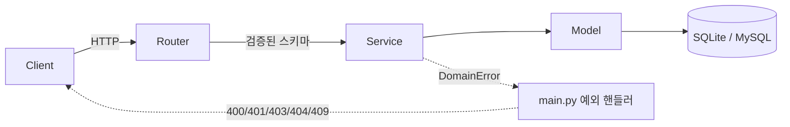
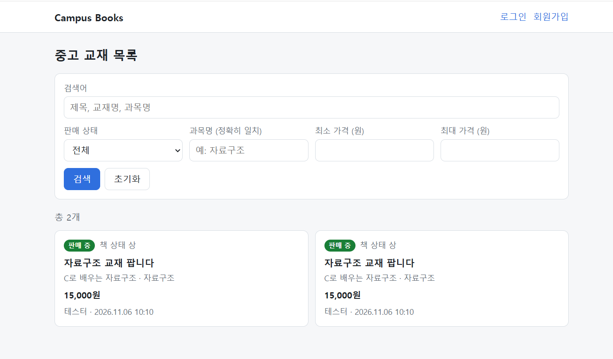
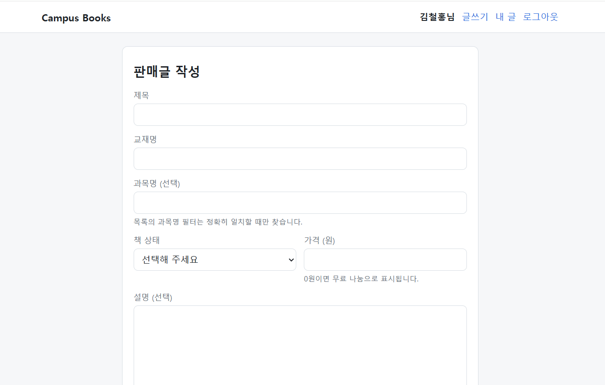
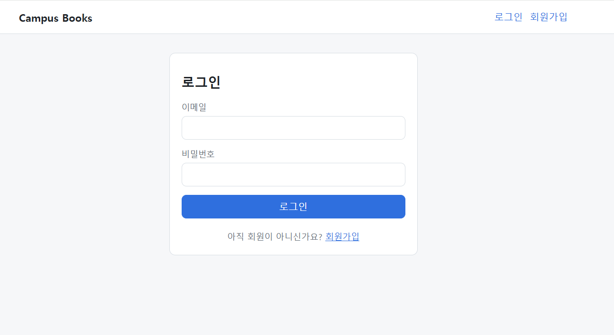
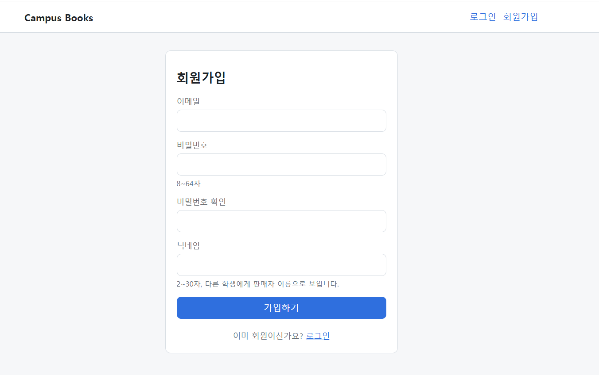
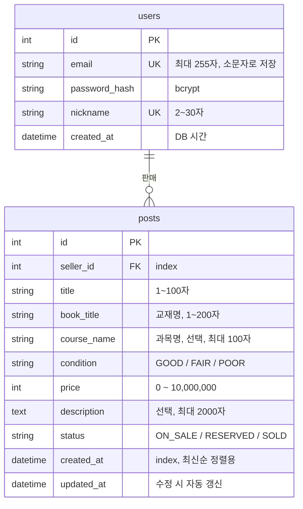
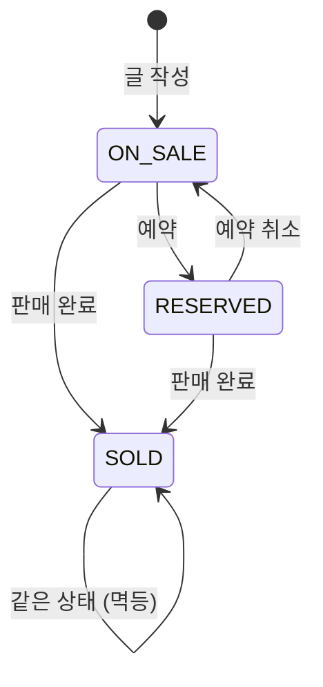

# Campus Books

같은 학교 학생끼리 전공 교재를 사고파는 **중고 교재 거래 게시판(API + 웹 화면)**입니다.

회원가입과 JWT 로그인, 판매글 작성·조회·수정·삭제, 판매 상태 관리, 교재 검색·필터를 제공합니다.
순수 HTML/CSS/JS로 만든 웹 화면 6개가 함께 들어 있어, 서버만 켜면 브라우저에서 바로 사용할 수 있습니다.
포트폴리오 프로젝트로, 기능 수보다 **계층 분리, 입력 검증, 권한 처리, 테스트**를 꼼꼼하게 다루는 데 집중했습니다.

## 목차

1. [문제 정의](#문제-정의)
2. [주요 기능](#주요-기능)
3. [기술 스택](#기술-스택)
4. [프로젝트 구조](#프로젝트-구조)
5. [프론트엔드](#프론트엔드)
6. [데이터 모델](#데이터-모델)
7. [실행 방법](#실행-방법)
8. [API 목록](#api-목록)
9. [상태 전이 규칙](#상태-전이-규칙)
10. [설계 결정과 트레이드오프](#설계-결정과-트레이드오프)
11. [테스트](#테스트)
12. [향후 개선 계획](#향후-개선-계획)

---

## 문제 정의

### 제가 겪은 불편

수업을 듣다 보면 교재가 꼭 필요한 과목이 있습니다. 하지만 새 교재는 가격이 부담스러워 구매하기가 꺼려졌습니다.

그래서 중고 교재를 구해 보려고 했습니다.

- **선배에게 직접 문의**: 아는 선배가 많지 않아 구하기 어려웠습니다.
- **에브리타임 이용**: 중고 교재 거래가 중심인 서비스가 아니어서 원하는 교재를 찾기 어려웠습니다.

결국 비싼 새 교재를 샀고, 얼마 쓰지 못한 채 책장에 넣어 두게 되었습니다.
다시 팔고 싶어도 마땅한 거래 창구가 없어 판매 또한 쉽지 않았습니다.

즉 교재를 **구하는 입장과 파는 입장 모두**에서 불편을 겪었습니다.

### 기존 거래 방식의 문제

같은 수업을 다음 학기에 듣는 학생에게 넘기면 양쪽 모두 이득이지만, 이런 거래는 보통 단체 채팅방이나 커뮤니티 게시판에서 이루어집니다.
이런 곳에서는 다음과 같은 문제가 생기기 쉽습니다.

- **찾기 어렵다**: 글이 대화나 다른 게시글에 묻혀서 과목명이나 교재명으로 검색하기 어렵습니다.
- **상태를 알 수 없다**: 이미 팔렸거나 예약된 책인지 글만 보고는 알기 어렵습니다.
- **정보가 제각각이다**: 가격, 책 상태, 과목명 같은 정보가 글마다 다른 형식으로 적혀 있습니다.

### 목표

그래서 이 프로젝트는 다음을 목표로 합니다.

- 교재명, 과목명, 가격대, 판매 상태로 **검색과 필터**를 할 수 있게 한다.
- 판매 상태(판매 중 / 예약 중 / 판매 완료)를 **명확한 규칙**으로 관리한다.
- 판매글 정보를 **정해진 형식**(교재명, 과목명, 책 상태, 가격)으로 받는다.

## 주요 기능

| 기능 | 내용 |
|---|---|
| 회원 | 회원가입, 로그인(JWT 발급), 내 정보 조회 |
| 판매글 작성·조회 | 작성, 목록(최신순, 페이지네이션), 상세, 내 글 목록 |
| 판매글 관리 | 일부 필드 수정, 판매 상태 변경, 삭제 (모두 작성자만 가능) |
| 검색·필터 | 검색어(제목·교재명·과목명), 상태, 과목명, 가격대 |
| 웹 화면 | 목록·검색, 상세(상태 변경·삭제), 작성·수정, 로그인, 회원가입, 내 글 |

## 기술 스택

| 분류 | 기술 | 선택 이유 |
|---|---|---|
| 언어 | Python 3.14.7 | 개발과 테스트에 사용한 버전 |
| 웹 프레임워크 | FastAPI | 타입 힌트 기반 입력 검증과 Swagger 문서 자동 생성 |
| ORM | SQLAlchemy 2.x | 타입이 지정된 `Mapped` 모델, SQLite와 MySQL을 같은 코드로 지원 |
| 검증 | Pydantic v2 | 요청 형식 오류를 서비스 로직에 닿기 전에 422로 차단 |
| DB | SQLite (개발) / MySQL (운영 목표) | 개발 중에는 설치 없이 실행하고, 운영에서는 `DATABASE_URL`만 교체 |
| 인증 | PyJWT, bcrypt | 서버에 세션을 저장하지 않는 토큰 인증, 솔트가 포함된 비밀번호 해시 |
| 프론트 | HTML/CSS/JS (ES 모듈, 빌드 도구 없음) | 별도 서버 없이 FastAPI가 정적 파일로 서빙하고, fetch로 API 호출 |
| 테스트 | pytest, httpx (TestClient) | API를 실제 요청처럼 호출하는 통합 테스트 |

제목 글꼴: [Gowun Batang](https://fonts.google.com/specimen/Gowun+Batang) (Google Fonts) Bold, SIL Open Font License 1.1 ([`static/fonts/OFL.txt`](static/fonts/OFL.txt)). 자주 쓰는 한글 2,350자만 남긴 woff2로 변환해 `static/fonts/`에서 직접 제공합니다.

## 프로젝트 구조

```
campus-books/
├── app/
│   ├── main.py            # 앱 생성, 라우터 등록, 업무 예외 → HTTP 응답 변환
│   ├── core/
│   │   ├── config.py      # .env 설정 (pydantic-settings)
│   │   ├── database.py    # 엔진, 세션, Base
│   │   ├── security.py    # 비밀번호 해시, JWT 발급·검증
│   │   ├── deps.py        # 현재 로그인 사용자 의존성 (CurrentUser)
│   │   └── exceptions.py  # 업무 예외 (DomainError 계층)
│   ├── models/            # SQLAlchemy 모델 (User, Post)
│   ├── schemas/           # Pydantic 요청·응답 스키마
│   ├── routers/           # auth, users, posts
│   └── services/          # 업무 로직
├── static/                # 프론트엔드 (아래 "프론트엔드" 참고)
│   ├── index.html, post.html, post-form.html, login.html, signup.html, my-posts.html
│   ├── css/style.css
│   └── js/
│       ├── api.js         # fetch 래퍼, 에러를 {status, message, fieldErrors}로 통일
│       ├── token.js       # 토큰 보관(localStorage)만 담당
│       ├── auth.js        # 공통 헤더, 로그인 후 돌아갈 주소, 로그아웃
│       ├── ui.js          # 카드·페이지 버튼·날짜 형식 등 공통 화면 부품
│       └── pages/         # 화면별 스크립트 (화면 1개 = 파일 1개)
├── tests/
├── .env.example
└── requirements.txt
```

### 계층 구조



- **Router**: 요청을 받아 서비스에 넘기고 응답 형식(`response_model`)만 정합니다.
- **Service**: 업무 규칙(권한, 상태 전이, 검색 조건)을 처리합니다. HTTP 상태 코드를 알지 못하고, 실패하면 `PostNotFoundError` 같은 업무 예외를 던집니다.
- **main.py**: 업무 예외를 HTTP 응답으로 바꾸는 일을 한 곳에서 맡습니다. 그래서 서비스 코드가 HTTP와 분리되고, 에러 응답 형식이 `{"detail": "..."}`로 통일됩니다.

| 예외 (기반 클래스) | HTTP 상태 |
|---|---|
| `BadRequestError` | 400 |
| `AuthenticationError` | 401 (`WWW-Authenticate: Bearer` 헤더 포함) |
| `ForbiddenError` | 403 |
| `NotFoundError` | 404 |
| `ConflictError` | 409 |

## 프론트엔드

서버를 실행한 뒤 http://127.0.0.1:8000/ 에 접속하면 목록 화면(`/static/index.html`)으로 이동합니다. 별도 설치나 빌드는 필요 없습니다.

### 화면 구성

| 화면 | 주소 | 로그인 필요 | 주요 동작 |
|---|---|---|---|
| 목록 | `/static/index.html` | | 검색어·상태·과목명·가격대 검색, 페이지 이동 |
| 상세 | `/static/post.html?id={id}` | 상태 변경·삭제만 🔒 | 글 내용 확인, 작성자에게만 상태 변경·수정·삭제 버튼 표시 |
| 작성·수정 | `/static/post-form.html` | 🔒 | 판매글 작성, 기존 글 수정 (`?id=`가 있으면 수정) |
| 로그인 | `/static/login.html` | | 로그인 후 원래 보던 화면으로 복귀 |
| 회원가입 | `/static/signup.html` | | 필드별 오류 메시지 표시 |
| 내 글 | `/static/my-posts.html` | 🔒 | 내 정보, 판매 완료를 포함한 내 글 목록 |

<!-- 스크린샷: 상세·내 글 화면은 docs/screenshots/ 에 이미지를 추가한 뒤 해당 줄의 주석을 푸세요 -->


<!--  -->







<!--  -->

### 구조

- **화면마다 HTML 1개와 스크립트 1개**(`js/pages/*.js`)를 둡니다. 공통 부품은 `ui.js`, 공통 헤더와 로그인 처리는 `auth.js`에 모았습니다.
- **API 호출은 `api.js`로만** 합니다. 토큰을 헤더에 넣고, 서버 에러를 `ApiError`(`status`, `message`, `fieldErrors`)로 바꿔 화면마다 같은 방식으로 처리합니다. 401을 받으면 토큰을 지웁니다.
- **토큰 접근은 `token.js`로만** 합니다. 저장 위치를 바꿀 때 이 파일 하나만 고치면 됩니다.
- **검색 조건과 페이지 번호는 주소창에 저장**합니다(`?q=...&page=2`). 새로고침, 뒤로 가기, 링크 공유에도 같은 결과가 나옵니다.
- 로그인이 필요한 화면에 로그아웃 상태로 들어오면 로그인 화면으로 보내고, 로그인 후 원래 주소로 돌려보냅니다.

## 데이터 모델



- `condition`과 `status`는 DB 고유 ENUM 대신 **문자열 컬럼 + 값 검사**로 저장합니다. SQLite와 MySQL에서 똑같이 동작하게 하기 위해서입니다.
- `created_at`과 `updated_at`은 앱 서버 시간이 아니라 DB 시간을 씁니다. `updated_at`은 값이 실제로 바뀐 경우에만 갱신됩니다.

## 실행 방법

### 1. 설치

```bash
git clone https://github.com/kim123-dev/campus-books.git
cd campus-books

python -m venv venv
# Windows
venv\Scripts\activate
# macOS / Linux
source venv/bin/activate

pip install -r requirements.txt
```

### 2. 환경 변수 설정

`.env.example`을 복사해 `.env`를 만듭니다. `.env`는 `.gitignore`에 포함되어 있어 커밋되지 않습니다.

```bash
cp .env.example .env
```

`SECRET_KEY`는 반드시 바꿔야 합니다. HS256 서명에는 **32바이트 이상**의 키를 권장합니다.

```bash
python -c "import secrets; print(secrets.token_urlsafe(32))"
```

| 변수 | 기본값 | 설명 |
|---|---|---|
| `DATABASE_URL` | `sqlite:///./dev.db` | 운영에서는 MySQL URL로 교체 |
| `SECRET_KEY` | (없음, 필수) | JWT 서명 키. 기본값이 없어서, 설정하지 않으면 서버가 시작되지 않습니다 |
| `ACCESS_TOKEN_EXPIRE_MINUTES` | `60` | 액세스 토큰 유효 시간(분) |

### 3. 서버 실행

```bash
uvicorn app.main:app --reload
```

- 서버가 시작될 때 테이블이 없으면 자동으로 만듭니다(`create_all`).
- 웹 화면: http://127.0.0.1:8000/
- API 문서: http://127.0.0.1:8000/docs
- `/docs` 오른쪽 위의 **Authorize** 버튼에 가입한 이메일(username 칸)과 비밀번호를 넣으면, 로그인이 필요한 API를 바로 호출할 수 있습니다.

## API 목록

총 11개입니다. 🔒 표시는 `Authorization: Bearer <토큰>` 헤더가 필요한 API입니다.

| 메서드 | 경로 | 인증 | 설명 | 성공 | 주요 실패 |
|---|---|---|---|---|---|
| GET | `/health` | | 서버 상태 확인 | 200 | |
| POST | `/auth/signup` | | 회원가입 | 201 | 409 이메일·닉네임 중복, 422 |
| POST | `/auth/login` | | 로그인 (form: `username`=이메일, `password`) | 200 | 401, 422 |
| GET | `/users/me` | 🔒 | 내 정보 조회 | 200 | 401 |
| GET | `/users/me/posts` | 🔒 | 내 판매글 목록 (모든 상태, 최신순) | 200 | 401, 422 |
| POST | `/posts` | 🔒 | 판매글 작성 (상태는 항상 `ON_SALE`로 시작) | 201 | 401, 422 |
| GET | `/posts` | | 판매글 목록 (검색·필터, 최신순) | 200 | 422 |
| GET | `/posts/{post_id}` | | 판매글 상세 | 200 | 404 |
| PATCH | `/posts/{post_id}` | 🔒 | 판매글 수정 (보낸 필드만) | 200 | 400 판매 완료, 401, 403, 404, 422 |
| PATCH | `/posts/{post_id}/status` | 🔒 | 판매 상태 변경 | 200 | 400 전이 불가, 401, 403, 404, 422 |
| DELETE | `/posts/{post_id}` | 🔒 | 판매글 삭제 | 204 | 401, 403, 404 |

### 목록 쿼리 파라미터 (`GET /posts`)

| 파라미터 | 형식 | 설명 |
|---|---|---|
| `q` | 문자열, 최대 100자 | 제목·교재명·과목명 중 하나라도 **부분 일치**. 대소문자 무시. `%`, `_`, `\`는 일반 글자로 처리 |
| `status` | `ON_SALE` / `RESERVED` / `SOLD` | 판매 상태. 보내지 않으면 전체 |
| `course_name` | 문자열, 최대 100자 | 과목명 **정확히 일치**. 앞뒤 공백 제거, 대소문자 무시 |
| `min_price` | 0 ~ 10,000,000 | 최소 가격 (포함) |
| `max_price` | 0 ~ 10,000,000 | 최대 가격 (포함). `min_price`보다 작으면 422 |
| `page` | 1 이상, 기본 1 | 페이지 번호 |
| `size` | 1 ~ 100, 기본 20 | 페이지당 글 수 |

- 여러 조건을 보내면 모두 AND로 묶입니다. `q`나 `course_name`에 빈 값을 보내면 조건이 없는 것으로 봅니다.
- `/users/me/posts`는 `page`, `size`만 지원합니다.

예시 요청:

```
GET /posts?q=자료구조&status=ON_SALE&min_price=10000&max_price=20000&page=1&size=10
```

응답 형식 (`total`은 조건에 맞는 전체 글 수):

```json
{
  "items": [
    {
      "id": 1,
      "title": "자료구조 교재 팝니다",
      "book_title": "C언어로 쉽게 풀어쓴 자료구조",
      "course_name": "자료구조",
      "condition": "GOOD",
      "price": 15000,
      "description": "필기 거의 없어요.",
      "status": "ON_SALE",
      "seller": { "id": 3, "nickname": "책벌레" },
      "created_at": "2026-11-06T10:00:00",
      "updated_at": "2026-11-06T10:00:00"
    }
  ],
  "total": 1,
  "page": 1,
  "size": 10
}
```

판매자 정보는 `id`와 `nickname`만 보여주고, 이메일은 노출하지 않습니다.

### 에러 응답

모든 에러는 `{"detail": ...}` 형식입니다. 422는 FastAPI 기본 형식(필드별 오류 목록)을 따릅니다.

수정·삭제 API는 다음 순서로 판정하므로, 여러 문제가 겹치면 앞의 에러가 반환됩니다.

```
401 로그인 안 됨 → 422 요청 형식 오류 → 404 글 없음 → 403 작성자 아님 → 400 상태 규칙 위반
```

## 상태 전이 규칙



| 현재 \ 변경 | ON_SALE | RESERVED | SOLD |
|---|---|---|---|
| **ON_SALE** | 200 (변화 없음) | 200 | 200 |
| **RESERVED** | 200 | 200 (변화 없음) | 200 |
| **SOLD** | **400** | **400** | 200 (변화 없음) |

- **같은 상태로의 변경은 멱등**입니다. 네트워크 오류로 같은 요청을 다시 보내도 에러가 나지 않고, 값이 바뀌지 않으므로 `updated_at`도 그대로입니다.
- **SOLD는 마지막 상태**입니다. 다른 상태로 되돌릴 수 없습니다.
- 상태는 상태 변경 API로만 바꿀 수 있습니다. 작성·수정 요청에 `status`를 넣으면 422입니다.
- SOLD 글은 **내용 수정도 불가(400)**하지만 **삭제는 가능**합니다.
- 규칙은 `app/services/post_service.py`의 `ALLOWED_TRANSITIONS` 표 한 곳에서 관리합니다.
- 상세 화면의 상태 변경 버튼은 `static/js/pages/post.js`에 있는 같은 이름의 표로 정하고, 두 표가 같은지 테스트로 확인합니다([설계 결정 6번](#6-프론트서버-상태-규칙표-일치-테스트)).

## 설계 결정과 트레이드오프

### 1. 계정 존재 여부 노출

| | 내용 |
|---|---|
| **결정** | 로그인 실패는 이메일이 없는 경우와 비밀번호가 틀린 경우 모두 `"이메일 또는 비밀번호가 올바르지 않습니다."`(401)로 응답합니다. 회원가입에서 이메일이 중복되면 `"이미 사용 중인 이메일입니다."`(409)로 응답합니다. |
| **이유** | 로그인 API로 가입된 이메일을 하나씩 확인해 보는 공격을 막습니다. 반면 회원가입에서는 사용자가 왜 가입이 안 되는지 알아야 다음 행동(로그인, 다른 이메일 사용)을 할 수 있습니다. |
| **트레이드오프** | 회원가입 API를 통해서는 특정 이메일의 가입 여부를 알아낼 수 있습니다. 사용성을 위해 이 위험을 감수했고, 요청 횟수 제한과 이메일 인증 방식 가입으로 보완할 계획입니다([향후 개선 계획](#향후-개선-계획)). |

같은 관점에서, 남의 글을 수정·삭제하려 하면 404가 아니라 **403**을 반환합니다. 판매글은 누구나 조회할 수 있는 공개 데이터라서 글이 있다는 사실을 숨길 이유가 없고, 403이 원인을 더 정확하게 알려주기 때문입니다.

### 2. Hard delete

| | 내용 |
|---|---|
| **결정** | 글을 삭제하면 DB 행을 실제로 지우고 204를 반환합니다. 삭제한 글은 다시 조회하면 404입니다. |
| **이유** | 모든 조회 쿼리에 "삭제되지 않은 글" 조건을 붙일 필요가 없어 코드가 단순합니다. 사용자가 지운 내용이 서버에 남지 않습니다. |
| **트레이드오프** | 거래 이력과 분쟁·신고 대응 자료가 사라지고, 실수로 지운 글을 되살릴 수 없습니다. 거래 후기나 신고 기능이 생기면 soft delete를 다시 검토합니다. |

### 3. SOLD 글 수정 불가

| | 내용 |
|---|---|
| **결정** | 판매 완료된 글에 `PATCH /posts/{id}`를 보내면 `"판매 완료된 글은 수정할 수 없습니다."`(400)를 반환합니다. 빈 본문 `{}`도 400입니다. 삭제는 허용합니다. |
| **이유** | 거래가 끝난 뒤 가격이나 책 상태를 바꾸면 거래 당시의 정보와 달라져 분쟁의 원인이 될 수 있습니다. 빈 본문도 막은 것은 "SOLD 글에는 수정 API를 쓸 수 없다"는 규칙을 예외 없이 단순하게 유지하기 위해서입니다. |
| **트레이드오프** | 판매 후 오타 같은 사소한 실수도 고칠 수 없습니다. 판매자가 글을 정리하고 싶을 때를 위해 삭제는 허용했습니다. |

### 4. 토큰을 localStorage에 저장

| | 내용 |
|---|---|
| **결정** | 로그인 토큰을 브라우저의 localStorage에 저장하고, 요청할 때 `Authorization: Bearer` 헤더로 보냅니다. |
| **이유** | 새 탭을 열거나 새로고침해도 로그인이 유지됩니다. 쿠키를 쓰지 않으므로 CSRF 대책이 따로 필요 없고, 서버의 Bearer 인증을 그대로 쓸 수 있습니다. |
| **트레이드오프** | XSS 취약점이 생기면 악성 스크립트가 토큰을 읽어 갈 수 있습니다. 그래서 XSS가 생길 여지 자체를 줄였습니다. 화면에 값을 넣을 때는 항상 `textContent`와 `createElement`만 쓰고, `static/js`의 모든 파일에 `innerHTML`, `outerHTML`, `insertAdjacentHTML`이 없는지 테스트로 검사합니다. 근본적인 해결책은 HttpOnly 쿠키입니다([향후 개선 계획](#향후-개선-계획)). |

### 5. 로그아웃은 토큰 삭제만

| | 내용 |
|---|---|
| **결정** | 로그아웃하면 브라우저에 저장된 토큰만 지웁니다. 서버에는 로그아웃 API가 없습니다. |
| **이유** | JWT는 서버가 로그인 상태를 저장하지 않는 방식이라, 토큰을 지우면 그 브라우저에서는 더 이상 인증 요청을 보낼 수 없습니다. |
| **한계** | 서버가 이미 발급한 토큰을 무효화할 수 없습니다. 토큰이 유출되면 로그아웃한 뒤에도 만료 시간(기본 60분)까지는 그 토큰으로 요청할 수 있습니다. 리프레시 토큰과 짧은 액세스 토큰 만료, 또는 토큰 차단 목록으로 보완할 계획입니다. |

### 6. 프론트·서버 상태 규칙표 일치 테스트

| | 내용 |
|---|---|
| **결정** | 상세 화면은 상태 변경 버튼을 고르기 위해 전이표(`ALLOWED_TRANSITIONS`)를 따로 갖고 있습니다. 테스트가 `post.js`에서 이 표를 읽어 서버의 표와 같은지 비교합니다. |
| **이유** | 서버 규칙만 바뀌고 프론트를 놓치면, 누르면 400이 나는 버튼이 보이거나 필요한 버튼이 사라집니다. 두 표가 어긋나면 테스트가 바로 실패하므로 배포 전에 알 수 있습니다. |
| **트레이드오프** | JS 파일을 정규식으로 읽으므로 상수의 이름이나 모양이 바뀌면 테스트가 실패합니다. 비교 없이 조용히 통과하지 않도록 의도한 동작입니다. 서버가 표를 API로 내려주는 방식도 있지만, 화면마다 요청이 하나 늘어납니다. |

### 그 밖의 결정

| 결정 | 이유 |
|---|---|
| 작성·수정 요청에서 모르는 필드는 422 (`extra="forbid"`) | `status`를 보냈는데 조용히 무시되면 클라이언트가 실수를 알 수 없습니다 |
| 가격은 strict 정수 (`"15000"`, `1500.5` 거절) | 문자열이나 실수가 자동 변환되며 생기는 오해를 막습니다 |
| PATCH는 보낸 필드만 반영 (`exclude_unset`) | 보내지 않은 필드를 null로 덮어쓰지 않습니다. 필수 필드에 명시적으로 null을 보내면 422 |
| 최신순 정렬은 `created_at DESC, id DESC` | SQLite는 시간을 초 단위로 저장해 같은 초에 쓴 글의 순서가 섞일 수 있습니다 |
| 목록에서 판매자를 JOIN으로 함께 조회 | 글마다 판매자 조회 쿼리가 나가는 N+1 문제를 막습니다. 목록 요청 하나에 쿼리 2번(개수 + 목록) |
| 검색어의 `%`, `_`, `\` 이스케이프 | `q=100%`가 "1000원"까지 찾는 식으로 와일드카드처럼 동작하는 것을 막습니다 |
| 비밀번호를 글자 수와 바이트 수로 함께 제한 | bcrypt는 72바이트까지만 처리하는데, 한글은 한 글자가 3바이트라 64자 제한만으로는 부족합니다 |
| JWT 검증 시 알고리즘을 HS256으로 고정 | `alg: none`처럼 헤더의 알고리즘을 바꿔치기하는 공격을 막습니다 |

## 테스트

```bash
# Windows
venv\Scripts\python -m pytest -q
# macOS / Linux
python -m pytest -q
```

- `.env` 없이도 실행됩니다. 테스트용 `SECRET_KEY`와 **인메모리 SQLite**를 쓰므로 개발용 `dev.db`를 건드리지 않습니다.
- `dependency_overrides`로 앱의 DB 세션을 테스트 세션으로 바꾸고, 테스트마다 테이블을 새로 만들어 테스트끼리 데이터가 섞이지 않습니다.
- 실제 회원가입·로그인 API로 토큰을 받아 사용하므로, 인증 흐름 전체가 함께 검증됩니다.

**12개 파일, 263개 테스트 케이스** (`pytest.mark.parametrize`로 펼쳐진 개수 기준)

| 파일 | 케이스 수 | 범위 |
|---|---|---|
| `test_health.py` | 1 | 서버 상태 확인 |
| `test_auth_signup.py` | 19 | 가입 성공, bcrypt 해시 저장, 이메일 대소문자 통일, 중복 409, 비밀번호 길이·72바이트 경계, 입력 검증 |
| `test_auth_login.py` | 18 | 로그인 성공, 없는 이메일과 틀린 비밀번호의 같은 401, 토큰 만료 시간, 토큰 만료·변조·`alg: none` 거절 |
| `test_users_me.py` | 12 | 토큰 없음·만료·변조·`alg: none`·다른 키 서명, 없는 사용자 |
| `test_posts_create.py` | 31 | 작성, 비로그인 401, 가격·필수 필드·`condition`·`status` 검증, 글자 수 경계값 |
| `test_posts_read.py` | 25 | 상세·404, 최신순 정렬, 닉네임 표시, N+1 방지, 페이지네이션 경계값 |
| `test_users_me_posts.py` | 8 | 내 글만 조회, 401, 페이지네이션 |
| `test_posts_update.py` | 37 | 일부 수정, 빈 본문, null 처리, SOLD 글 400, `updated_at`, 401/403/404 |
| `test_posts_status.py` | 24 | 전이표 9칸 전부, 멱등성, 401/403/404/422 |
| `test_posts_delete.py` | 11 | 204, 실제 행 삭제, 목록에서 제거, SOLD 글 삭제, 401/403/404 |
| `test_posts_search.py` | 52 | 필터별·조합 검색, 특수문자, 가격 경계값, 결과 없음, 필터 + 페이지네이션의 `total` |
| `test_static.py` | 25 | 정적 파일 서빙과 MIME 타입, `/` 리다이렉트, API와의 공존, JS 파일별 `innerHTML` 계열 사용 금지, 프론트·서버 전이표 일치 |

## 향후 개선 계획

1. **학교 이메일 인증**: 지금은 아무 이메일로나 가입할 수 있어서 "같은 학교 학생끼리"라는 목표를 아직 보장하지 못합니다. 학교 도메인 이메일로 인증 코드를 보내 확인한 뒤 가입되도록 바꿀 계획입니다. 가장 우선순위가 높은 과제입니다.
2. **HttpOnly 쿠키 전환**: 토큰을 JS가 읽을 수 없는 HttpOnly 쿠키로 옮겨, XSS가 생겨도 토큰을 탈취할 수 없게 합니다. 대신 쿠키는 자동으로 전송되므로 SameSite 설정과 CSRF 토큰 같은 대책을 함께 넣어야 합니다([설계 결정 4번](#4-토큰을-localstorage에-저장)).
3. **작성 중 토큰 만료 시 입력 내용 보존**: 지금은 글을 저장하는 순간 토큰이 만료되어 401이 나면 로그인 화면으로 이동하면서 입력한 내용이 사라집니다. 이동 전에 입력 내용을 sessionStorage에 임시 저장하고, 로그인 후 돌아오면 복원할 계획입니다.
4. **내 글 상태별 필터와 개수**: 내 글 화면에 "판매 중 3 · 예약 중 1 · 판매 완료 5" 같은 탭을 넣습니다. 서버의 `/users/me/posts`에 `status` 파라미터와 상태별 개수 응답도 함께 추가해야 합니다.
5. **보안 강화**: 로그인·회원가입 요청 횟수 제한, 리프레시 토큰으로 로그아웃 한계 보완([설계 결정 5번](#5-로그아웃은-토큰-삭제만))
6. **DB 운영 준비**: Alembic 마이그레이션 도입(지금은 `create_all`이라 컬럼 변경이 반영되지 않음), MySQL 실제 연동, Docker Compose 구성
7. **기능 확장**: 교재 사진 업로드, 댓글 또는 거래 문의
8. **검색 성능**: `%검색어%` 검색은 인덱스를 쓰지 못하므로, 데이터가 늘면 MySQL FULLTEXT 인덱스를 검토합니다.
9. **삭제 정책 재검토**: 거래 후기나 신고 기능을 추가할 때 soft delete를 다시 검토합니다.
10. **CI**: GitHub Actions에서 push마다 테스트를 자동 실행합니다.
