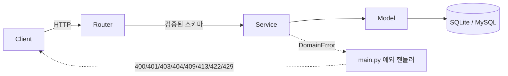
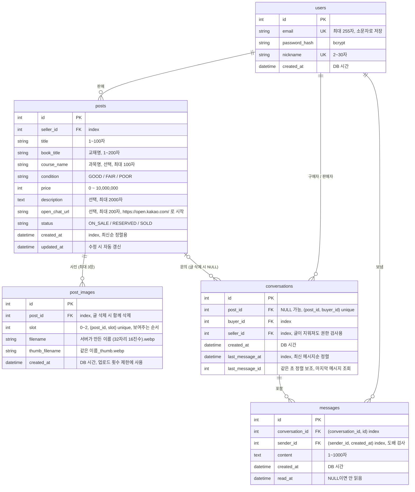
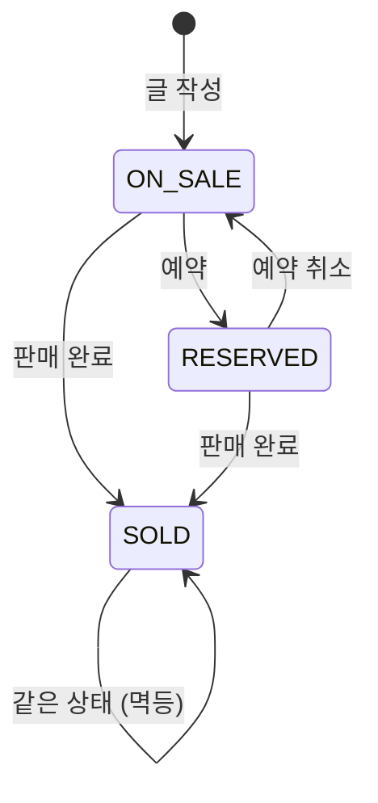

# Campus Books

같은 학교 학생끼리 전공 교재를 사고파는 **중고 교재 거래 게시판(API + 웹 화면)**입니다.

회원가입과 JWT 로그인, 판매글 작성·조회·수정·삭제, 판매 상태 관리, 교재 검색·필터, 교재 사진, 구매자와 판매자의 1:1 쪽지를 제공합니다.
순수 HTML/CSS/JS로 만든 웹 화면 8개가 함께 들어 있어, 서버만 켜면 브라우저에서 바로 사용할 수 있습니다.
포트폴리오 프로젝트로, 기능 수보다 **계층 분리, 입력 검증, 권한 처리, 테스트**를 꼼꼼하게 다루는 데 집중했습니다.

## 목차

1. [문제 정의](#문제-정의)
2. [주요 기능](#주요-기능)
3. [기술 스택](#기술-스택)
4. [프로젝트 구조](#프로젝트-구조)
5. [프론트엔드](#프론트엔드)
6. [데이터 모델](#데이터-모델)
7. [실행 방법](#실행-방법)
8. [API 목록](#api-목록)
9. [상태 전이 규칙](#상태-전이-규칙)
10. [설계 결정과 트레이드오프](#설계-결정과-트레이드오프)
11. [테스트](#테스트)
12. [향후 개선 계획](#향후-개선-계획)

---

## 문제 정의

### 제가 겪은 불편

수업을 듣다 보면 교재가 꼭 필요한 과목이 있습니다. 하지만 새 교재는 가격이 부담스러워 구매하기가 꺼려졌습니다.

그래서 중고 교재를 구해 보려고 했습니다.

- **선배에게 직접 문의**: 아는 선배가 많지 않아 구하기 어려웠습니다.
- **에브리타임 이용**: 중고 교재 거래가 중심인 서비스가 아니어서 원하는 교재를 찾기 어려웠습니다.

결국 비싼 새 교재를 샀고, 얼마 쓰지 못한 채 책장에 넣어 두게 되었습니다.
다시 팔고 싶어도 마땅한 거래 창구가 없어 판매 또한 쉽지 않았습니다.

즉 교재를 **구하는 입장과 파는 입장 모두**에서 불편을 겪었습니다.

### 기존 거래 방식의 문제

같은 수업을 다음 학기에 듣는 학생에게 넘기면 양쪽 모두 이득이지만, 이런 거래는 보통 단체 채팅방이나 커뮤니티 게시판에서 이루어집니다.
이런 곳에서는 다음과 같은 문제가 생기기 쉽습니다.

- **찾기 어렵다**: 글이 대화나 다른 게시글에 묻혀서 과목명이나 교재명으로 검색하기 어렵습니다.
- **상태를 알 수 없다**: 이미 팔렸거나 예약된 책인지 글만 보고는 알기 어렵습니다.
- **정보가 제각각이다**: 가격, 책 상태, 과목명 같은 정보가 글마다 다른 형식으로 적혀 있습니다.

### 목표

그래서 이 프로젝트는 다음을 목표로 합니다.

- 교재명, 과목명, 가격대, 판매 상태로 **검색과 필터**를 할 수 있게 한다.
- 판매 상태(판매 중 / 예약 중 / 판매 완료)를 **명확한 규칙**으로 관리한다.
- 판매글 정보를 **정해진 형식**(교재명, 과목명, 책 상태, 가격)으로 받는다.

## 주요 기능

| 기능 | 내용 |
|---|---|
| 회원 | 회원가입, 로그인(JWT 발급), 내 정보 조회 |
| 판매글 작성·조회 | 작성, 목록(최신순, 페이지네이션), 상세, 내 글 목록 |
| 판매글 관리 | 일부 필드 수정, 판매 상태 변경, 삭제 (모두 작성자만 가능) |
| 검색·필터 | 검색어(제목·교재명·과목명), 상태, 과목명, 가격대 |
| 교재 사진 | 글당 최대 3장(JPG·PNG·WebP, 장당 5MB). 서버가 WebP로 다시 인코딩해 위치 정보(GPS) 등 메타데이터를 지우고, 목록용 썸네일을 함께 만듭니다 |
| 연락 방법 | 판매글에 카카오 오픈채팅 링크(선택) 등록, 상세 화면에서 로그인한 사용자에게만 표시 |
| 1:1 쪽지 | 판매글 문의 시작, 쪽지함(최신 메시지순, 안 읽은 개수), 대화 화면(새 메시지 자동 확인, 이전 메시지 불러오기), 읽음 처리, 도배 방지 |
| 웹 화면 | 목록·검색, 상세(상태 변경·삭제·문의), 작성·수정, 로그인, 회원가입, 내 글, 쪽지함, 대화 |

## 기술 스택

| 분류 | 기술 | 선택 이유 |
|---|---|---|
| 언어 | Python 3.14.7 | 개발과 테스트에 사용한 버전 |
| 웹 프레임워크 | FastAPI | 타입 힌트 기반 입력 검증과 Swagger 문서 자동 생성 |
| ORM | SQLAlchemy 2.x | 타입이 지정된 `Mapped` 모델, SQLite와 MySQL을 같은 코드로 지원 |
| 검증 | Pydantic v2 | 요청 형식 오류를 서비스 로직에 닿기 전에 422로 차단 |
| DB | SQLite (개발) / MySQL (운영 목표) | 개발 중에는 설치 없이 실행하고, 운영에서는 `DATABASE_URL`만 교체 |
| 이미지 | Pillow 12.3.0 | 실제 내용으로 형식 확인, 다시 인코딩(메타데이터 제거), 크기 조정 |
| 인증 | PyJWT, bcrypt | 서버에 세션을 저장하지 않는 토큰 인증, 솔트가 포함된 비밀번호 해시 |
| 프론트 | HTML/CSS/JS (ES 모듈, 빌드 도구 없음) | 별도 서버 없이 FastAPI가 정적 파일로 서빙하고, fetch로 API 호출 |
| 테스트 | pytest, httpx (TestClient) | API를 실제 요청처럼 호출하는 통합 테스트 |

글꼴: [Pretendard](https://github.com/orioncactus/pretendard) v1.3.9 (Regular·SemiBold·Bold), SIL Open Font License 1.1 ([`static/fonts/OFL-Pretendard.txt`](static/fonts/OFL-Pretendard.txt)). 공식 배포본의 서브셋 woff2를 수정 없이 `static/fonts/`에서 직접 제공합니다.

## 프로젝트 구조

```
campus-books/
├── app/
│   ├── main.py            # 앱 생성, 라우터 등록, 업무 예외 → HTTP 응답 변환
│   ├── core/
│   │   ├── config.py      # .env 설정 (pydantic-settings)
│   │   ├── database.py    # 엔진, 세션, Base
│   │   ├── security.py    # 비밀번호 해시, JWT 발급·검증
│   │   ├── deps.py        # 현재 로그인 사용자 의존성 (CurrentUser)
│   │   └── exceptions.py  # 업무 예외 (DomainError 계층)
│   ├── models/            # SQLAlchemy 모델 (User, Post, PostImage, Conversation, Message)
│   ├── schemas/           # Pydantic 요청·응답 스키마
│   ├── routers/           # auth, users, posts, images, conversations
│   └── services/          # 업무 로직 (사진: image_service 검사·인코딩, image_storage 파일 쓰기·지우기)
├── static/                # 프론트엔드 (아래 "프론트엔드" 참고)
│   ├── index.html, post.html, post-form.html, login.html, signup.html, my-posts.html,
│   │   conversations.html, chat.html
│   ├── css/style.css
│   ├── img/book-placeholder.svg  # 사진 없는 글의 기본 그림
│   └── js/
│       ├── api.js         # fetch 래퍼, 에러를 {status, message, fieldErrors}로 통일
│       ├── token.js       # 토큰 보관(localStorage)만 담당
│       ├── auth.js        # 공통 헤더, 로그인 후 돌아갈 주소, 로그아웃
│       ├── ui.js          # 카드·페이지 버튼·날짜 형식 등 공통 화면 부품
│       └── pages/         # 화면별 스크립트 (화면 1개 = 파일 1개)
├── tests/
├── uploads/               # 올린 사진 (서버가 만듦, .gitignore 대상, static/ 밖)
├── .env.example
└── requirements.txt
```

### 계층 구조



- **Router**: 요청을 받아 서비스에 넘기고 응답 형식(`response_model`)만 정합니다.
- **Service**: 업무 규칙(권한, 상태 전이, 검색 조건)을 처리합니다. HTTP 상태 코드를 알지 못하고, 실패하면 `PostNotFoundError` 같은 업무 예외를 던집니다.
- **main.py**: 업무 예외를 HTTP 응답으로 바꾸는 일을 한 곳에서 맡습니다. 그래서 서비스 코드가 HTTP와 분리되고, 에러 응답 형식이 `{"detail": "..."}`로 통일됩니다.

| 예외 (기반 클래스) | HTTP 상태 |
|---|---|
| `BadRequestError` | 400 |
| `AuthenticationError` | 401 (`WWW-Authenticate: Bearer` 헤더 포함) |
| `ForbiddenError` | 403 |
| `NotFoundError` | 404 |
| `ConflictError` | 409 |
| `PayloadTooLargeError` | 413 (사진 5MB 초과) |
| `UnprocessableError` | 422 (지원하지 않는 사진 형식, 깨진 파일) |
| `TooManyRequestsError` | 429 (`Retry-After` 헤더 포함) |

## 프론트엔드

서버를 실행한 뒤 http://127.0.0.1:8000/ 에 접속하면 목록 화면(`/static/index.html`)으로 이동합니다. 별도 설치나 빌드는 필요 없습니다.

### 화면 구성

| 화면 | 주소 | 로그인 필요 | 주요 동작 |
|---|---|---|---|
| 목록 | `/static/index.html` | | 검색어·상태·과목명·가격대 검색, 페이지 이동, 카드마다 첫 사진 썸네일(없으면 기본 그림) |
| 상세 | `/static/post.html?id={id}` | 연락·상태 변경·삭제만 🔒 | 사진(큰 사진 + 작은 사진을 누르면 바뀜), 글 내용 확인, 쪽지 문의·오픈채팅 연락 버튼(로그인 시, 내 글·판매 완료 글 제외), 작성자에게만 상태 변경·수정·삭제 버튼 표시 |
| 작성·수정 | `/static/post-form.html` | 🔒 | 판매글 작성, 기존 글 수정 (`?id=`가 있으면 수정), 사진 고르기·미리보기·빼기(최대 3장) |
| 로그인 | `/static/login.html` | | 로그인 후 원래 보던 화면으로 복귀 |
| 회원가입 | `/static/signup.html` | | 필드별 오류 메시지 표시 |
| 내 글 | `/static/my-posts.html` | 🔒 | 내 정보, 판매 완료를 포함한 내 글 목록 |
| 쪽지함 | `/static/conversations.html` | 🔒 | 내 대화방 목록(상대 닉네임, 글 제목 또는 "삭제된 글", 마지막 메시지, 안 읽은 개수), 페이지 이동 |
| 대화 | `/static/chat.html?id={id}` | 🔒 | 메시지 보기·보내기, 5초마다 새 메시지 확인, 위로 스크롤하면 이전 메시지, 429 시 남은 시간 표시, 개인정보 주의 안내 |

<!-- 스크린샷: 상세·내 글 화면은 docs/screenshots/ 에 이미지를 추가한 뒤 해당 줄의 주석을 푸세요 -->


<!--  -->


<!--  -->

### 구조

- **화면마다 HTML 1개와 스크립트 1개**(`js/pages/*.js`)를 둡니다. 공통 부품은 `ui.js`, 공통 헤더와 로그인 처리는 `auth.js`에 모았습니다.
- **API 호출은 `api.js`로만** 합니다. 토큰을 헤더에 넣고, 서버 에러를 `ApiError`(`status`, `message`, `fieldErrors`)로 바꿔 화면마다 같은 방식으로 처리합니다. 401을 받으면 토큰을 지웁니다.
- **토큰 접근은 `token.js`로만** 합니다. 저장 위치를 바꿀 때 이 파일 하나만 고치면 됩니다.
- **검색 조건과 페이지 번호는 주소창에 저장**합니다(`?q=...&page=2`). 새로고침, 뒤로 가기, 링크 공유에도 같은 결과가 나옵니다.
- 로그인이 필요한 화면에 로그아웃 상태로 들어오면 로그인 화면으로 보내고, 로그인 후 원래 주소로 돌려보냅니다.
- **사진은 글을 저장한 뒤 한 장씩 따로 올립니다.** 글(JSON) 저장 → 뺀 사진 삭제 → 새 사진 업로드 순서입니다. 지우기를 먼저 해야 "3장 중 1장 바꾸기"가 3장 제한에 걸리지 않습니다. 사진 일부가 실패하면 글은 이미 저장된 상태이므로 화면을 수정 모드(`?id=`)로 바꾸고 "글은 저장됐지만 사진 1장을 처리하지 못했습니다: (서버 메시지)"를 보여줍니다. 다시 저장해도 글이 두 번 생기지 않습니다.
- 사진을 고르면 형식·크기·장수를 먼저 확인해 걸린 파일만 빼고 이유를 보여줍니다. 최종 검사는 서버가 합니다. 이 기준값이 서버와 같은지 테스트로 확인합니다.
- 로그인하면 헤더의 "쪽지" 옆에 안 읽은 쪽지 수가 보입니다. 헤더를 먼저 그리고 숫자는 따로 불러와, 숫자 요청이 늦어도 화면이 늦게 뜨지 않습니다.

## 데이터 모델



- `condition`과 `status`는 DB 고유 ENUM 대신 **문자열 컬럼 + 값 검사**로 저장합니다. SQLite와 MySQL에서 똑같이 동작하게 하기 위해서입니다.
- 사진 파일은 DB가 아니라 `UPLOAD_DIR/posts/`에 두고, DB에는 서버가 만든 파일 이름만 저장합니다. 사용자가 올린 원래 파일 이름은 저장하지 않습니다.
- 글당 3장 제한은 서비스 검사와 함께 `(post_id, slot)` unique + `slot` 0~2 CHECK 제약으로 DB에서도 막습니다. 동시에 올려도 3장을 넘지 않습니다.
- `created_at`과 `updated_at`은 앱 서버 시간이 아니라 DB 시간을 씁니다. `updated_at`은 값이 실제로 바뀐 경우에만 갱신됩니다.

## 실행 방법

### 1. 설치

```bash
git clone https://github.com/kim123-dev/campus-books.git
cd campus-books

python -m venv venv
# Windows
venv\Scripts\activate
# macOS / Linux
source venv/bin/activate

pip install -r requirements.txt
```

### 2. 환경 변수 설정

`.env.example`을 복사해 `.env`를 만듭니다. `.env`는 `.gitignore`에 포함되어 있어 커밋되지 않습니다.

```bash
cp .env.example .env
```

`SECRET_KEY`는 반드시 바꿔야 합니다. HS256 서명에는 **32바이트 이상**의 키를 권장합니다.

```bash
python -c "import secrets; print(secrets.token_urlsafe(32))"
```

| 변수 | 기본값 | 설명 |
|---|---|---|
| `DATABASE_URL` | `sqlite:///./dev.db` | 운영에서는 MySQL URL로 교체 |
| `SECRET_KEY` | (없음, 필수) | JWT 서명 키. 기본값이 없어서, 설정하지 않으면 서버가 시작되지 않습니다 |
| `ACCESS_TOKEN_EXPIRE_MINUTES` | `60` | 액세스 토큰 유효 시간(분) |
| `UPLOAD_DIR` | `./uploads` | 사진 저장 폴더. 사진은 그 아래 `posts/`에 저장됩니다. `static/` 밖에 두어야 합니다 |

### 3. 서버 실행

```bash
uvicorn app.main:app --reload
```

- 서버가 시작될 때 테이블이 없으면 자동으로 만듭니다(`create_all`). 이미 있는 테이블에 컬럼을 추가하지는 않습니다(아래 참고).
  - 쪽지 기능의 `conversations`, `messages`와 사진의 `post_images`는 새 테이블이라 기존 `dev.db`에서도 서버를 켜면 자동으로 생깁니다. 별도 작업이 필요 없습니다.
  - 사진 폴더(`uploads/posts/`)는 첫 업로드 때 자동으로 만들어집니다.
- 웹 화면: http://127.0.0.1:8000/
- API 문서: http://127.0.0.1:8000/docs
- `/docs` 오른쪽 위의 **Authorize** 버튼에 가입한 이메일(username 칸)과 비밀번호를 넣으면, 로그인이 필요한 API를 바로 호출할 수 있습니다.

### 4. 기존 `dev.db` 업데이트 (오픈채팅 링크 추가 전에 만든 DB)

`create_all`은 없는 테이블만 만들고, 이미 있는 `posts` 테이블에 새 컬럼을 추가하지 않습니다.
그래서 `open_chat_url` 컬럼이 생기기 전에 만든 `dev.db`를 그대로 쓰면 글 조회가 `no such column` 오류(500)로 실패합니다.
아래처럼 한 번만 백업하고 컬럼을 추가하면 기존 데이터를 유지한 채 사용할 수 있습니다. 비워도 되는 컬럼이라 기존 글은 링크 없이(`NULL`) 남습니다.

```bash
# 1. 백업 (*.bak은 .gitignore에 포함되어 커밋되지 않습니다)
cp dev.db dev.db.bak

# 2. 컬럼 추가 (sqlite3 명령이 없으면 아래 python 한 줄을 사용)
sqlite3 dev.db "ALTER TABLE posts ADD COLUMN open_chat_url VARCHAR(200);"
python -c "import sqlite3; c = sqlite3.connect('dev.db'); c.execute('ALTER TABLE posts ADD COLUMN open_chat_url VARCHAR(200)'); c.commit()"
```

- 이미 컬럼이 있으면 `duplicate column name` 오류가 나며 아무것도 바뀌지 않습니다.
- 데이터가 필요 없다면 `dev.db`를 지우고 서버를 다시 켜도 됩니다. 테이블이 새 구조로 만들어집니다.
- 이런 수동 작업을 없애려면 마이그레이션 도구(Alembic)가 필요합니다([향후 개선 계획 6번](#향후-개선-계획)).

## API 목록

총 17개입니다. 🔒 표시는 `Authorization: Bearer <토큰>` 헤더가 필요한 API입니다.

| 메서드 | 경로 | 인증 | 설명 | 성공 | 주요 실패 |
|---|---|---|---|---|---|
| GET | `/health` | | 서버 상태 확인 | 200 | |
| POST | `/auth/signup` | | 회원가입 | 201 | 409 이메일·닉네임 중복, 422 |
| POST | `/auth/login` | | 로그인 (form: `username`=이메일, `password`) | 200 | 401, 422 |
| GET | `/users/me` | 🔒 | 내 정보 조회 | 200 | 401 |
| GET | `/users/me/posts` | 🔒 | 내 판매글 목록 (모든 상태, 최신순) | 200 | 401, 422 |
| POST | `/posts` | 🔒 | 판매글 작성 (상태는 항상 `ON_SALE`로 시작) | 201 | 401, 422 |
| GET | `/posts` | | 판매글 목록 (검색·필터, 최신순) | 200 | 422 |
| GET | `/posts/{post_id}` | 선택 | 판매글 상세 (`open_chat_url`은 로그인 시에만) | 200 | 404 |
| PATCH | `/posts/{post_id}` | 🔒 | 판매글 수정 (보낸 필드만) | 200 | 400 판매 완료, 401, 403, 404, 422 |
| PATCH | `/posts/{post_id}/status` | 🔒 | 판매 상태 변경 | 200 | 400 전이 불가, 401, 403, 404, 422 |
| DELETE | `/posts/{post_id}` | 🔒 | 판매글 삭제 (쪽지 대화방은 남음, 사진은 파일까지 삭제) | 204 | 401, 403, 404 |
| POST | `/posts/{post_id}/images` | 🔒 | 사진 1장 올리기 (multipart, 필드 이름 `file`) | 201 | 400 판매 완료·이미 3장, 401, 403, 404, 413 5MB 초과, 422 형식, 429 |
| DELETE | `/posts/{post_id}/images/{image_id}` | 🔒 | 사진 삭제 (파일도 삭제) | 204 | 400 판매 완료, 401, 403, 404 |
| GET | `/images/{filename}` | | 사진 파일 (`image/webp`) | 200 | 404 |
| POST | `/posts/{post_id}/conversations` | 🔒 | 문의 시작 (이미 있으면 기존 대화방) | 201 / 200 | 400 본인 글·판매 완료, 401, 404 |
| GET | `/conversations` | 🔒 | 내 대화방 목록 (최신 메시지순) | 200 | 401, 422 |
| GET | `/conversations/unread-count` | 🔒 | 안 읽은 쪽지 수 (헤더 배지용) | 200 | 401 |
| GET | `/conversations/{conversation_id}` | 🔒 | 대화방 정보 | 200 | 401, 403, 404 |
| GET | `/conversations/{conversation_id}/messages` | 🔒 | 메시지 목록 (조회 시 상대 메시지 읽음 처리) | 200 | 401, 403, 404, 422 |
| POST | `/conversations/{conversation_id}/messages` | 🔒 | 메시지 전송 | 201 | 401, 403, 404, 422, 429 도배 |

### 목록 쿼리 파라미터 (`GET /posts`)

| 파라미터 | 형식 | 설명 |
|---|---|---|
| `q` | 문자열, 최대 100자 | 제목·교재명·과목명 중 하나라도 **부분 일치**. 대소문자 무시. `%`, `_`, `\`는 일반 글자로 처리 |
| `status` | `ON_SALE` / `RESERVED` / `SOLD` | 판매 상태. 보내지 않으면 전체 |
| `course_name` | 문자열, 최대 100자 | 과목명 **정확히 일치**. 앞뒤 공백 제거, 대소문자 무시 |
| `min_price` | 0 ~ 10,000,000 | 최소 가격 (포함) |
| `max_price` | 0 ~ 10,000,000 | 최대 가격 (포함). `min_price`보다 작으면 422 |
| `page` | 1 이상, 기본 1 | 페이지 번호 |
| `size` | 1 ~ 100, 기본 20 | 페이지당 글 수 |

- 여러 조건을 보내면 모두 AND로 묶입니다. `q`나 `course_name`에 빈 값을 보내면 조건이 없는 것으로 봅니다.
- `/users/me/posts`는 `page`, `size`만 지원합니다.

예시 요청:

```
GET /posts?q=자료구조&status=ON_SALE&min_price=10000&max_price=20000&page=1&size=10
```

응답 형식 (`total`은 조건에 맞는 전체 글 수):

```json
{
  "items": [
    {
      "id": 1,
      "title": "자료구조 교재 팝니다",
      "book_title": "C언어로 쉽게 풀어쓴 자료구조",
      "course_name": "자료구조",
      "condition": "GOOD",
      "price": 15000,
      "description": "필기 거의 없어요.",
      "status": "ON_SALE",
      "seller": { "id": 3, "nickname": "책벌레" },
      "created_at": "2026-11-06T10:00:00",
      "updated_at": "2026-11-06T10:00:00"
    }
  ],
  "total": 1,
  "page": 1,
  "size": 10
}
```

판매자 정보는 `id`와 `nickname`만 보여주고, 이메일은 노출하지 않습니다.

### 오픈채팅 링크 (`open_chat_url`)

작성(`POST /posts`)과 수정(`PATCH /posts/{post_id}`)에서 선택으로 보낼 수 있습니다.

| 규칙 | 내용 |
|---|---|
| 허용 형식 | `https://open.kakao.com/`으로 시작하고, 뒤에 영문·숫자와 `. _ ~ - / ? = & %`만 있는 주소 |
| 거절 (422) | `javascript:`, `data:`, `http://`, 다른 도메인(`open.kakao.com.evil.com` 포함), 따옴표·꺾쇠·공백·역슬래시가 섞인 주소, 201자 이상 |
| 빈 값 | `""`, 공백만, `null`은 "링크 없음"으로 저장. 수정에서 보내면 링크가 지워집니다 |
| 응답 범위 | 상세·작성·수정·상태 변경 응답에만 포함. 목록과 내 글 목록 응답에는 없습니다 |
| 공개 범위 | `GET /posts/{post_id}`는 로그인 없이도 볼 수 있지만, 토큰이 없거나 잘못·만료되었으면 `open_chat_url`을 `null`로 응답합니다 (401이 아님) |

### 사진

| 규칙 | 내용 |
|---|---|
| 형식 | JPG, PNG, WebP. 확장자나 `Content-Type`이 아니라 **파일 내용**을 Pillow로 열어 판단합니다. `.jpg`로 이름만 바꾼 텍스트, 앞부분만 JPEG처럼 꾸민 파일, 중간에 잘린 사진은 422. PNG를 `.jpg`라는 이름으로 올리면 내용이 PNG이므로 받습니다 |
| 크기 | 장당 5MB. `Content-Length`가 크면 본문을 받기 전에 413, 헤더가 없어도 서비스가 읽으면서 5MB를 넘는 순간 멈추고 413 |
| 해상도 | 4천만 픽셀 초과는 422. 작은 파일이 풀면 거대한 이미지가 되어 메모리를 다 쓰는 공격(decompression bomb)을 막습니다 |
| 장수 | 글당 3장. 4번째는 400. 지운 칸은 다음 업로드가 다시 씁니다 |
| 저장 | WebP로 다시 인코딩. 상세용(긴 변 1600px)과 썸네일(긴 변 400px) 2개 파일. 휴대폰 사진의 회전 정보는 픽셀에 반영한 뒤 메타데이터를 지웁니다. 투명 PNG는 투명도를 유지합니다 |
| 업로드 횟수 | 한 사용자가 10분에 20장까지. 넘으면 429 (`Retry-After: 600`). 기준은 `image_service.IMAGE_UPLOAD_RATE_LIMIT` 하나로 바꿉니다 |
| 판매 완료 | 판매 완료된 글은 내용처럼 사진도 추가·삭제할 수 없습니다(400) |
| 삭제 | 사진 삭제·글 삭제 모두 DB를 먼저 커밋하고 파일을 지웁니다. 파일 삭제가 실패해도 요청은 성공하고 로그만 남깁니다 |

응답에서 사진은 다음과 같이 보입니다.

- 상세(`GET /posts/{id}`): `"images": [{"id": 3, "url": "/images/3f9c…e1.webp", "thumbnail_url": "/images/3f9c…e1_thumb.webp"}]` (보여주는 순서대로)
- 목록·내 글 목록: 글마다 첫 사진의 `"thumbnail_url"` 하나 (사진이 없으면 `null`). 목록에는 사진 목록 전체를 싣지 않습니다.

판정 순서: 401 → 404 글 없음 → 403 작성자 아님 → 400 판매 완료 → 400 이미 3장 → 429 횟수 제한 → 413 크기 → 422 형식. 디코딩처럼 무거운 일은 싼 검사를 모두 통과한 뒤에 합니다.

### 1:1 쪽지

구매자가 판매글에서 문의를 시작하면 대화방이 생기고, 그 방의 구매자와 판매자만 조회·전송할 수 있습니다.

| 규칙 | 내용 |
|---|---|
| 대화방 수 | 같은 글·같은 구매자의 대화방은 하나. 다시 요청하면 기존 방을 200으로 돌려줍니다 (DB unique 제약 + 동시 요청 시 기존 방 반환) |
| 문의 불가 | 본인 글(400), 판매 완료된 글에 **새** 문의(400). 판매 완료 전에 만든 방은 계속 쓸 수 있고, 예약 중인 글은 문의할 수 있습니다 |
| 권한 | 방이 없으면 404, 구매자·판매자가 아니면 403. 글이 삭제되어도 그대로 적용됩니다 |
| 메시지 내용 | 앞뒤 공백을 지운 뒤 1~1000자. 공백만 있으면 422. 문장 사이 줄바꿈은 유지 |
| 읽음 처리 | 메시지 목록을 조회하면, 그 방에서 상대가 보낸 안 읽은 메시지 **전체**의 `read_at`을 채웁니다 |
| 도배 방지 | 같은 사용자가 최근 **10초 안에 5개**를 보냈으면 429 (`Retry-After: 10`). 대화방과 상관없이 셉니다 |
| 개인정보 | 상대 정보는 `id`와 `nickname`만. 이메일은 어떤 응답에도 없습니다 |

대화방 응답 (목록 항목과 대화방 정보가 같은 형식, `post`는 글이 삭제되면 `null`):

```json
{
  "id": 7,
  "post": { "id": 1, "title": "자료구조 교재 팝니다", "status": "ON_SALE" },
  "partner": { "id": 3, "nickname": "책벌레" },
  "my_role": "BUYER",
  "last_message": { "content": "네, 아직 있어요", "is_mine": false, "created_at": "2026-11-09T10:05:00" },
  "unread_count": 1,
  "created_at": "2026-11-09T10:00:00",
  "last_message_at": "2026-11-09T10:05:00"
}
```

메시지 목록은 페이지 번호 대신 **메시지 id 커서**를 씁니다. 응답은 `{"items": [...], "has_more": true}`이고, `items`는 오래된 것부터 정렬됩니다.

| 파라미터 | 설명 |
|---|---|
| (없음) | 최근 `limit`개 |
| `before_id` | 이 id보다 오래된 메시지 `limit`개 (위로 스크롤해 이전 대화 보기) |
| `after_id` | 이 id보다 새 메시지 `limit`개 (새 메시지 확인) |
| `limit` | 1 ~ 100, 기본 50 |

`before_id`와 `after_id`를 함께 보내면 422입니다.

### 에러 응답

모든 에러는 `{"detail": ...}` 형식입니다. 422는 FastAPI 기본 형식(필드별 오류 목록)을 따릅니다.

수정·삭제 API는 다음 순서로 판정하므로, 여러 문제가 겹치면 앞의 에러가 반환됩니다.

```
401 로그인 안 됨 → 422 요청 형식 오류 → 404 글 없음 → 403 작성자 아님 → 400 상태 규칙 위반
```

쪽지 API도 같은 순서입니다: 401 → 422 → 404 대화방 없음 → 403 참여자 아님 → 429 도배.

## 상태 전이 규칙



| 현재 \ 변경 | ON_SALE | RESERVED | SOLD |
|---|---|---|---|
| **ON_SALE** | 200 (변화 없음) | 200 | 200 |
| **RESERVED** | 200 | 200 (변화 없음) | 200 |
| **SOLD** | **400** | **400** | 200 (변화 없음) |

- **같은 상태로의 변경은 멱등**입니다. 네트워크 오류로 같은 요청을 다시 보내도 에러가 나지 않고, 값이 바뀌지 않으므로 `updated_at`도 그대로입니다.
- **SOLD는 마지막 상태**입니다. 다른 상태로 되돌릴 수 없습니다.
- 상태는 상태 변경 API로만 바꿀 수 있습니다. 작성·수정 요청에 `status`를 넣으면 422입니다.
- SOLD 글은 **내용 수정도 불가(400)**하지만 **삭제는 가능**합니다.
- 규칙은 `app/services/post_service.py`의 `ALLOWED_TRANSITIONS` 표 한 곳에서 관리합니다.
- 상세 화면의 상태 변경 버튼은 `static/js/pages/post.js`에 있는 같은 이름의 표로 정하고, 두 표가 같은지 테스트로 확인합니다([설계 결정 6번](#6-프론트서버-상태-규칙표-일치-테스트)).

## 설계 결정과 트레이드오프

### 1. 계정 존재 여부 노출

| | 내용 |
|---|---|
| **결정** | 로그인 실패는 이메일이 없는 경우와 비밀번호가 틀린 경우 모두 `"이메일 또는 비밀번호가 올바르지 않습니다."`(401)로 응답합니다. 회원가입에서 이메일이 중복되면 `"이미 사용 중인 이메일입니다."`(409)로 응답합니다. |
| **이유** | 로그인 API로 가입된 이메일을 하나씩 확인해 보는 공격을 막습니다. 반면 회원가입에서는 사용자가 왜 가입이 안 되는지 알아야 다음 행동(로그인, 다른 이메일 사용)을 할 수 있습니다. |
| **트레이드오프** | 회원가입 API를 통해서는 특정 이메일의 가입 여부를 알아낼 수 있습니다. 사용성을 위해 이 위험을 감수했고, 요청 횟수 제한과 이메일 인증 방식 가입으로 보완할 계획입니다([향후 개선 계획](#향후-개선-계획)). |

같은 관점에서, 남의 글을 수정·삭제하려 하면 404가 아니라 **403**을 반환합니다. 판매글은 누구나 조회할 수 있는 공개 데이터라서 글이 있다는 사실을 숨길 이유가 없고, 403이 원인을 더 정확하게 알려주기 때문입니다.

### 2. Hard delete

| | 내용 |
|---|---|
| **결정** | 글을 삭제하면 DB 행을 실제로 지우고 204를 반환합니다. 삭제한 글은 다시 조회하면 404입니다. |
| **이유** | 모든 조회 쿼리에 "삭제되지 않은 글" 조건을 붙일 필요가 없어 코드가 단순합니다. 사용자가 지운 내용이 서버에 남지 않습니다. |
| **트레이드오프** | 거래 이력과 분쟁·신고 대응 자료가 사라지고, 실수로 지운 글을 되살릴 수 없습니다. 거래 후기나 신고 기능이 생기면 soft delete를 다시 검토합니다. |

### 3. SOLD 글 수정 불가

| | 내용 |
|---|---|
| **결정** | 판매 완료된 글에 `PATCH /posts/{id}`를 보내면 `"판매 완료된 글은 수정할 수 없습니다."`(400)를 반환합니다. 빈 본문 `{}`도 400입니다. 삭제는 허용합니다. |
| **이유** | 거래가 끝난 뒤 가격이나 책 상태를 바꾸면 거래 당시의 정보와 달라져 분쟁의 원인이 될 수 있습니다. 빈 본문도 막은 것은 "SOLD 글에는 수정 API를 쓸 수 없다"는 규칙을 예외 없이 단순하게 유지하기 위해서입니다. |
| **트레이드오프** | 판매 후 오타 같은 사소한 실수도 고칠 수 없습니다. 판매자가 글을 정리하고 싶을 때를 위해 삭제는 허용했습니다. |

### 4. 토큰을 localStorage에 저장

| | 내용 |
|---|---|
| **결정** | 로그인 토큰을 브라우저의 localStorage에 저장하고, 요청할 때 `Authorization: Bearer` 헤더로 보냅니다. |
| **이유** | 새 탭을 열거나 새로고침해도 로그인이 유지됩니다. 쿠키를 쓰지 않으므로 CSRF 대책이 따로 필요 없고, 서버의 Bearer 인증을 그대로 쓸 수 있습니다. |
| **트레이드오프** | XSS 취약점이 생기면 악성 스크립트가 토큰을 읽어 갈 수 있습니다. 그래서 XSS가 생길 여지 자체를 줄였습니다. 화면에 값을 넣을 때는 항상 `textContent`와 `createElement`만 쓰고, `static/js`의 모든 파일에 `innerHTML`, `outerHTML`, `insertAdjacentHTML`이 없는지 테스트로 검사합니다. 근본적인 해결책은 HttpOnly 쿠키입니다([향후 개선 계획](#향후-개선-계획)). |

### 5. 로그아웃은 토큰 삭제만

| | 내용 |
|---|---|
| **결정** | 로그아웃하면 브라우저에 저장된 토큰만 지웁니다. 서버에는 로그아웃 API가 없습니다. |
| **이유** | JWT는 서버가 로그인 상태를 저장하지 않는 방식이라, 토큰을 지우면 그 브라우저에서는 더 이상 인증 요청을 보낼 수 없습니다. |
| **한계** | 서버가 이미 발급한 토큰을 무효화할 수 없습니다. 토큰이 유출되면 로그아웃한 뒤에도 만료 시간(기본 60분)까지는 그 토큰으로 요청할 수 있습니다. 리프레시 토큰과 짧은 액세스 토큰 만료, 또는 토큰 차단 목록으로 보완할 계획입니다. |

### 6. 프론트·서버 상태 규칙표 일치 테스트

| | 내용 |
|---|---|
| **결정** | 상세 화면은 상태 변경 버튼을 고르기 위해 전이표(`ALLOWED_TRANSITIONS`)를 따로 갖고 있습니다. 테스트가 `post.js`에서 이 표를 읽어 서버의 표와 같은지 비교합니다. |
| **이유** | 서버 규칙만 바뀌고 프론트를 놓치면, 누르면 400이 나는 버튼이 보이거나 필요한 버튼이 사라집니다. 두 표가 어긋나면 테스트가 바로 실패하므로 배포 전에 알 수 있습니다. |
| **트레이드오프** | JS 파일을 정규식으로 읽으므로 상수의 이름이나 모양이 바뀌면 테스트가 실패합니다. 비교 없이 조용히 통과하지 않도록 의도한 동작입니다. 서버가 표를 API로 내려주는 방식도 있지만, 화면마다 요청이 하나 늘어납니다. |

### 7. 오픈채팅 링크는 로그인한 사용자에게만

| | |
|---|---|
| **결정** | 상세 API는 로그인 없이 볼 수 있게 두되, 토큰이 없거나 잘못·만료된 요청이면 `open_chat_url`만 `null`로 비워 응답합니다. 화면은 "로그인하면 연락 방법을 볼 수 있어요"와 로그인 링크(돌아올 주소 포함)를 보여줍니다. |
| **이유** | 링크를 아무나 볼 수 있으면 크롤러가 모아 스팸을 보낼 수 있습니다. 화면에서만 숨기면 API로 바로 보이므로 서버가 응답에서 뺍니다. 오래된 토큰 때문에 글 자체를 못 보는 일이 없도록 401 대신 링크만 비웁니다. |
| **트레이드오프** | 같은 주소인데 로그인 여부에 따라 응답이 달라서, 응답을 캐시할 때 주의해야 합니다. 또 지금은 아무 이메일로나 가입할 수 있어 "로그인한 사용자"가 곧 "같은 학교 학생"은 아닙니다([향후 개선 계획 1번](#향후-개선-계획)). |

링크 형식은 서버가 1차로 검사하고(422), 화면도 `https://open.kakao.com/`으로 시작할 때만 링크를 만들어 `javascript:` 같은 주소가 `href`에 들어가지 않게 한 번 더 막습니다. 링크는 `target="_blank"`와 `rel="noopener noreferrer"`로 열어, 열린 페이지가 원래 탭을 조작하지 못하게 합니다.

### 8. 쪽지: 글이 삭제되어도 대화방은 남긴다

| | |
|---|---|
| **결정** | 글을 삭제하면 대화방의 `post_id`만 `NULL`로 바꾸고 대화방과 메시지는 남깁니다. 목록에서는 `post: null`로 보입니다. 대화방에 `seller_id`를 따로 저장해, 글이 없어도 권한 검사가 됩니다. |
| **이유** | 함께 지우면 구매자가 예고 없이 대화를 잃고, 판매자가 글을 지워 대화 기록을 없앨 수 있습니다. 거래 분쟁 때 기록이 필요합니다. |
| **트레이드오프** | FK에 `ondelete="SET NULL"`을 두었지만 SQLite는 FK를 검사하지 않아서, 글 삭제 서비스에서 직접 `NULL`로 바꿉니다. 글 제목은 남지 않으므로, 삭제된 글의 대화방은 상대 닉네임으로만 구분됩니다. |

### 9. 쪽지: 커서 페이지네이션, 조회 시 읽음 처리, DB 기준 도배 방지

| | |
|---|---|
| **커서** | 쪽지는 새 메시지가 계속 추가되므로, 페이지 번호 방식이면 페이지 경계가 밀려 중복·누락이 생깁니다. 메시지 id를 기준으로 이전(`before_id`)이나 이후(`after_id`)를 가져옵니다. |
| **읽음 처리** | 메시지 목록 GET이 읽음 처리까지 합니다. GET에 부수 효과가 생기는 대신, 화면이 별도 요청 없이 "열면 읽음"을 구현할 수 있습니다. 응답 페이지 밖의 안 읽은 메시지도 함께 읽음 처리해 규칙을 단순하게 했습니다. |
| **도배 방지** | 최근 10초 동안 보낸 메시지 수를 DB에서 셉니다. 새 라이브러리가 필요 없고, 서버를 재시작하거나 여러 대로 늘려도 같은 기준으로 동작합니다. 앱 서버 시간 대신 DB 시간을 기준으로 비교합니다. 기준은 `conversation_service.MESSAGE_RATE_LIMIT` 하나로 바꿀 수 있습니다. 메시지마다 쿼리가 한 번 늘어나며, 트래픽이 커지면 Redis 같은 저장소로 옮기는 것을 검토합니다. |
| **목록 정렬** | 대화방에 `last_message_at`과 `last_message_id`를 따로 저장해, 하위 쿼리 없이 인덱스로 최신 메시지순 정렬을 합니다. SQLite는 시간을 초 단위로 저장하므로 같은 초의 메시지는 `last_message_id`로 순서를 정합니다. 목록 요청 하나에 쿼리는 방 수와 상관없이 5번입니다(로그인 사용자, 개수, 방·글·상대 JOIN, 마지막 메시지, 안 읽은 개수). |

### 10. 쪽지 화면: 폴링으로 새 메시지 확인

| | |
|---|---|
| **결정** | 대화 화면은 5초마다 `after_id`로 새 메시지를 확인합니다. `setInterval` 대신 응답이 온 뒤 다음 요청을 예약해 요청이 겹치지 않게 하고, 탭이 숨겨지면 멈췄다가 다시 보이면 바로 확인합니다. 연결이 불안정하면 15초 간격으로 늦춥니다. |
| **이유** | 지금 구조(동기 FastAPI + SQLite)에 서버 변경 없이 붙일 수 있고, 테스트하기 쉽습니다. 메시지는 id로 모아 두어 전송 응답과 폴링이 같은 메시지를 줘도 한 번만 그립니다. |
| **트레이드오프** | 새 메시지가 최대 5초 늦게 보이고, 대화 화면을 연 사람마다 5초에 요청 1번이 생깁니다. 사용자가 늘면 WebSocket으로 바꿀 계획입니다([향후 개선 계획](#향후-개선-계획)). |

그 밖의 화면 처리:
- 맨 아래를 보고 있을 때만 새 메시지를 따라 내려가고, 위쪽 이전 대화를 읽는 중이면 위치를 두고 "새 메시지 ↓" 버튼을 띄웁니다.
- 이전 메시지를 위에 붙인 뒤 늘어난 높이만큼 스크롤을 보정해, 보던 위치가 튀지 않게 합니다.
- Enter는 보내기, Shift+Enter는 줄바꿈입니다. 한글 조합 중인 Enter(`isComposing`)는 무시해 마지막 글자가 두 번 가지 않게 하고, 터치 화면에서는 Enter를 줄바꿈으로 둡니다.
- 429를 받으면 서버 메시지와 `Retry-After` 초를 보여주고, 그동안 보내기 버튼을 잠그며 입력한 내용은 남겨 둡니다.
- 내가 보낸 메시지의 "읽음" 표시는 넣지 않았습니다. `after_id` 폴링은 새 메시지만 받아 예전 메시지의 `read_at` 변화를 알 수 없어서, 화면을 연 시점 값만 보여주면 틀린 "안 읽음"이 남기 때문입니다.

### 11. 사진: 다시 인코딩으로 메타데이터(GPS) 제거

| | |
|---|---|
| **결정** | 올라온 파일을 그대로 저장하지 않고, Pillow로 픽셀을 읽어 **WebP로 새로 인코딩**합니다. 인코딩 전에 EXIF·XMP·ICC 같은 부가 정보(`info`)를 비워, 새 파일에는 픽셀만 남습니다. |
| **이유** | 휴대폰 사진의 EXIF에는 **찍은 위치(GPS 위도·경도)**, 시각, 기기 정보가 들어 있습니다. 기숙사나 자취방에서 교재를 찍어 올리면 사는 곳이 그대로 공개됩니다. 사용자가 이를 알고 지우기를 기대할 수 없으므로 서버가 지웁니다. 또 원본 바이트를 그대로 저장하면 이미지 뒤에 덧붙인 스크립트나 다른 파일(폴리글랏 파일)도 함께 저장·배포되는데, 새로 인코딩하면 실제 픽셀 말고는 아무것도 따라가지 않습니다. 형식이 하나(WebP)로 통일되고 크기도 줄어 목록 화면이 가벼워집니다. |
| **트레이드오프** | 업로드마다 디코딩·인코딩에 CPU를 씁니다. 그래서 크기·해상도 제한과 업로드 횟수 제한(10분 20장)을 두었습니다. 다시 압축하므로 원본보다 화질이 조금 떨어지고(품질 85), 색 프로필(ICC)을 버려 일부 사진의 색감이 약간 달라질 수 있습니다. 회전 정보도 메타데이터라서, 지우기 전에 픽셀을 실제로 돌려 둡니다. 테스트가 GPS를 넣은 JPEG을 올린 뒤 저장된 파일에 EXIF가 없는지 확인합니다. |

### 12. 사진: 전용 경로로 이미지 제공

| | |
|---|---|
| **결정** | 사진은 `static/` 밖의 `UPLOAD_DIR`에 저장하고, `GET /images/{filename}` 한 경로로만 내려줍니다. 파일 이름은 서버가 만든 `32자리 16진수(_thumb).webp` 형식만 받고, 그 밖의 이름은 디스크를 찾아보지도 않고 404입니다. 응답은 항상 `Content-Type: image/webp`와 `X-Content-Type-Options: nosniff`를 붙입니다. |
| **이유** | 업로드 폴더를 `StaticFiles`로 열면 확장자에 따라 형식이 정해지고, 폴더에 무엇이 들어가든 그대로 배포됩니다. 전용 경로는 ① 정해진 이름 형식만 열어 `../.env` 같은 **경로 조작이 원천적으로 통하지 않고**, ② 브라우저가 내용을 HTML·스크립트로 짐작해 실행하지 않도록(`nosniff`) **형식을 고정**하며, ③ 사용자가 올린 파일과 앱의 화면 파일(`static/`)이 섞이지 않게 합니다. 이름은 추측할 수 없는 임의 값이라, 남의 사진 주소를 번호로 훑어볼 수도 없습니다. 같은 이름에 다른 내용이 들어가는 일이 없으므로 1년 캐시(`immutable`)를 걸었습니다. |
| **트레이드오프** | 파일 전송을 앱 서버(파이썬)가 맡으므로 nginx나 CDN이 바로 주는 것보다 느립니다. 사용자가 늘면 같은 규칙(이름 형식, 헤더)을 유지한 채 오브젝트 스토리지 + CDN으로 옮길 계획입니다. 사진 자체는 로그인 없이 볼 수 있습니다(판매글처럼 공개 정보로 봄). |

### 그 밖의 결정

| 결정 | 이유 |
|---|---|
| 작성·수정 요청에서 모르는 필드는 422 (`extra="forbid"`) | `status`를 보냈는데 조용히 무시되면 클라이언트가 실수를 알 수 없습니다 |
| 가격은 strict 정수 (`"15000"`, `1500.5` 거절) | 문자열이나 실수가 자동 변환되며 생기는 오해를 막습니다 |
| PATCH는 보낸 필드만 반영 (`exclude_unset`) | 보내지 않은 필드를 null로 덮어쓰지 않습니다. 필수 필드에 명시적으로 null을 보내면 422 |
| 최신순 정렬은 `created_at DESC, id DESC` | SQLite는 시간을 초 단위로 저장해 같은 초에 쓴 글의 순서가 섞일 수 있습니다 |
| 목록에서 판매자를 JOIN으로 함께 조회 | 글마다 판매자 조회 쿼리가 나가는 N+1 문제를 막습니다. 목록 요청 하나에 쿼리 2번(개수 + 목록) |
| 목록 썸네일은 글 SELECT 안의 하위 쿼리로 | 첫 사진의 썸네일 이름을 `column_property`(스칼라 하위 쿼리)로 함께 읽어, 사진이 생겨도 목록 쿼리가 2번 그대로입니다 |
| 사진 업로드는 한 요청에 한 장 | 한 장이 실패해도 나머지는 저장되고, 어떤 사진이 왜 실패했는지 화면이 정확히 알려줄 수 있습니다 |
| 사진 파일을 먼저 쓰고 DB를 커밋 | DB 기록이 실패하면 방금 쓴 파일을 지워 주인 없는 파일을 남기지 않습니다. 삭제는 반대로 DB를 먼저 커밋한 뒤 파일을 지웁니다 |
| 검색어의 `%`, `_`, `\` 이스케이프 | `q=100%`가 "1000원"까지 찾는 식으로 와일드카드처럼 동작하는 것을 막습니다 |
| 비밀번호를 글자 수와 바이트 수로 함께 제한 | bcrypt는 72바이트까지만 처리하는데, 한글은 한 글자가 3바이트라 64자 제한만으로는 부족합니다 |
| JWT 검증 시 알고리즘을 HS256으로 고정 | `alg: none`처럼 헤더의 알고리즘을 바꿔치기하는 공격을 막습니다 |

## 테스트

```bash
# Windows
venv\Scripts\python -m pytest -q
# macOS / Linux
python -m pytest -q
```

- `.env` 없이도 실행됩니다. 테스트용 `SECRET_KEY`와 **인메모리 SQLite**를 쓰므로 개발용 `dev.db`를 건드리지 않습니다.
- `dependency_overrides`로 앱의 DB 세션을 테스트 세션으로 바꾸고, 테스트마다 테이블을 새로 만들어 테스트끼리 데이터가 섞이지 않습니다.
- 실제 회원가입·로그인 API로 토큰을 받아 사용하므로, 인증 흐름 전체가 함께 검증됩니다.
- 사진 폴더는 테스트마다 임시 폴더로 바꿔 끼우므로(`conftest.py`의 `image_dir`), 프로젝트의 `uploads/`에 파일이 남지 않습니다.

**16개 파일, 470개 테스트 케이스** (`pytest.mark.parametrize`로 펼쳐진 개수 기준)

| 파일 | 케이스 수 | 범위 |
|---|---|---|
| `test_health.py` | 1 | 서버 상태 확인 |
| `test_auth_signup.py` | 19 | 가입 성공, bcrypt 해시 저장, 이메일 대소문자 통일, 중복 409, 비밀번호 길이·72바이트 경계, 입력 검증 |
| `test_auth_login.py` | 18 | 로그인 성공, 없는 이메일과 틀린 비밀번호의 같은 401, 토큰 만료 시간, 토큰 만료·변조·`alg: none` 거절 |
| `test_users_me.py` | 12 | 토큰 없음·만료·변조·`alg: none`·다른 키 서명, 없는 사용자 |
| `test_posts_create.py` | 31 | 작성, 비로그인 401, 가격·필수 필드·`condition`·`status` 검증, 글자 수 경계값 |
| `test_posts_read.py` | 25 | 상세·404, 최신순 정렬, 닉네임 표시, N+1 방지, 페이지네이션 경계값 |
| `test_users_me_posts.py` | 8 | 내 글만 조회, 401, 페이지네이션 |
| `test_posts_update.py` | 37 | 일부 수정, 빈 본문, null 처리, SOLD 글 400, `updated_at`, 401/403/404 |
| `test_posts_status.py` | 24 | 전이표 9칸 전부, 멱등성, 401/403/404/422 |
| `test_posts_delete.py` | 11 | 204, 실제 행 삭제, 목록에서 제거, SOLD 글 삭제, 401/403/404 |
| `test_posts_search.py` | 52 | 필터별·조합 검색, 특수문자, 가격 경계값, 결과 없음, 필터 + 페이지네이션의 `total` |
| `test_posts_open_chat.py` | 71 | 오픈채팅 링크 허용·거절 주소(`javascript:`, 다른 도메인, 따옴표 등), 길이 경계값, 수정·삭제, 토큰 없음·만료·변조·정상 로그인별 상세 응답, 목록 미포함, XSS 시도 문자열 |
| `test_conversations.py` | 34 | 문의 시작 201·중복 시 200, 동시 요청 시 기존 방 반환, DB unique 제약, 본인 글·판매 완료 글 400, 401/403/404, 상대 정보만 노출(이메일 없음), 최신 메시지순 정렬, 페이지네이션, 글 삭제 후 대화방 보존, 목록 쿼리 수, 전체 안 읽은 개수와 경로 충돌 없음 |
| `test_messages.py` | 49 | 전송·조회 권한(제3자 403, 비로그인 401), 공백만·길이 경계값(1, 1000, 1001), 읽음 처리와 안 읽은 개수, 커서 페이지네이션(`before_id`·`after_id`·`has_more`), 도배 방지 429와 시간 경과 후 해제 |
| `test_post_images.py` | 43 | JPG·PNG·WebP 업로드와 WebP 재인코딩·크기 조정, GPS·EXIF 제거, 회전 반영, 투명도 유지, 서버가 만든 파일 이름, GIF·BMP·이름만 바꾼 텍스트·가짜 JPEG 헤더·잘린 파일 422, 5MB 초과 413, 픽셀 폭탄 422, 401/403/404, 판매 완료 400, 4번째 400, 업로드 횟수 429, 사진·글 삭제 시 파일 삭제, DB 실패 시 파일 정리, 목록 썸네일과 쿼리 수, `nosniff` 헤더, 경로 조작 404 |
| `test_static.py` | 35 | 정적 파일 서빙(쪽지함·대화 화면 포함)과 MIME 타입, 기본 그림·사진 입력칸, 사진 장수·크기 기준의 프론트·서버 일치, 대화 화면 개인정보 안내, `/` 리다이렉트, API와의 공존, JS 파일별 `innerHTML` 계열 사용 금지, 프론트·서버 전이표 일치, 오픈채팅 링크의 `rel`·`target`과 허용 접두사 일치 |

## 향후 개선 계획

1. **같은 학교 학생 확인**: 지금은 아무 이메일로나 가입할 수 있어서 "같은 학교 학생끼리"라는 목표를 아직 보장하지 못합니다. 학교에서 학생 이메일을 따로 발급하지 않아, 가입 이메일을 학교 도메인(`@학교.ac.kr`)으로 제한하는 방식은 쓸 수 없습니다. 대안으로 다음 두 방식을 검토 중입니다. 가장 우선순위가 높은 과제입니다.
   - **초대 코드 방식**: 학과·동아리 단위로 배포한 초대 코드가 있어야 가입할 수 있게 합니다. 코드마다 사용 횟수와 만료일을 두어, 코드가 밖으로 퍼져도 피해를 줄입니다.
   - **관리자 승인**: 가입은 받되, 관리자가 학생인지 확인해 승인하기 전에는 글쓰기·쪽지를 막습니다. 확인은 정확하지만 관리자의 일이 늘고 승인까지 기다려야 합니다.
2. **HttpOnly 쿠키 전환**: 토큰을 JS가 읽을 수 없는 HttpOnly 쿠키로 옮겨, XSS가 생겨도 토큰을 탈취할 수 없게 합니다. 대신 쿠키는 자동으로 전송되므로 SameSite 설정과 CSRF 토큰 같은 대책을 함께 넣어야 합니다([설계 결정 4번](#4-토큰을-localstorage에-저장)).
3. **작성 중 토큰 만료 시 입력 내용 보존**: 지금은 글을 저장하는 순간 토큰이 만료되어 401이 나면 로그인 화면으로 이동하면서 입력한 내용이 사라집니다. 이동 전에 입력 내용을 sessionStorage에 임시 저장하고, 로그인 후 돌아오면 복원할 계획입니다.
4. **내 글 상태별 필터와 개수**: 내 글 화면에 "판매 중 3 · 예약 중 1 · 판매 완료 5" 같은 탭을 넣습니다. 서버의 `/users/me/posts`에 `status` 파라미터와 상태별 개수 응답도 함께 추가해야 합니다.
5. **보안 강화**: 로그인·회원가입 요청 횟수 제한, 리프레시 토큰으로 로그아웃 한계 보완([설계 결정 5번](#5-로그아웃은-토큰-삭제만))
6. **DB 운영 준비**: Alembic 마이그레이션 도입(지금은 `create_all`이라 컬럼 변경이 반영되지 않음), MySQL 실제 연동, Docker Compose 구성
7. **사진 정리 작업**: 서버가 파일을 쓴 직후 꺼지거나 파일 삭제가 실패하면, DB에 없는 파일이 `uploads/`에 남을 수 있습니다. DB에 없는 파일을 찾아 지우는 정리 스크립트를 주기적으로 돌릴 계획입니다.
8. **검색 성능**: `%검색어%` 검색은 인덱스를 쓰지 못하므로, 데이터가 늘면 MySQL FULLTEXT 인덱스를 검토합니다.
9. **삭제 정책 재검토**: 거래 후기나 신고 기능을 추가할 때 soft delete를 다시 검토합니다.
10. **CI**: GitHub Actions에서 push마다 테스트를 자동 실행합니다.
11. **신고·차단 기능**: 쪽지가 생기면서 원치 않는 연락을 막을 방법이 필요합니다. 사용자 차단(차단한 상대는 문의 시작·메시지 전송 불가)과 글·쪽지 신고를 추가하고, 신고된 쪽지를 확인할 수 있도록 관리자 권한도 함께 검토합니다.
12. **쪽지 읽음 표시**: 내가 보낸 메시지에 "읽음"을 보여줍니다. 서버는 이미 `read_at`을 주므로, 폴링 때 상대가 마지막으로 읽은 메시지 id를 함께 받는 방식으로 화면이 최신 상태를 알 수 있게 하면 됩니다.
13. **WebSocket 전환 (폴링 대체)**: 지금은 대화 화면이 5초마다 새 메시지를 묻습니다. WebSocket으로 서버가 새 메시지와 읽음 변화를 바로 보내 주면 지연이 없어지고 빈 요청도 줄어듭니다. 서버가 여러 대일 때를 위해 Redis Pub/Sub 같은 메시지 전달 계층도 함께 필요합니다.
14. **사진 업로드 기록 테이블**: 지금 업로드 횟수 제한은 남아 있는 사진만 세므로, 올렸다 지우기를 반복하면 덜 셉니다. 업로드 기록을 따로 저장하면 정확하게 셀 수 있습니다. 사용자가 늘면 사진 저장도 오브젝트 스토리지 + CDN으로 옮깁니다([설계 결정 12번](#12-사진-전용-경로로-이미지-제공)).
